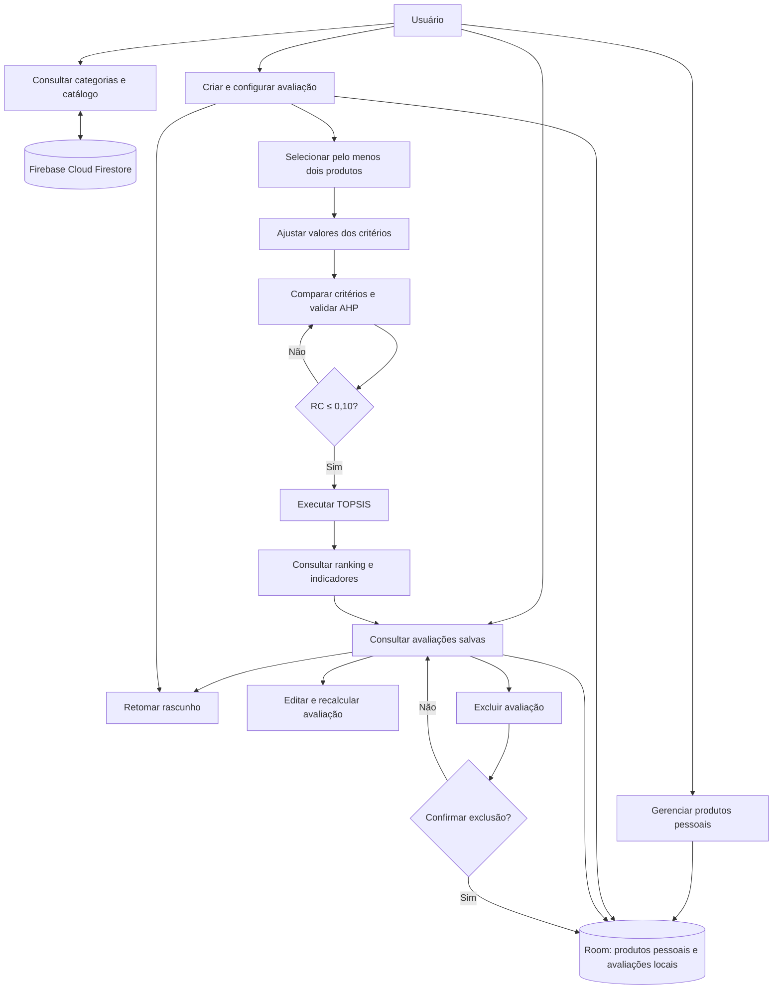

# 02 — Engenharia de requisitos

**Projeto:** Sistema de Avaliação Comparativa Multicritério de Produtos (AHP-TOPSIS)
**Versão:** proposta preliminar 0.1
**Base:** decisões DEC-001 a DEC-019
**Situação:** proposta inicial, sujeita à revisão, detalhamento e validação.

## 1. Atores

- **Usuário:** consulta produtos, mantém o catálogo pessoal, cria e gerencia avaliações e consulta resultados.
- **Firebase Cloud Firestore:** sistema externo que disponibiliza o catálogo oficial.

O Room é componente interno de persistência local e, portanto, não é ator externo.

## 2. Casos de uso candidatos

| ID | Caso de uso | Descrição |
|---|---|---|
| UC01 | Consultar categorias | Visualizar categorias disponíveis. |
| UC02 | Consultar produtos | Visualizar produtos e informações. |
| UC03 | Gerenciar catálogo pessoal | Cadastrar, consultar, editar e excluir produtos pessoais. |
| UC04 | Criar avaliação | Iniciar uma avaliação multicritério. |
| UC05 | Selecionar alternativas | Escolher no mínimo dois produtos. |
| UC06 | Ajustar valores | Personalizar os valores dos critérios para a avaliação. |
| UC07 | Comparar critérios | Informar as comparações pareadas AHP. |
| UC08 | Validar consistência | Calcular pesos e consistência da matriz. |
| UC09 | Processar avaliação | Executar o TOPSIS. |
| UC10 | Consultar resultados | Visualizar classificação e indicadores. |
| UC11 | Consultar avaliações salvas | Listar rascunhos e avaliações concluídas. |
| UC12 | Retomar avaliação | Continuar uma avaliação não concluída. |
| UC13 | Editar e recalcular | Alterar e reprocessar uma avaliação. |
| UC14 | Salvar rascunho | Persistir uma avaliação incompleta. |
| UC15 | Excluir avaliação | Excluir uma avaliação após confirmação. |

Os casos de uso serão detalhados posteriormente com pré-condições, fluxo principal, exceções e pós-condições.

## 3. Mapa funcional

O Room representa persistência interna local. O Firebase é o sistema externo do catálogo oficial.

## 4. Requisitos funcionais — proposta preliminar

### Grupo 1 — Categorias e catálogo oficial

| ID | Requisito funcional |
|---|---|
| RF01 | O sistema deve apresentar as categorias de produtos disponibilizadas no catálogo oficial. |
| RF02 | O sistema deve apresentar os produtos pertencentes à categoria selecionada. |
| RF03 | O sistema deve apresentar os detalhes e os valores dos critérios de cada produto. |
| RF04 | O sistema deve consultar o catálogo oficial no Firebase Cloud Firestore. |
| RF05 | O sistema deve atualizar automaticamente os dados do catálogo e permitir a consulta dos dados previamente armazenados em cache quando não houver conexão. |

### Grupo 2 — Catálogo pessoal

| ID | Requisito funcional |
|---|---|
| RF06 | O sistema deve permitir cadastrar produtos pessoais em categorias existentes. |
| RF07 | O sistema deve permitir consultar e editar os dados de produtos pessoais. |
| RF08 | O sistema deve permitir excluir produtos pessoais mediante confirmação. |
| RF09 | O sistema deve armazenar localmente os produtos pessoais, disponibilizando-os para avaliações futuras. |

### Grupo 3 — Criação e configuração de avaliações

| ID | Requisito funcional |
|---|---|
| RF10 | O sistema deve permitir criar uma avaliação associada a uma categoria. |
| RF11 | O sistema deve permitir selecionar produtos oficiais e pessoais para compor uma avaliação, exigindo no mínimo duas alternativas antes do processamento. |
| RF12 | O sistema deve permitir ajustar os valores dos critérios para cada produto dentro de uma avaliação, sem alterar os valores dos catálogos. |
| RF13 | O sistema deve validar os valores dos critérios segundo suas unidades, tipos e limites definidos. |

### Grupo 4 — Método AHP

| ID | Requisito funcional |
|---|---|
| RF14 | O sistema deve permitir comparar os critérios dois a dois utilizando a escala fundamental de Saaty. |
| RF15 | O sistema deve calcular os pesos dos critérios pelo método da média geométrica normalizada, conforme o documento de referência aprovado na DEC-018. |
| RF16 | O sistema deve calcular o autovalor máximo estimado, o Índice de Consistência e a Razão de Consistência. |
| RF17 | O sistema deve impedir o processamento TOPSIS quando a Razão de Consistência for superior a 0,10 e permitir a revisão das comparações. |

### Grupo 5 — Método TOPSIS e resultados

| ID | Requisito funcional |
|---|---|
| RF18 | O sistema deve calcular a matriz normalizada, a matriz ponderada, as soluções ideais, as distâncias euclidianas e os coeficientes de proximidade utilizando os pesos AHP validados. |
| RF19 | O sistema deve classificar os produtos por ordem decrescente do coeficiente de proximidade relativa e destacar a alternativa mais bem classificada. |
| RF20 | O sistema deve apresentar os pesos dos critérios, indicadores de consistência, distâncias e coeficientes utilizados para justificar o ranking. |

### Grupo 6 — Persistência e gerenciamento de avaliações

| ID | Requisito funcional |
|---|---|
| RF21 | O sistema deve permitir salvar uma avaliação incompleta como rascunho. |
| RF22 | O sistema deve listar avaliações salvas, distinguindo rascunhos de avaliações concluídas. |
| RF23 | O sistema deve permitir retomar avaliações salvas. |
| RF24 | O sistema deve permitir editar e recalcular avaliações concluídas, substituindo os resultados anteriores. |
| RF25 | O sistema deve preservar os dados utilizados em cada avaliação, independentemente de alterações posteriores nos catálogos. |
| RF26 | O sistema deve permitir excluir avaliações salvas, mediante confirmação, removendo seus dados sem afetar os catálogos. |

## 5. Detalhamento inicial de RF26 — excluir avaliação salva

**Ator:** Usuário.
**Pré-condição:** a avaliação existe no armazenamento local.
**Pós-condição de sucesso:** a avaliação e seus resultados deixam de existir no armazenamento local, sem afetar os catálogos de produtos.

### Critérios de aceitação

- Uma avaliação salva oferece uma ação de exclusão.
- Ao solicitar a exclusão, o sistema exige confirmação.
- Se o usuário cancelar, nenhum dado é removido.
- Se confirmar, a avaliação deixa de aparecer na listagem e seus dados locais são removidos.
- Os produtos dos catálogos oficial e pessoal permanecem intactos.
- A avaliação excluída não pode ser recuperada pela interface da primeira versão.

## 6. Diretrizes de qualidade dos requisitos

Os requisitos serão refinados para que cada funcionalidade tenha cenários de sucesso, erros, comportamento offline quando aplicável e critérios de aceitação verificáveis. A especificação atual não estabelece ainda todos os detalhes de interface, arquitetura ou tratamento de exceções.

## 7. Próxima atividade

Detalhar os requisitos RF01–RF05 (categorias e catálogo oficial), incluindo cenários de sucesso, falhas de conexão, uso de cache e critérios de aceitação. Depois, continuar com catálogo pessoal, avaliações, AHP, TOPSIS e persistência.
