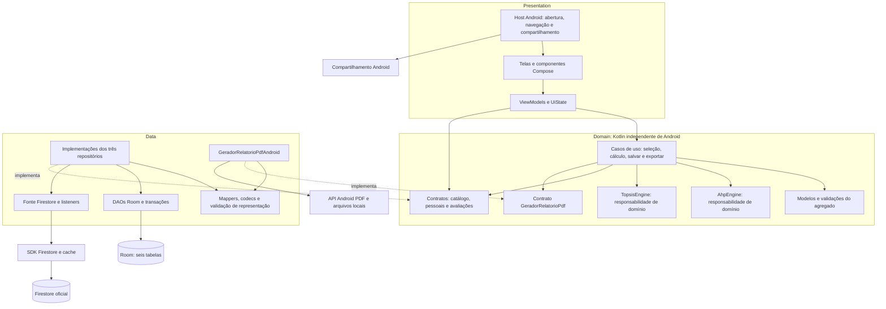

# Etapa 4 — Arquitetura do Aplicativo

**Versão 0.4 · 08/11/2026 · Decisões técnicas adotadas por delegação do usuário.** Modelo documentado; componentes ainda não implementados. A adoção das escolhas não declara encerramento formal da Etapa 4.

## Objetivo e contexto

Definir uma arquitetura Android viável para a primeira entrega de Requisitos e Modelagem do Sistema de Avaliação Comparativa Multicritério de Produtos — AHP-TOPSIS, FACOM32503/UFU. Aplicar MVVM, princípios de Clean Architecture e separação de responsabilidades às decisões vigentes, preservando o domínio e a persistência da Etapa 3.

Fontes normativas do projeto: [visão](../01-visao-e-escopo.md), [RF01–RF27 e RNF01–RNF13](../requisitos/README.md), [UC01–UC16](../requisitos/casos-de-uso/README.md), [domínio](../modelagem/dominio.md), [estados](../modelagem/04-estados-transicoes.md), [Parte 5](../modelagem/05-persistencia-snapshots.md), [contratos consolidados](../modelagem/05-contratos-persistencia.md) e [registro de decisões](../decisoes/registro-decisoes.md). Anotações e documentação técnica apoiam escolhas arquiteturais; sua classificação e limitações estão em [fontes e verificação](referencias-e-validacao.md).

## Diagnóstico da base existente

| Evidência examinada | Situação encontrada e consequência |
|---|---|
| Arquitetura antes da v0.1 | Documento de pendências, sem componentes, ViewModels ou diagramas arquiteturais. Este arquivo passou a ser o índice da proposta. |
| DEC-038–DEC-042 | Aprovadas no registro e em `decisoes/aprovadas/`. Textos em `decisoes/propostas/` e estudos históricos da Parte 5 não reabrem essas escolhas. |
| Parte 5 | Seis tabelas, resultados incorporados, números tipados, revisões e compatibilidade já contratados. Não foi identificada inconsistência que exija redesenhar domínio ou persistência. CHECK canônico, schema/migrations e escolha de serialização continuam dependências técnicas. |
| Código em `app/` | Motor Kotlin puro isolado, `AhpTopsis.kt`, e roteiro de testes; sem projeto Gradle Android configurado. O motor ainda não cumpre todos os contratos posteriores, conforme [análise específica](motores-matematicos.md). |
| Interface em paralelo | [Etapa 5 v0.5](../interface/README.md), [mapa de telas](../interface/mapa-telas.md) e [navegação](../interface/navegacao.md) foram aprovados pelo usuário em 10/11/2026, com [alcance registrado](../interface/finalizacao-v05.md#aprovação-e-fechamento-documental). Seus IDs orientam a interface e não impõem rotas Kotlin. O encerramento da Etapa 4 não é presumido por essa aprovação. |
| Enunciado v2, pp. 9 e 12 | A primeira entrega precisa explicar MVVM e fluxos; as quatro responsabilidades não exigem quatro módulos Gradle. O método de pesos segue a adaptação aprovada na DEC-018. |

## Organização desta proposta

| Documento | Conteúdo de referência |
|---|---|
| Este arquivo | Camadas, dependências, composição dos objetos, pacotes e síntese para apresentação. |
| [Componentes e contratos](componentes.md) | Responsabilidades, entradas/saídas, casos de uso e rastreabilidade. |
| [Gerenciamento de estado](gerenciamento-estado.md) | ViewModels, sessão, eventos, ciclo de vida, concorrência e navegação/Figma. |
| [Fluxo de dados](fluxo-dados.md) | Room/Firestore, mapeamento, salvamento e PDF. |
| [Motores matemáticos](motores-matematicos.md) | Fluxo AHP/TOPSIS, contratos e lacunas do código isolado. |
| [Decisões adotadas e pendências técnicas](decisoes-pendentes.md) | Escolhas vigentes, comparação das alternativas, fontes e tarefas técnicas futuras. |
| [Fontes e verificação](referencias-e-validacao.md) | Evidência das aulas, referências técnicas, verificações e revisão futura. |

### Refinamentos v0.1 → v0.2

A revisão independente foi recebida e seus [quatro apontamentos foram respondidos](referencias-e-validacao.md#resposta-à-revisão-independente-da-v01). A v0.2 explicita as regras definitivas de DEC-041/042 sem mudá-las, detalha proprietário/retorno/encerramento do ViewModel no Navigation Compose com o [Diagrama 5](gerenciamento-estado.md#diagrama-5--propriedade-e-ciclo-de-vida-da-sessão), torna a identificação das anotações portável e consolida ARQ-P01–ARQ-P06 para aprovação. A distribuição de camadas/componentes e a integração matemática permanecem as da proposta v0.1; nenhum motor, schema ou protótipo foi implementado/alterado.

### Adoção das escolhas — v0.3

Por instrução posterior do usuário para tomar as decisões conforme o enunciado e as aulas, ARQ-P01–ARQ-P06 foram resolvidas nas **DEC-043–DEC-048**: módulo único/três camadas, DI manual, sessão compartilhada, casos de uso/motores independentes, Navigation Compose e PDF nativo local. O [quadro de decisões](decisoes-pendentes.md) e o [registro central](../decisoes/registro-decisoes.md) identificam fontes, status e consequências. Os textos anteriores de revisão descrevem o percurso v0.1/v0.2; não deixam essas alternativas ainda abertas.

## Arquitetura geral: três camadas lógicas

**Correção v0.4:** o escopo do enunciado, p. 4, exige abertura/splash animada. A [DEC-049](../decisoes/adotadas/dec-049.md) corrige a omissão da v0.3 e atribui essa apresentação ao host Android, fora da sessão de avaliação. A [especificação da interface](../interface/especificacao-telas.md#aberturasplash--exigência-do-enunciado) e a navegação conceitual foram alinhadas documentalmente naquela rodada, sem alterar Figma/HTML. **Estado posterior, 09/11/2026:** o HTML e o manifesto da Etapa 5 já incluem T00, com animação/transição; essa era a pendência Figma em 09/11. Em 10/11, a página 03 recebeu a abertura e os roteiros conectados, conforme [registro da interface](../interface/finalizacao-v05.md). Ver [validação da interface](../interface/validacao.md). O Diagrama 5 também foi corrigido para retornar do cadastro à seleção antes de avançar a valores.

| Camada | Responsabilidade | Correspondência com as quatro responsabilidades do enunciado |
|---|---|---|
| Presentation | Composables, ViewModels, UiState, eventos e integração Android de navegação/compartilhamento. | UI + apresentação/estado (ViewModel). |
| Domain | Modelos aprovados, regras/validações, operações de negócio, motores e contratos de acesso externo. | Domínio/motores matemáticos; inclui regras que não são fórmulas. |
| Data | Implementações de repositórios e do gerador PDF, DTOs/entidades, mapeadores e fontes Room/Firestore. | Dados/repositório; geração de arquivo é também um detalhe de infraestrutura. |

`di` é o ponto de composição, não uma quarta camada de negócio. A geração de PDF pertence a um adaptador em Data por depender de Android/arquivos; Domain define elegibilidade, conteúdo e contrato do documento. Não é necessária uma camada adicional de infraestrutura.

### Diagrama 1 — Componentes e dependências de código

Seta contínua significa **conhece/usa um tipo**; seta pontilhada `implementa` significa **realiza um contrato do Domain**. Nenhuma seta representa retorno de dados. Os componentes são projetados e ainda não implementados; apenas o cálculo puro inicial existe hoje, concentrado em `AhpTopsis`.



O nó conjunto de implementações resume três repositórios: catálogo usa Firestore; pessoais e avaliações usam Room. O [fluxo de dados](fluxo-dados.md) separa esses caminhos. `PDF → MAP` limita-se à formatação do relatório, sem consultas ao catálogo ou banco durante o desenho do PDF.

### Dependências de código e execução

Presentation depende de contratos/modelos e casos de uso do Domain; Data também depende do Domain para implementar seus contratos. Domain não importa Data, Android, Compose, Room, Firebase, `Context`, `Uri`, `NavController` ou ViewModel. Pode utilizar Kotlin e Coroutines/Flow, independentes de Android; isso não introduz acesso à infraestrutura no núcleo.

Em execução, um clique chega ao ViewModel, que chama um caso de uso ou consulta simples pelo contrato de repositório. A instância concreta recebida executa o acesso externo e retorna modelos/erros tipados; o ViewModel publica UiState. A chamada de Domain para uma instância Data ocorre por uma interface do próprio Domain. Isso não cria dependência de código `Domain → Data`. A UI renderiza estado; recomposição não dispara escrita.

### Construção e fornecimento das dependências

DEC-044 (origem ARQ-P02): injeção por construtor e montagem manual em `AppContainer`, com fábrica de ViewModels integrada ao proprietário AndroidX. O container cria Room, cliente Firestore, repositórios, gerador PDF e casos de uso, e fornece dispatchers. A fábrica recebe dependências e dados mínimos de navegação/estado salvo. UI e Domain não procuram o container globalmente.

Banco/cliente/repositórios podem ser compartilhados no escopo da aplicação; motores e casos de uso sem estado não exigem escopos sofisticados. A edição pertence ao `AvaliacaoViewModel` mantido no NavBackStackEntry do grafo da sessão, nunca a um singleton do container. Cadastro pessoal aberto durante seleção é destino filho com VM próprio; seu retorno não remove esse proprietário pai, conforme [contrato de sessão](gerenciamento-estado.md). Dependências Android usam contexto de aplicação quando necessário, sem reter Activity em ViewModel/repositório. O host de compartilhamento usa a Activity somente enquanto disponível. [Comparação e decisões adotadas](decisoes-pendentes.md).

## Organização sugerida do código

DEC-043 (origem ARQ-P01): começar com **um único módulo Android `app`**, organizado por pacotes. Múltiplos módulos acrescentariam configuração Gradle e coordenação sem necessidade atual de distribuição independente. Pacotes não impõem fronteiras de compilação: revisão de imports e testes devem proteger a regra de dependência. Extrair módulos só diante de necessidade concreta.

Estrutura futura sob o namespace existente `br.edu.ufu.pdm.mcdm`:

```text
app/src/main/java/br/edu/ufu/pdm/mcdm/
├── presentation/
│   ├── catalogo/        # consulta oficial/pessoal e detalhes
│   ├── produtopessoal/  # formulário e manutenção
│   ├── avaliacoes/      # listagem salva
│   ├── avaliacao/       # sessão: seleção, valores, AHP, revisão e resultado
│   ├── navigation/      # host, destinos e argumentos após decisão
│   ├── exportacao/      # compartilhamento Android
│   └── components/      # componentes visuais realmente reutilizados
├── domain/
│   ├── model/           # domínio aprovado e resultados tipados
│   ├── repository/      # contratos de catálogo, pessoais e avaliações
│   ├── usecase/         # operações com regras/orquestração relevantes
│   ├── validation/      # valores, compatibilidade e invariantes
│   ├── engine/          # responsabilidades AHP e TOPSIS
│   └── exportacao/      # conteúdo e porta PDF sem Android
├── data/
│   ├── repository/      # implementações dos contratos
│   ├── local/           # Room, DAOs, entidades e codecs
│   ├── remote/          # Firestore, DTOs e listeners
│   ├── mapper/          # representação externa ↔ domínio
│   └── exportacao/      # adaptador Android de PDF
└── di/                  # AppContainer e ViewModelFactory
```

A árvore orienta organização posterior: nenhum pacote/classe Kotlin novo foi criado. O motor só será movido/adaptado na implementação. Testes JVM futuros concentram regras, motores e ViewModels com fakes; testes instrumentados verificam Room, integração Android e Compose.

## Testabilidade e manutenção

Contratos permitem substituir Firestore/Room por fakes e testar casos de uso sem rede. Motores recebem matrizes e retornam resultados, sem repositórios. Dispatchers substituíveis tornam concorrência testável. Mappers/transações têm testes próprios de tipos, round-trip e atomicidade. Composables recebem estado/callbacks, permitindo verificar renderização sem construir todo o grafo.

RNF09–RNF11 e DEC-029 orientam os testes, sem alegar execução do aplicativo nesta etapa. RNF05/06/08 mantêm integridade, offline disponível e dados pessoais locais. Não se promete recuperação de edição após morte do processo, catálogo integral offline ou reprodução binária entre versões do motor.

## Pendências e status de aprovação

ARQ-P01–ARQ-P06 foram resolvidas nas DEC-043–DEC-048 por delegação explícita do usuário, sem mudar DEC-001–DEC-042. As escolhas técnicas estão adotadas para orientar implementação. O alinhamento documental com a Etapa 5 v0.5 foi registrado; restam a integração de implementação, eventuais ajustes da conferência arquitetural final e o encerramento formal da Etapa 4; não se atribui ao professor um aceite não informado. Configuração e testes de implementação ficam para a etapa técnica, conforme o [checklist](referencias-e-validacao.md).

Para o vídeo: apresentar três camadas/quatro responsabilidades; seleção e cálculo sem salvar; salvamento manual atômico; catálogo/cache independente dos snapshots Room; pendências e limites. Estes documentos não comprovam apresentação ou entrega ao professor.
