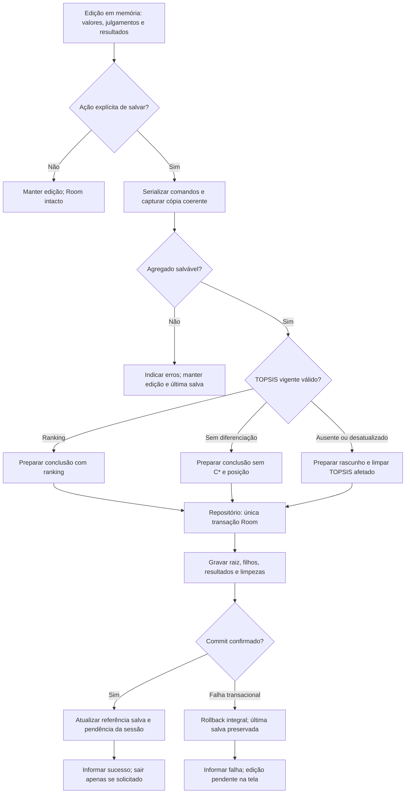

# Fluxo de dados, persistência e exportação

**Versão 0.1 · 08/11/2026 · Rascunho para revisão técnica independente; não aprovado.** Diagramas representam comportamento proposto, sem Room/Firestore/PDF configurados.

## Objetivo e contexto

Definir como os [componentes](componentes.md) implementam conceitualmente os [contratos P5](../modelagem/05-contratos-persistencia.md). DEC-038–DEC-042 estão aprovadas: esta proposta não reabre o schema de seis tabelas, os tipos numéricos, a política de snapshots ou as revisões. DEC-025/032 definem salvamento manual e PDF; RNF05–RNF08 definem integridade, offline e privacidade.

## Proposta: fontes com responsabilidades distintas

### Diagrama 4 — Dados remotos, locais e snapshots

Setas representam **circulação de dados em execução**, não dependências de código. O caminho oficial só lê; SDK/cache não são uma réplica Room. Os modelos do Domain trafegam através dos contratos implementados pelos repositórios.

```mermaid
flowchart LR
    FS[(Firestore oficial)] --> SDK["SDK Firestore: leitura e listeners"]
    CACHE[(Cache do SDK)] <--> SDK
    SDK --> REM["Fonte remota: DTO e metadados"]
    REM --> RC["Repositório de catálogo e mapper"]
    RC --> DC["Domain: catálogo conhecido e proveniência"]
    ROOM[(Room local: seis tabelas)] --> DAO["DAOs: leitura consistente"]
    DAO --> RP["Repositório pessoal e mapper"]
    RP --> DP["Domain: produto e definições pessoais"]
    DAO --> RA["Repositório de avaliações e mapper"]
    RA --> HIST["Domain: agregado histórico íntegro"]
    DC --> SEL["Compatibilidade com critérios de destino"]
    DP --> SEL
    SEL --> EDIT["Cópias na avaliação em memória"]
    HIST --> EDIT
    DC --> VM["ViewModels: projeções de consulta"]
    DP --> VM
    HIST --> VM
    EDIT --> SAVE["Salvar explicitamente: validar agregado"]
    SAVE --> WRITE["Repositório: transação local"]
    WRITE --> ROOM
```

`Firestore → repositório → Domain → avaliação` significa ler/validar e copiar dados com identidade e proveniência. Depois da seleção, a cópia pertence à avaliação, sem vínculo vivo com catálogo. `Room → repositório → Domain → ViewModel` significa reconstruir estado salvo e projetá-lo para a UI; não carregar Entity diretamente na tela. O cache é gerenciado pelo SDK, sem cópia integral adicional do catálogo no Room.

### Firestore e proveniência

`FirestoreCatalogoRepository` usa uma fonte pequena para encapsular consultas/listeners e tipos Firebase. O mapper interpreta DTOs; chama validação pura para definição/valores/compatibilidade. Não criar fontes remotas por operação ou um framework genérico de DataSource. Consultas básicas: categorias, `produtos` filtrados por `categoriaId` e detalhe por ID global. O layout aprovado é `categorias/{id}` com critérios embutidos e `produtos/{id}` raiz, conforme [P5-C](../modelagem/contratos/04-firestore.md).

Ao entrar no catálogo, observar dados disponíveis e tentar atualização do servidor automaticamente pelo SDK, respeitando DEC-010. Manter listener enquanto houver observação útil; removê-lo ao cancelar. Incluir eventos de metadados para atualizar origem mesmo se os valores não mudarem. Nova tentativa após falha reabre a consulta apropriada, sem adicionar sincronização periódica de fundo ou serviço REST. Retrofit não é dependência desta arquitetura.

| Condição de consulta | Saída conceitual e apresentação |
|---|---|
| Dados confirmados em evento de servidor | Conteúdo conhecido validado; `fromCache=false` naquele evento. Não certifica qualidade/completude de todo o catálogo. |
| Dados do cache | Conteúdo conhecido + `fromCache=true`; indicar origem. Cache pode ser parcial, desatualizado ou removido; não equivale necessariamente a dispositivo sem internet. |
| Cache vazio sem confirmação remota | Indicar indisponibilidade/não confirmação dos dados; não declarar catálogo remoto vazio. |
| Consulta vazia confirmada | Estado vazio da consulta confirmada, distinto de falha. |
| Atualização falha com dados válidos anteriores | Manter dados conhecidos com aviso de atualização falha; não marcar nova confirmação. |
| Permissão negada | Erro de acesso, separado de rede e vazio. |
| Formato ou significado incompatível | Identificar item/problema; consulta possível do que for interpretável, sem autorizar seleção inválida. |

Metadados seguem a [política P5-E](../modelagem/contratos/05-compatibilidade-offline.md): `atualizadoEm` vem do publicador; `dataReferencia` descreve a fonte do valor; instante local de confirmação do servidor, se registrado, pertence ao documento/consulta confirmado. Não atualizar esse instante ao ler cache, nem substituí-lo pela data de referência. Datas desconhecidas permanecem desconhecidas. A proposta não cria tabela para persistir confirmações; registrar além da sessão exige detalhamento próprio sem ampliar o modelo por inferência. O [SDK Firestore](https://firebase.google.com/docs/firestore/manage-data/enable-offline) distingue eventos de cache e admite alterações apenas de metadados.

### Revisões e compatibilidade

Validar `formatoContrato`, identidades, tipos, ordens/critérios, regras conhecidas e relação categoria/produto antes da seleção. Revisão é token opaco. Eventos independentes não fornecem uma revisão atômica: aguardar conjunto compatível, apresentar indeterminação ou usar cópias já íntegras. Tokens diferentes exigem comparar definições disponíveis; nomes iguais não demonstram compatibilidade. Não presumir serviço remoto de histórico de revisões.

O publicador deve manter cada definição imutável sob `(categoriaId, revisaoDefinicao)`. Se houver evidência de conteúdo contraditório sob mesmo token, rejeitar uso dependente; sem evidência/definição anterior, o cliente não detecta troca semântica oculta. Não propor hash/assinatura/payload extra como se DEC-040 já os exigisse.

Ao selecionar, comparar com as definições do destino: as escolhidas na criação ou os critérios preservados da avaliação existente. Mudança editorial pode ser compatível, remapeando IDs/ordem; mudança de limite exige revalidação; mudança semântica ou falta de informação bloqueia conforme P5-E. Confirmação visual não contorna bloqueio. Produto pessoal incompatível semanticamente requer novo cadastro explícito com novas definições/UUID, sem migrar silenciosamente os números ou a categoria do antigo.

### Room, DAOs e reconstrução

As tabelas são **`produto_pessoal`, `avaliacao`, `criterio_preservado`, `alternativa_avaliacao`, `valor_alternativa` e `julgamento_ahp`**. Mantêm-se chaves/índices/uniqueness e campos de [P5-A](../modelagem/contratos/01-estrutura-fisica.md), sem tabela de resultado, sessão ou histórico nova. Não há FK das alternativas para o produto atual nem dos critérios preservados para o remoto.

DAOs descrevem acesso físico; repositórios escondem a montagem entre tabelas e coordenam transações. Não é necessário um wrapper `LocalDataSource` que apenas repita todos os métodos DAO. Mappers agrupam indicadores/pesos em Resultado AHP e detalhes por alternativa em Resultado TOPSIS; preservam a separação entre definição e resultado. Payloads pessoais usam codec versionado escolhido posteriormente.

Leitura de agregado usa transação/leitura consistente, valida completude e invariantes antes de retornar domínio. Não executar motores atuais para exigir igualdade binária do resultado salvo. Contrato desconhecido ou bloco incoerente deve ser informado, não reparado remotamente. Consulta/PDF históricos não consultam catálogo; recálculo explícito usa dados preservados, conforme [P5, seção 7](../modelagem/contratos/07-recalculo-precisao.md).

### Tipos e validações de fronteira

| Fronteira | Responsabilidade preservada |
|---|---|
| Entrada localizada → valor | Presentation interpreta pt-BR com decimal exato; Domain valida. Monetário BRL usa Long centavos: zeros decimais excedentes exatos são aceitos; fração de centavo não zero e overflow são rejeitados sem arredondamento silencioso. |
| Firestore/JSON → domínio | Validar união tipada, envelope e definições. Não converter Double/string em centavos por aparência inteira; não passar Long por Double no decoder. |
| Domínio → Room/JSON | Original/efetivo e proveniências independentes; ausência é null, não zero. Double finito com round-trip binário; Long decimal exato; códigos estáveis/formato versionado. |
| Edição incompleta → rascunho | Valor efetivo canônico ausente pode coexistir com texto `entradaPendenteEfetiva`; não participa do cálculo. Só persiste ao salvar. Produto pessoal exige validação completa. |
| Domínio → motores | Valores efetivos validados; dinheiro converte deterministicamente de centavos para a unidade do critério em Double, sem substituir o canônico. Bloquear colisões de valores distintos e inviabilidade numérica. |

Original com representação desconhecida não pode ser selecionado fingindo ausência ou corrigindo apenas o efetivo. Original canônico conhecido fora de domínio pode ser preservado como evidência, exigindo efetivo válido para cálculo. Fonte/data do número original não certificam o ajustado. Regras completas ficam em [P5-D](../modelagem/contratos/03-valores-serializacao.md), sem duplicação do dicionário físico aqui.

## Diagrama 3 — Da edição ao salvamento manual

Setas representam passos de execução. A edição e a referência salva ficam separadas até confirmação. O fluxo também atende Salvar ao sair; saída só ocorre no ramo de sucesso.

Salvar pode criar diretamente conclusão sem rascunho prévio. Rascunho aceita menos de duas alternativas, entradas pendentes e julgamentos parciais; não aceita relações inválidas ou conjuntos calculados parciais. AHP inconsistente completo e vigente pode permanecer como diagnóstico. AHP ausente/desatualizado exige limpar cabeçalho/pesos; alteração apenas de valores/alternativas preserva AHP correspondente e limpa TOPSIS. A invalidação está na mesma transação que as novas entradas, conforme DEC-039.

Não usar substituição implícita da raiz que dispare cascatas inesperadas. Nenhuma chamada remota ou geração de PDF fica na transação. Exclusão de avaliação confirmada remove raiz/filhos numa transação e preserva catálogos; excluir/editar pessoal não modifica snapshots.

Falha confirmada antes do commit preserva a versão anterior e a edição. Se o processo morrer depois de commit, pode existir versão salva mesmo sem mensagem de sucesso: recuperar lendo Room, sem escrever novamente só pela restauração. Atomicidade impede meia gravação, não cria garantia de recuperação das alterações ainda não gravadas.

## Exportação local sem misturar versões

| Escolha/condição | Sequência obrigatória |
|---|---|
| Sem edição pendente | Ler versão salva elegível com resultado correspondente; validar e gerar localmente. Sem salva processada, explicar bloqueio. |
| Salvar e exportar | Exigir resultado vigente válido na edição; salvar explicitamente; só após commit ler/usar a cópia salva confirmada e gerar. Falha de salvar interrompe; não exportar automaticamente a anterior. |
| Exportar última versão salva | Disponível apenas se já processada/íntegra; carregar essa versão completa, preservando a edição pendente. |
| Cancelar | Fechar escolha; sem salvar, descartar ou gerar. |
| Falha de PDF após salvar | Manter salvamento confirmado; informar falha de geração, sem desfazer a avaliação. |
| Compartilhamento cancelado/indisponível | Preservar avaliação e informar quando necessário; não declarar envio. |

O ViewModel resolve a escolha de versão; o caso de uso de exportação conhece apenas uma cópia salva elegível. Serializar comandos de gravação/exportação na sessão para não trocar a versão entre confirmação e leitura. Uma vez lida consistentemente, usar a mesma cópia imutável no documento inteiro. Não introduzir histórico de versões ou coluna de versionamento só para esse fluxo.

Domain prepara identificação/categoria, instante de geração, produtos/valores efetivos/unidades, critérios/naturezas/pesos, λmax/IC/RC, ranking/C*/distâncias definidos, indicação de empates/sem diferenciação e referência ao método. O conteúdo é o da DEC-032; não inclui matrizes intermediárias, coeficiente/posição fictícios ou dados novos do catálogo.

O adaptador Data gera arquivo privado temporário; propõe-se a API nativa [PdfDocument](https://developer.android.com/reference/android/graphics/pdf/PdfDocument) e compartilhamento por URI com [acesso temporário ao arquivo](https://developer.android.com/training/secure-file-sharing/share-file) via host Presentation. O Domain recebe/retorna referência opaca sem Android. O host abre o seletor padrão após a ação explícita autorizada; não há upload próprio. API, paginação, nome, acessibilidade do documento e limpeza segura após o uso ficam em ARQ-P06. Gerar arquivo independe de rede; o destino escolhido pode depender dela.

## Justificativas, pendências e aprovação

Repositórios por origem/responsabilidade evitam sincronização ambígua, cópias integrais do catálogo e dependência histórica do remoto. Validação na entrada e na reconstrução protege tanto processamento quanto consulta. RNF07 exige regras Firestore de leitura pública e escrita negada, inclusive fora da UI; RNF08/DEC-030 exigem exclusão de dados pessoais de backup/transferência, ainda sem configuração nesta etapa.

Continuam pendentes CHECK canônico AHP, schema/migrations sem fallback destrutivo, serialização/versões, domínios/precisão/fontes/rubricas e testes reais de atomicidade/offline. A arquitetura distribui suas responsabilidades, sem declarar essas tarefas resolvidas. ARQ-P04/P06 requerem revisão; aprovação e implementação não foram realizadas.
