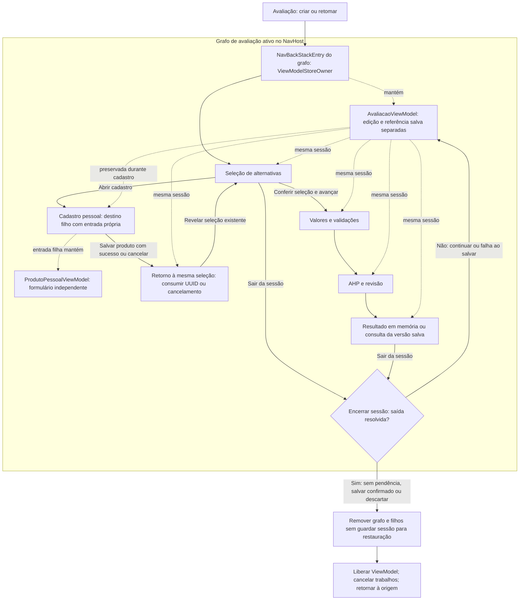

# ViewModels, estado e execução assíncrona

**Versão 0.4 · 08/11/2026 · Decisões técnicas adotadas por delegação do usuário.** Sessão e navegação definidas nas DEC-045/047, sem ViewModels implementados.

## Objetivo e contexto

Aplicar MVVM e fluxo unidirecional aos [casos de uso](../requisitos/casos-de-uso/README.md), respeitando as dimensões da [Parte 4](../modelagem/04-estados-transicoes.md) e o salvamento manual DEC-025. As aulas de 06/10 e 09/10 fundamentam estado, ciclo de vida e compartilhamento; políticas específicas abaixo são propostas do projeto, conforme [fontes](referencias-e-validacao.md).

## Proposta de ViewModels

Não criar um ViewModel por frame Figma ou por par AHP. Uma sessão de avaliação compartilha estado entre seleção, valores, comparações, resumo e resultado. Consultar uma avaliação salva pode usar o mesmo ViewModel em modo de consulta, sem marcar alteração por abrir.

| ViewModel e escopo | Estado observado em StateFlow | Eventos principais | Operações assíncronas e dependências |
|---|---|---|---|
| `CatalogoViewModel`, fluxo de catálogo | Categorias, categoria selecionada, oficiais/pessoais, detalhe consultado, origem/cache, datas conhecidas, carregamento, atualização, erros/vazio | Selecionar categoria/produto, tentar novamente, abrir cadastro, solicitar criação de avaliação | Observa contratos de catálogo/pessoais; troca consulta por categoria cancelando a anterior; não mantém a edição da avaliação. |
| `ProdutoPessoalViewModel`, formulário | Identificação, categoria fixa após escolha/cadastro, valores/definições locais, erros por campo, alteração pendente, salvando/excluindo, confirmação | Alterar campo, salvar, solicitar/confirmar exclusão, tentar sair, descartar/continuar | Carrega local quando edição; chama `SalvarProdutoPessoal` e contrato de exclusão. Só retorna ID após sucesso; falha mantém formulário. Novo cadastro exige definições suficientes, não necessariamente rede. |
| `AvaliacoesViewModel`, lista | Resumos efetivamente salvos com os três estados persistidos, carregando/vazio/erro, exclusão em curso/confirmação | Abrir, criar, tentar novamente, solicitar/confirmar/cancelar exclusão | Observa `AvaliacaoRepository`; exclusão confirmada por contrato. Não injeta resultados em memória na lista salva. |
| `AvaliacaoViewModel`, sessão inteira | Edição, referência da última salva, alterações pendentes, etapa/par atual, estados AHP/TOPSIS, erros por campo/tentativa, operação em curso, diálogos e PDF disponível | Criar/carregar, selecionar/remover, alterar efetivo, registrar julgamento, calcular AHP, processar, salvar, pedir saída/PDF, escolher opção, descartar/continuar | Casos de uso de seleção, AHP, processamento, salvamento/exportação; repositório para carregar; consultas de candidatos pelos contratos quando necessárias. Cálculos e acesso externo em corrotinas controladas. |

Todos traduzem erros tipados em informação de UI, preservando dados válidos conhecidos. Não usam uma única variante global `Error` que apague formulário ou resultado. Carregamento inicial pode ser exclusivo; atualizar, salvar e exportar são estados de operação associados ao conteúdo já visível. AHP inconsistente é diagnóstico exibível, não tela genérica de falha.

## Quatro responsabilidades de estado

| Estado | Proprietário/fonte | Duração e regra |
|---|---|---|
| Visual local | Compose: expansão de seção, foco, rolagem, visibilidade puramente visual | `remember` quando efêmero; `rememberSaveable` para pequenos valores elegíveis que valha restaurar. Não contém a cópia autoritativa do agregado. |
| Apresentação | ViewModel: UiState imutável exposto como `StateFlow`, etapa/par, operação, erros e confirmação | Retido enquanto o proprietário AndroidX existir, inclusive recriação por configuração. Não é sinônimo de dado persistido. |
| Edição ainda não salva | Agregado/cópia de trabalho em memória, pertencente à sessão no `AvaliacaoViewModel` | Inclui valores originais/efetivos, entradas pendentes, julgamentos e resultados novos. Não escreve Room por mudança de campo, navegação ou cálculo. |
| Última versão salva | Room, lida pelo repositório; cópia de referência imutável na sessão | Só muda por salvamento explícito ou exclusão confirmada com sucesso. A lista e a exportação usam essa fonte, não a edição. Antes do primeiro salvamento ela inexiste. |

UiState projeta a edição e a referência salva; não manter duas edições mutáveis desconectadas. Ao retomar, ler uma vez, validar e copiar o agregado salvo para a sessão. Emissões da lista Room não sobrescrevem essa sessão. Atualizações do catálogo só afetam candidatos ainda não incorporados, nunca snapshots já selecionados.

`temAlteracoesNaoSalvas` compara conteúdo canônico relevante a salvar, incluindo resultados e texto pendente, com a referência da última gravação. Uma avaliação nova é pendente mesmo vazia de alternativas. Abrir/navegar/rolar não marca mudança. Calcular resultado novo/diferente pode marcar pendência mesmo sem alterar entradas; recalcular resultado idêntico não exige marcar diferença só pela tentativa. Indicadores visuais, datas de tentativa e loading não participam dessa igualdade. Data de salvamento só é atribuída ao comando explícito, não à digitação.

## Contrato de eventos e fluxo unidirecional

1. Composable recebe estado e callbacks; emite intenção identificando critério, alternativa ou par por ID.
2. ViewModel aplica alteração pura ou chama caso de uso. Regras e matrizes não ficam em Composable; ViewModel não duplica matemática.
3. O resultado modifica a cópia em memória e os indicadores de validade/pendência, de forma coerente.
4. ViewModel expõe novo UiState somente de leitura. A UI coleta com `collectAsStateWithLifecycle()` e renderiza.

O estado mutável fica encapsulado. Coleta vinculada ao ciclo de vida da UI não tem o mesmo ciclo de `viewModelScope`. Parar a coleta em segundo plano não destrói automaticamente o ViewModel nem salva a edição. A produção de estado e a coleta são responsabilidades distintas, como documenta o [guia Android](https://developer.android.com/topic/architecture/ui-layer/state-production).

Confirmação de saída, confirmação de exclusão e escolha de PDF ficam no UiState até resposta explícita. Mensagens que precisam sobreviver à rotação também ficam em estado até reconhecimento. Navegação/abertura do compartilhamento são executadas pelo host Android mediante solicitação identificada e reconhecimento de consumo, sem refazer a ação por recomposição. Não atribuir garantia universal de entrega única a `Channel` ou `SharedFlow`: queda de processo pode perder a solicitação. Um PDF gerado pode voltar a ser oferecido para compartilhar por ação explícita; não reenviar automaticamente ao restaurar tela.

## Invalidação, salvar e saída

| Evento | Efeito em memória | Efeito no Room |
|---|---|---|
| Alterar julgamento | Desatualiza AHP e TOPSIS; pode manter resultado antigo apenas identificado como desatualizado | Nenhum até salvar. |
| Alterar alternativas/valores | Desatualiza TOPSIS; preserva AHP se julgamentos/critérios permanecem | Nenhum até salvar. |
| Calcular AHP | Atualiza pesos/indicadores e diagnóstico; mudança de pesos ou perda de consistência desatualiza TOPSIS. Diagnóstico inconsistente continua salvável em rascunho | Nenhum. |
| Processar TOPSIS | Publica ranking ou sem diferenciação válido, se operação ainda corresponder à edição | Nenhum. |
| Salvar explicitamente | Valida cópia congelada; após sucesso atualiza referência salva e pendência | Transação integral, incluindo limpezas de resultados desatualizados. |
| Falhar ao salvar | Mantém edição e pendência; não autoriza saída nem exportação da edição | Versão anterior preservada em falha transacional confirmada. |
| Descartar | Restaura cópia da última salva ou abandona nova avaliação; pode sair após essa escolha | Nenhuma gravação/exclusão. |

Ao encerrar sessão pendente, apresentar **Salvar**, **Descartar alterações** e **Continuar editando**. Salvar escolhe rascunho ou conclusão conforme validade atual e só permite sair após confirmação; falha permanece na tela. Voltar entre etapas mantém a sessão. Abrir edição de concluída não invalida seus resultados. Rascunhos podem preservar AHP inconsistente atual, sem TOPSIS. O [diagrama de persistência](fluxo-dados.md) detalha sucesso/falha.

Proibir gravação por `LaunchedEffect` observando campos, por debounce, `onStop`, `onCleared`, recomposição, mudança de rota ou atualização de StateFlow. Não usar tabela de rascunho automático, DataStore ou arquivo oculto para contornar DEC-025. O texto inválido permitido em rascunho só é persistido por salvar explícito, conforme P5-D.

## Coroutines, Flow e concorrência

| Mecanismo | Uso proposto | Limite |
|---|---|---|
| `suspend` | Carregar agregado pontual, gravar/excluir e gerar documento | Pode suspender; não troca automaticamente de thread nem torna um cálculo bloqueante seguro para Main. |
| `Flow` | Emissões de listas Room e catálogo/metadata remotos | Representa sequência; não significa estado da tela nem gravação automática. Cancelar coleta remota remove listener. |
| `StateFlow` | Último UiState de cada ViewModel, publicamente somente leitura | Estado atual, não fila confiável de todos os eventos. Não usar para transmitir cada escrita de banco. |
| Função comum | Alteração pequena da edição, validação trivial e construção de evento | Não iniciar corrotina para mudar booleano, avançar par ou atualizar campo simples. |

Consultas Firestore usam integração assíncrona do SDK; adaptar listener para Flow cancelável, com remoção ao cancelar e eventos de metadata habilitados. Retentativas são controladas; troca de categoria cancela a observação anterior. O SDK cuida da comunicação, sem bloquear com espera síncrona. Mapeamento volumoso pode ir para dispatcher de CPU.

Room expõe consultas observáveis e operações suspensas; o adaptador usa as APIs assíncronas/transacionais e executores do Room. Não envolver todo método em novas corrotinas ou `IO` por hábito. Código realmente bloqueante de arquivos/PDF usa dispatcher apropriado fornecido. Serialização pesada e cálculo usam CPU (`Default` injetado), preservando motores como funções puras síncronas. Atualizações coordenadas do UiState ocorrem no contexto do ViewModel.

`viewModelScope` inicia os trabalhos ligados à sessão. `CalcularAhp`/`ProcessarAvaliacao` podem encapsular `withContext` no dispatcher de CPU recebido, sem importar Android e sem scope global. Dispatchers são fornecidos por DI para testes determinísticos, conforme [boas práticas Android](https://developer.android.com/kotlin/coroutines/coroutines-best-practices).

### Política inicial de operações concorrentes

- Cada cálculo captura entradas imutáveis e um identificador de geração da edição. Mudança relevante, novo cálculo, descarte ou encerramento cancela/invalida o trabalho anterior. A resposta só entra no UiState se ainda corresponder à geração ativa; um Job cancelado de CPU pode terminar antes de observar cancelamento, portanto cancelar sozinho não basta.
- AHP e TOPSIS não publicam parcialmente sobre a mesma edição. TOPSIS exige AHP vigente consistente; se ausente/desatualizado, direcionar à validação AHP. Não encadear processamento usando pesos antigos.
- Proposta simples: durante salvar, excluir ou preparar PDF, serializar comandos conflitantes da mesma avaliação e bloquear mutações/novas gravações até o retorno. Não congelar Main. Antes de salvar, invalidar respostas de cálculos ainda em curso. Não há múltiplos editores simultâneos do mesmo agregado nesta proposta.
- Ao salvar com sucesso, a referência é o conteúdo confirmado pelo repositório, inclusive os resultados/limpezas realmente gravados. Erro ou cancelamento não pode limpar pendência nem navegar como sucesso. A transação Room é atômica; se o processo morrer após commit e antes da confirmação visual, o próximo carregamento consulta o banco para conhecer o fato. Não prometer que todo cancelamento tardio desfez um commit já ocorrido.
- Encerrar sessão cancela cálculos/leituras e invalida respostas tardias. Salvar para sair mantém o proprietário ativo até confirmação. Rotação não cancela automaticamente o scope retido. Não há trabalho persistente em segundo plano nem necessidade atual de WorkManager.

Falha de rede conserva cache válido conhecido com aviso, sem declarar sincronização. Falha local mantém conteúdo e oferece nova tentativa. Erros matemáticos indicam causa sem produzir conclusão. Propagar `CancellationException`, evitando captura genérica que a converta em sucesso/falha de negócio.

## Mudança de configuração e morte do processo

O ViewModel retido pelo mesmo proprietário preserva a sessão durante rotação, mas perde-se ao terminar o proprietário ou morrer o processo. O mecanismo AndroidX retém ViewModels; DI apenas ajuda a criá-los.

DEC-045 (origem ARQ-P03): `SavedStateHandle` guarda apenas pequenos identificadores/parâmetros de recuperação (avaliação salva, categoria, etapa/par quando reconstruíveis), sem serializar a edição ou resultados não salvos. Após morte do processo, uma avaliação já salva pode ser recarregada integralmente do Room; edição posterior pode se perder. Uma avaliação nova nunca salva não pode ser recuperada pelo seu UUID sozinho. Etapa restaurada deve ser validada contra o conteúdo realmente recuperado; não prometer retorno a um resultado não salvo. Sem registro salvo ou definições suficientes, oferecer reinício/retorno seguro, sem criar rascunho.

`rememberSaveable`/`SavedStateHandle` são restauração condicionada ao estado fornecido pelo Android e a seus limites, não backup permanente. O aviso ao sair cobre saída controlada; não há garantia de mostrar diálogo antes de encerramento inesperado. Essa limitação já é aceita em RNF05/DEC-025 e precisa aparecer na comunicação do produto.

## Contrato com navegação e Etapa 5

Destinos são identificados conceitualmente, sem strings/rotas fixadas. Passar IDs e origem, não matrizes/objetos inteiros no back stack. Para avaliação nova, compartilhar a sessão em memória e sua categoria; UUID ainda não salvo não é uma referência recuperável pelo Room.

### Proprietário AndroidX da sessão — ARQ-P03/P05

Decisão DEC-047 (origem ARQ-P05): **Navigation 2 / Navigation Compose**, com um grafo aninhado de avaliação dentro do NavHost principal. O proprietário do `AvaliacaoViewModel` é o **`NavBackStackEntry` da instância desse grafo**, que implementa `ViewModelStoreOwner`. Todas as etapas obtêm o VM no mesmo proprietário pai por meio da fábrica manual; obter o VM no proprietário padrão de cada tela criaria instâncias diferentes. O mecanismo de escopo está documentado nas [APIs AndroidX de ViewModel](https://developer.android.com/topic/libraries/architecture/viewmodel/viewmodel-apis).

O nome do grafo aqui é conceitual, sem fixar rotas Kotlin. Ao criar ou retomar uma avaliação, entrar uma única vez no grafo e inicializar a sessão: criação em memória com critérios disponíveis, ou cópia validada da versão salva. Navegar entre seleção, valores, AHP, revisão e resultado altera destinos filhos, preservando a entrada pai. Há **uma sessão ativa por NavHost**; iniciar outra avaliação exige resolver a saída da atual primeiro. A composição do grafo não é o agregado persistido, e seu identificador não torna recuperável uma avaliação nunca salva.

Duração dos proprietários definida na DEC-045:

| Proprietário | Objeto mantido | Até quando permanece |
|---|---|---|
| Entrada do grafo de avaliação | Um `AvaliacaoViewModel` com edição e referência salva separadas | Durante todas as etapas e o cadastro pessoal aberto a partir delas, mesmo quando uma etapa fica fora de composição ou com ciclo de vida parado. |
| Entrada filha de cadastro pessoal | `ProdutoPessoalViewModel` do formulário | Enquanto esse formulário estiver na pilha; removê-lo no retorno não remove o proprietário pai da avaliação. |
| Entrada externa de catálogo/lista | ViewModel correspondente, conforme seu escopo | Segue o fluxo externo. Não é proprietário da edição nem recebe uma cópia mutável dela. |

O AndroidX oferece entradas também para grafos pais e mantém seus ViewModels enquanto esse escopo existir, conforme o [contrato de NavBackStackEntry e compartilhamento por grafo](https://developer.android.com/guide/navigation/use-graph/programmatic). A organização do assistente em um [grafo aninhado](https://developer.android.com/guide/navigation/design/nested-graphs) é a escolha adotada nas DEC-045/047 por delegação do usuário.

### Cadastro pessoal e retorno à mesma seleção

1. A seleção abre o cadastro como **destino filho do mesmo grafo de avaliação**, mantendo a entrada da seleção abaixo dele. Não sair do grafo, não substituir sua entrada pai e não recriar a sessão.
2. O formulário usa seu próprio ViewModel, com categoria fixa da avaliação e definições suficientes/compatíveis. O host fornece esses dados de contexto; não passar o agregado inteiro por argumento nem permitir ao formulário editar a avaliação. O mesmo Composable pode atender cadastro externo com outro proprietário/contexto, sem criar uma sessão artificial.
3. Salvar produto pessoal é uma operação local explícita independente de salvar avaliação. Em falha, manter formulário e sessão. Em sucesso, retornar apenas o UUID do produto à entrada de seleção como resultado pequeno; a proposta admite o `SavedStateHandle` dessa entrada para o retorno, com consumo e remoção do resultado após tratamento.
4. Remover somente a entrada do formulário por retorno na pilha, revelando a seleção já existente. A seleção continua obtendo o mesmo `AvaliacaoViewModel` do pai; não navegar para uma nova instância da seleção nem recarregar a avaliação do Room sobre a edição.
5. O ID retornado permite localizar o produto na lista pessoal atualizada. Incorporá-lo à avaliação exige a ação de seleção e a validação de identidade/compatibilidade já previstas; o retorno não salva nem associa a avaliação por recomposição. Cancelamento retorna sem ID de produto novo. Um produto pessoal já salvo continua no catálogo se depois o usuário descartar a avaliação.

O resultado de navegação transporta uma referência de produto, não valores ou definições que substituam snapshots. Remover o ID após consumo evita reaplicação por nova observação, sem prometer entrega única após morte de processo. Se houver ID pendente restaurado, verificar o cadastro e o contexto recuperados; isso não recupera a edição perdida nem autoriza seleção automática.

### Diagrama 5 — Propriedade e ciclo de vida da sessão

Setas contínuas indicam entrada/navegação/saída; pontilhadas indicam **propriedade do ViewModel ou uso da mesma sessão**. O contorno representa a instância do grafo cujo proprietário permanece na pilha. Cadastro e retorno são destinos/estados da mesma sessão, não avaliações novas. Componentes são projetados conforme DEC-045/047, sem implementação de navegação.

O nó de retorno representa o tratamento do resultado antes de revelar a seleção anterior, não uma rota nova. O caminho é explicitamente `RET → SEL`; avançar de `SEL` para valores exige ação separada, depois de conferir/selecionar as alternativas e aplicar validações. Cadastro bem-sucedido ou cancelado não pula a seleção. Saída a partir de qualquer outra etapa segue a mesma decisão do nó `EXIT`; o desenho mostra duas origens para evitar repetição. Valores, AHP e revisão não são necessariamente um fluxo visual rígido. As regras de consistência/processamento permanecem no [Diagrama 2](motores-matematicos.md).

### Voltar, encerramento e retomada

| Contexto de Voltar ou saída | Comportamento proposto e efeito no proprietário |
|---|---|
| Teclado/diálogo aberto | Tratar primeiro esse elemento conforme navegação da Etapa 5; fechar diálogo de confirmação equivale a cancelar/continuar. Não remover o grafo nem gravar por esse gesto. |
| Cadastro pessoal dentro da avaliação | Voltar trata as pendências do próprio formulário; ao cancelar/descartar ou salvar com sucesso e retornar, remover só sua entrada. Edição da avaliação permanece no pai. |
| Valores, comparações e revisão | Voltar para a etapa/par anterior conserva o agregado em memória e a entrada pai; não recarregar Room nem salvar por navegação. Rever par pode ser evento de UI sem nova entrada de navegação. |
| Resultado | Voltar à revisão conserva a sessão e os resultados correspondentes. Resultado novo/diferente continua pendente até salvar explicitamente. |
| Seleção inicial ou ação explícita de sair/ir a fluxo externo | Resolver saída da sessão: sem pendência, sair; com pendência, oferecer Salvar/Descartar/Continuar. Salvar só sai após confirmação; falha ou Continuar mantém entrada pai e edição. |
| Processamento em curso | Voltar à revisão invalida/cancela a tentativa; resposta tardia não entra na edição. Se a ação for encerrar sessão, resolver também as alterações pendentes antes de remover o grafo. |
| Exclusão confirmada da avaliação salva | Após sucesso, encerrar sua sessão e remover grafo/filhos; em cancelamento/falha, preservar sessão e versão salva. |
| Fora da sessão | Aplicar a pilha do fluxo externo conforme a [navegação proposta](../interface/navegacao.md); não há edição de avaliação oculta a salvar. Nova entrada no assistente cria outro escopo. |

Botão Voltar do Android e botão da barra superior devem respeitar essas condições. Atalhos para catálogo/lista ou para outra avaliação não podem contornar o aviso de saída. Não remover o grafo ao simplesmente salvar e continuar, apresentar resultado ou abrir/fechar o compartilhamento Android; enviar o app ao segundo plano também não é encerramento controlado da sessão.

Na saída resolvida, remover definitivamente a entrada do grafo e seus filhos: conceitualmente `popUpTo` do grafo com remoção inclusiva e **sem `saveState` para guardar essa sessão**. Não usar restauração de back stack para ressuscitar uma edição descartada ou encerrada; as opções de [salvar/restaurar pilha](https://developer.android.com/guide/navigation/backstack) não substituem a política DEC-025. Quando a remoção definitiva do escopo se efetivar, seu ViewModelStore será liberado e `onCleared`/cancelamento de `viewModelScope` encerrarão trabalhos; não gravar nesse momento. Término definitivo do NavHost/Activity ou morte de processo também pode eliminar o escopo, sem garantia de diálogo prévio.

Enquanto o proprietário for retido durante mudança de configuração, sua sessão pode continuar em memória. **Após morte do processo, a instância do ViewModel foi perdida**, mesmo que o Android restaure a pilha. Aplicar a política da seção de restauração: nova instância só carrega a última versão Room se houver ID salvo e contrato válido; nunca reconstruir seleção/resultados não salvos a partir de etapas da pilha. Se a entrada restaurada apontar ao cadastro, AHP ou resultado que dependia de edição perdida, redirecionar para uma etapa coerente com os dados recuperados; para avaliação nunca salva, reiniciar/retornar com explicação, sem criar rascunho automático. O cadastro pessoal já confirmado no Room permanece consultável, independentemente da avaliação.

| Contrato a alinhar com Figma | Estados e ações que precisam de representação |
|---|---|
| T01–T04/T06: catálogos e seleção | Carregando, vazio confirmado, cache parcial/indisponível, permissão negada, dados incompatíveis, origem, seleção mista e confirmação de gravação do pessoal. |
| T07/T08/T09: valores e AHP | Original/efetivo, entrada pendente, erros por critério, dez pares atuais, progresso/revisão, RC precisa e bloqueio por inconsistência. |
| T10/T11/T12: cálculo e resultado | Em processamento sem atraso artificial, cancelamento/Voltar, falha numérica/resolução, resultado desatualizado, empates e sem diferenciação. |
| T05/T12: dados salvos | Distinguir resultado em memória da última salva e seus três estados; ausência de versão salva; edição pendente por resultados novos. |
| D01–D04 e T13 | Saída com três escolhas; exportação com três escolhas; exclusão com confirmação; sucesso somente após commit; falhas/cancelamento e sem afirmar envio no compartilhamento. |
| Preservação e navegação | Voltar entre etapas preserva edição; saída aplica aviso; cadastro durante seleção retém sessão; morte do processo recupera somente o que a política permite. |

IDs seguem o [mapa em elaboração](../interface/mapa-telas.md); não são contratos de rotas. A arquitetura não altera protótipos. Após revisão, alinhar os fluxos de [navegação](../interface/navegacao.md), sem aguardar o encerramento visual para validar responsabilidades.

## Justificativas, pendências e aprovação

Um ViewModel de sessão evita cópias concorrentes de uma avaliação; ViewModels separados para catálogos/formulário/lista evitam estado global excessivo. Estado imutável e comandos explícitos tornam DEC-025/039 verificáveis. A v0.2 refinou o proprietário, cadastro/retorno e término do escopo; na v0.3 essas escolhas foram adotadas nas DEC-045/047 por delegação do usuário. Restam alinhamento com Figma e verificações da implementação, sem nova confirmação de cada alternativa técnica nem declaração de código implementado.
