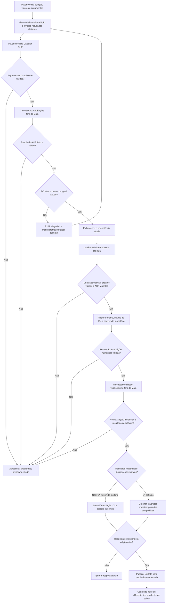

# Integração dos motores AHP e TOPSIS

**Versão 0.4 · 08/11/2026 · Decisões técnicas adotadas por delegação do usuário.** Conteúdo matemático preservado; motores não foram reimplementados ou alterados nesta atividade.

## Objetivo e contexto

Integrar cálculo puro aos [componentes](componentes.md), mantendo RF13–RF20, RNF03/04/09/10 e DEC-018/024/026–029/035/039/041. A referência de pesos é o [PDF AHP+TOPSIS](../../references/ProjetoDisciplina_PDM20262_AHP+TOPSIS.pdf) escolhido na [DEC-018](../decisoes/aprovadas/dec-018.md), não a outra formulação do enunciado v2. As definições das categorias permanecem externas aos algoritmos.

## Código existente examinado

O arquivo [AhpTopsis.kt](../../app/src/main/java/br/edu/ufu/pdm/mcdm/domain/AhpTopsis.kt) contém `object AhpTopsis` com `calculateAhp` e `calculateTopsis`, além de resultados e natureza benefício/custo. Não depende de Android, banco ou rede. O [roteiro de testes existente](../../app/src/test/java/br/edu/ufu/pdm/mcdm/domain/README.md) é planejamento, sem suíte executável Gradle configurada.

| Aspecto | Evidência no código e consequência para integração futura |
|---|---|
| AHP | Já calcula média geométrica (via logaritmos), pesos, λmax/IC/RI/RC e diagnóstico. Verifica matriz positiva/finita, quadrada, diagonal e reciprocidade. A integração deve preservar essa metodologia. |
| RI | Tabela cobre n=1–10; n=5 usa 1,12. RC é null quando RI=0, caso futuro que não deve ser exibido como zero medido. Não habilitar n sem suporte aprovado. |
| Limiar AHP | Parâmetro público permite outro limiar; o caso de uso do app deve fixar a regra aprovada 0,10, sem preferência do usuário. |
| TOPSIS | Já normaliza vetorialmente, pondera, calcula ideais por natureza, distâncias e C*. Recebe apenas números/pesos/tipos; por si só não conhece nem bloqueia AHP inconsistente. Essa pré-condição pertence também ao caso de uso. |
| Ausência de diferenciação | Hoje transforma soma de distâncias zero em `closeness=0.0`, contrariando o contrato aprovado posterior de C*/posição ausentes. Precisa de adequação antes da integração; não é um resultado válido a repassar à UI/Room. |
| Empates e posições | Ordena por C* e depois por índice. Não forma grupos por tolerância nem fornece posições competitivas. Índice pode localizar uma linha, mas não pode virar desempate de mérito. |
| Falhas numéricas | Valida entradas finitas e norma positiva, mas não cobre explicitamente toda finitude/overflow/underflow intermediário e final; uma norma infinita pode passar por `> 0`. Exige revisão/testes antes de uso real. Coluna constante positiva é normalizável; a mensagem atual sobre variar não deve ser adotada como regra. |
| Identidade e dinheiro | Usa índices de matriz e Double; não valida UUID, origem+ID, snapshots ou colisões Long→Double. Esses controles pertencem à preparação/mapeamento Domain, não ao acesso a banco pelo motor. |

Essas são lacunas do protótipo matemático, não inconsistências que autorizem alterar a modelagem aprovada. A arquitetura não declara o motor pronto ou seus testes passados.

## Responsabilidades e contratos adotados

`AhpEngine` e `TopsisEngine` nomeiam duas responsabilidades lógicas do Domain. Não obrigam duas interfaces, injeção sofisticada ou descarte do `AhpTopsis` existente. Na implementação futura, adaptar/separar o código quando isso tornar seus contratos claros; não manter duas implementações concorrentes. A política de grupos/posições pode permanecer uma função pura de resultado no Domain.

| Responsável | Entrada conceitual | Saída tipada e garantias |
|---|---|---|
| Preparação/validação Domain | Critérios preservados, julgamentos canônicos, alternativas/valores efetivos | Matriz AHP e matriz de decisão válidas, mais mapas imutáveis de índice↔ID e naturezas na mesma ordem. Bloqueia incompletude, incompatibilidade e perda de resolução. |
| `AhpEngine` | Matriz positiva/quadrada/recíproca completa e regra fixa do app | Pesos por índice, λmax, IC, RI, RC quando definida e diagnóstico; ou falha matemática específica. Função pura sem I/O. |
| `CalcularAhp` | Cópia dos julgamentos/definições da edição | Resultado AHP associado aos IDs corretos e à edição correspondente. RC > 0,10 é diagnóstico atual inconsistente, não falha de cálculo. |
| `TopsisEngine` | Matriz Double validada, pesos AHP e naturezas benefício/custo alinhados | Resultado matemático tipado: distâncias/C* definidos, ou sem diferenciação legítima com distâncias calculáveis e C* ausente; ou falha. Sem acessar ViewModel/repositório. |
| `ProcessarAvaliacao` | Edição válida com AHP vigente consistente | Resultado TOPSIS por identidade da alternativa, com ranking/posições ou sem diferenciação; não grava. Valida saída e aplica política aprovada de empate. |

Ordem visual e ordem canônica de par são distintas. Normalizar pares pelo ID textual canônico antes de armazenar, invertendo o sentido quando necessário; matriz segue a ordem dos critérios preservados, com diagonal 1 e recíprocos derivados. AHP inicial tem cinco critérios e dez julgamentos independentes. O resultado não pode ser associado por posição da UI depois de uma reordenação.

`CalcularAhp` e `ProcessarAvaliacao` executam CPU fora de Main com dispatcher fornecido; motores continuam funções síncronas puras. Os resultados só são incorporados se a geração da edição permanecer válida, conforme [estado e concorrência](gerenciamento-estado.md). Não passar callbacks de UI, DAO, Firebase ou ViewModel ao motor.

## Diagrama 2 — Interação, AHP, TOPSIS e resultado

Setas representam execução e publicação de estado, não dependências de código. Os caminhos de cálculo não incluem salvamento.

Retomar uma avaliação com AHP consistente vigente permite solicitar TOPSIS sem recalcular AHP só por abrir. Se os julgamentos mudarem, a pré-condição é revogada. Recalcular AHP com pesos diferentes ou perder consistência também desatualiza TOPSIS, mesmo sem nova edição dos julgamentos; resultado inteiramente igual pode continuar correspondendo às entradas. O mesmo controle de geração do diagrama aplica-se à resposta AHP.

## Regras matemáticas preservadas

- Pesos AHP por média geométrica normalizada; λmax pela média de `(Aw)i/wi`, IC e RC conforme DEC-018. Para cinco critérios, RI=1,12. Comparar RC interno diretamente com 0,10, sem arredondamento nem margem adicional. Exibir precisão suficiente para não representar RC rejeitada como aceita.
- TOPSIS usa valores efetivos da avaliação e pesos AHP correspondentes, normalização vetorial, ponderação, ideais de benefício/custo, distâncias euclidianas e `C*=d−/(d++d−)` somente com denominador definido. Não arredondar intermediários.
- Dinheiro canônico permanece Long centavos; preparar Double na unidade preservada, sem divisão inteira. Antes do motor, valores monetários efetivos distintos do mesmo critério que colapsem na mesma entrada Double bloqueiam processamento, conforme DEC-041. Finitude do tipo não encerra a dependência de domínio/resolução admissível.
- Coluna com norma zero ou inviabilidade numérica é falha, não conclusão sem diferenciação. Coluna constante positiva é normalizável. Na ausência legítima de diferenciação com distâncias calculáveis e `d+=d−=0`, C*/posição ficam ausentes e nenhum vencedor é eleito. Não usar coeficientes iguais definidos ou arredondados para inferir C* indefinido: isso é empate de ranking.
- Ordenar C* interno decrescente; agrupar cada valor pela diferença absoluta ≤ 10⁻⁹ em relação ao maior coeficiente do grupo, sem encadear vizinhos. Usar posições competitivas (1,2,2,4), sem desempate por índice/ID/nome/preço. Ordem estável de exibição dentro do grupo não atribui mérito.
- Resultados AHP/TOPSIS são conjuntos completos; erro não publica nem salva bloco parcial. Consulta/exportação de resultado salvo valida contrato/invariantes sem executar o motor atual; recálculo é explícito e pode gerar edição pendente, conforme DEC-039/041.

## Testes futuros e justificativas

Testar motores em JVM sem Android e casos de uso com entradas independentes da UI. Referências de alta precisão devem ser independentes do algoritmo sob teste; números arredondados do PDF não bastam. A tolerância DEC-029 é `|calculado−referência| ≤ 10⁻⁹ + 10⁻⁹×|referência|`, distinta da RC e do agrupamento de empate.

Cobrir pesos uniformes e não uniformes, matriz recíproca consistente/inconsistente, RC nas fronteiras, dimensões/valores inválidos, benefício/custo, norma zero, coluna constante positiva, ausência de diferenciação, empates em cadeia, mapeamento de IDs, colisão monetária, overflow/underflow e não finitude. Separar testes de motor, preparação e política de ranking. Testar também bloqueio de TOPSIS sem AHP vigente e descarte de resposta tardia no ViewModel.

Desempenho segue DEC-026: cenários de 2/10/50 alternativas e cinco critérios, 100 medições após aquecimento por cenário, build de produção/dispositivo físico documentado, pelo menos 95% em até 500 ms para AHP+TOPSIS/validações/ordenação. Exclui rede, banco, PDF e renderização. Cinquenta é cenário de teste, não limite funcional. Não foi realizada medição nesta etapa.

## Pendências e status de aprovação

A DEC-046 (origem ARQ-P04) adota a fronteira de preparação/motores/resultado, preservando a metodologia já aprovada. Implementação deve adequar o caso degenerado, empates/posições e defesas numéricas antes de conectar UI/Room. Escolher dados de referência e definir domínios/precisão dos critérios continuam pendências. Não houve código novo, reescrita, teste do motor ou aprovação da Etapa 4.
