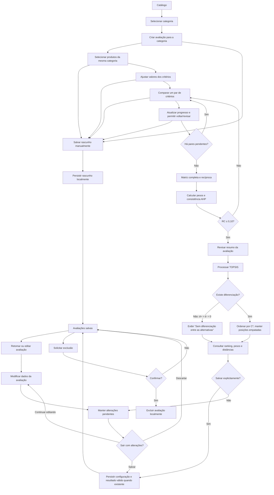

# Navegação e fluxo da avaliação

Fluxo funcional de referência, alinhado às DEC-022–DEC-025 e aos RF10–RF26. A categoria fica fixa durante toda a avaliação.

## Regras de navegação

- O usuário não altera a categoria depois da criação da avaliação; para outra categoria, inicia uma nova.
- As comparações AHP aparecem uma por vez, com progresso e retorno para revisão. Alterar uma comparação invalida a validação de consistência anterior.
- Uma matriz AHP incompleta pode permanecer em rascunho, mas não libera TOPSIS.
- RC acima de 0,10 retorna o fluxo para revisão dos julgamentos.
- Alterações não são salvas automaticamente. Ao sair com mudanças pendentes, oferecer **Salvar**, **Descartar alterações** ou **Continuar editando**.
- Processar em memória não salva o resultado; sucesso de salvamento só é informado após persistência local confirmada.
- Empates matemáticos compartilham posição. Se não houver diferenciação matemática, informar o estado sem declarar vencedor.

## Exportação em PDF — DEC-032

A consulta da avaliação processada oferece exportação pelo [UC16](../requisitos/casos-de-uso/05-exportacao.md), conforme [RF27](../requisitos/funcionais/07-exportacao.md). Sem edição pendente, gerar a partir da versão salva elegível e abrir o compartilhamento padrão do Android.

Com alterações não salvas, oferecer **Salvar e exportar**, **Exportar última versão salva** e **Cancelar**. A primeira opção exige resultado atualizado e persistência bem-sucedida; a segunda depende de versão salva processada e mantém a edição pendente. Informar necessidade de recálculo antes de permitir exportar uma edição desatualizada. Cancelamentos e falhas não alteram a avaliação salva. Este complemento textual não constitui protótipo de telas.

Identidade das alternativas segue origem + ID (DEC-034). Processamento válido sem diferenciação pode ser salvo e listado como **Concluída — sem diferenciação** (DEC-035); isso não converte falhas de normalização em resultados válidos.
