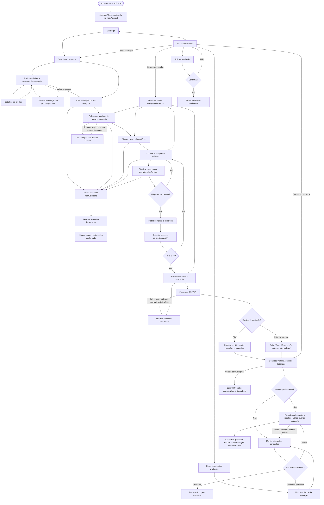
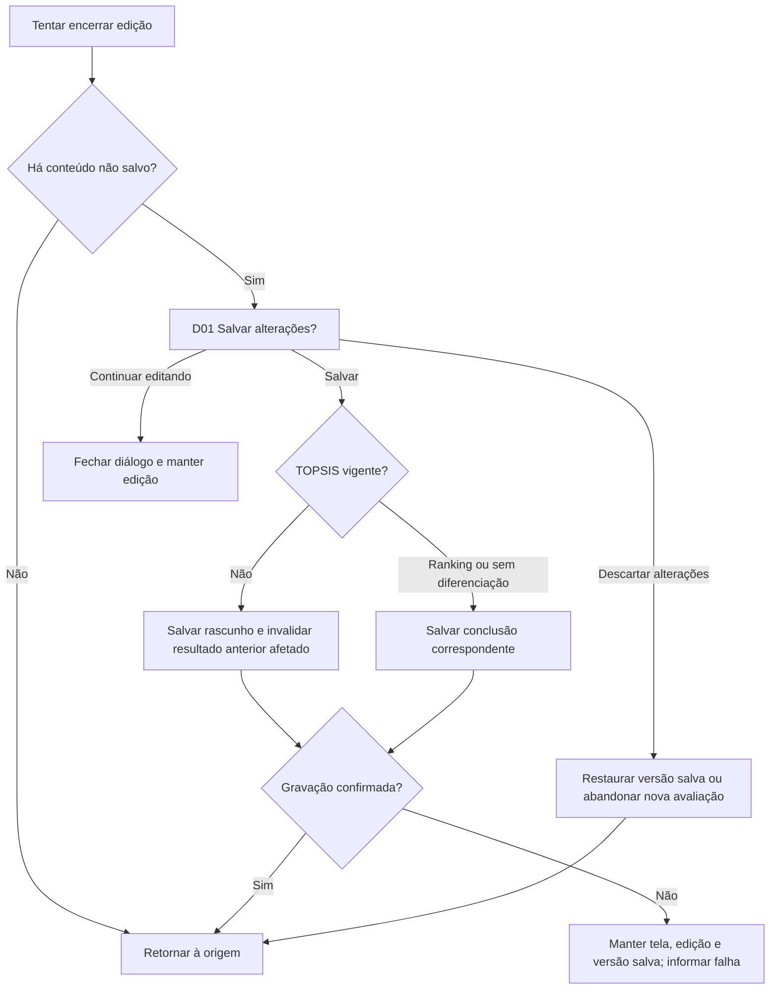
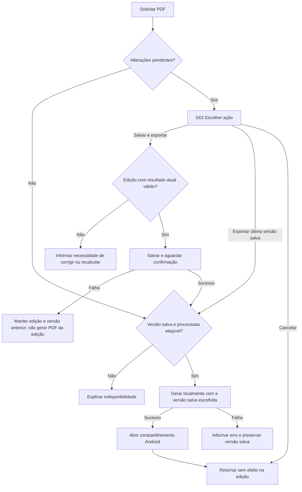

# Navegação e fluxo da avaliação

[Etapa 5](README.md) · [Mapa de telas](mapa-telas.md) · [Protótipo local](prototipos/index.html)

[Resumo vetorial editável em SVG](prototipos/mapa-navegacao.svg).

**Revisão v0.4, 09/11/2026.** Fluxos aplicados ao demonstrador HTML, alinhados às DEC-043–DEC-049 e ao contrato definitivo da sessão da Etapa 4. Sem rotas Kotlin. Categoria fixa na avaliação. Abertura T00 aplicada localmente. A rodada posterior de 10/11 aplica abertura e conexões na página Figma 03, com [roteiros restritos](finalizacao-v05.md).

## Regras de navegação

- A abertura animada atende ao escopo do enunciado, p. 4, conforme [DEC-049](../decisoes/adotadas/dec-049.md). No percurso normal segue ao catálogo, sem impor espera fixa de dois segundos ou aguardar rede. Não é uma etapa do grafo de avaliação nem um destino para voltar; integração com a splash do sistema e restauração válida seguem o contrato arquitetural, evitando reinício de edição ou duas aberturas em sequência.
- O usuário não altera a categoria depois da criação da avaliação; para outra categoria, inicia uma nova.
- As comparações AHP aparecem uma por vez, com progresso e retorno para revisão. Alterar uma comparação invalida a validação de consistência anterior.
- Uma matriz AHP incompleta pode permanecer em rascunho, mas não libera TOPSIS.
- RC acima de 0,10 retorna o fluxo para revisão dos julgamentos.
- Alterações não são salvas automaticamente. Ao sair com mudanças pendentes, oferecer **Salvar**, **Descartar alterações** ou **Continuar editando**.
- Processar em memória não salva o resultado; sucesso de salvamento só é informado após persistência local confirmada.
- Empates matemáticos compartilham posição. Se não houver diferenciação matemática, informar o estado sem declarar vencedor.

## Exportação em PDF — DEC-032

A consulta da avaliação processada oferece exportação pelo [UC16](../requisitos/casos-de-uso/05-exportacao.md), conforme [RF27](../requisitos/funcionais/07-exportacao.md). Sem edição pendente, gerar a partir da versão salva elegível e abrir o compartilhamento padrão do Android.

Com alterações não salvas, oferecer **Salvar e exportar**, **Exportar última versão salva** e **Cancelar**. A primeira opção exige resultado atualizado e persistência bem-sucedida; a segunda depende de versão salva processada e mantém a edição pendente. Informar necessidade de recálculo antes de permitir exportar uma edição desatualizada. Cancelamentos e falhas não alteram a avaliação salva. O diálogo D02 e T13 são funcionais no demonstrador; na página 03, as ramificações PDF/EDIT_PDF representam versões preparadas. Isso não confere memória global ao Figma. O HTML não gera um PDF real.

Identidade das alternativas segue origem + ID (DEC-034). Processamento válido sem diferenciação pode ser salvo e listado como **Concluída — sem diferenciação** (DEC-035); isso não converte falhas de normalização em resultados válidos.

## Voltar do Android e encerramento de edição

Voltar entre etapas conserva a sessão em memória. Encerrar a edição aplica a DEC-025. Retomar abre a primeira pendência útil (seleção, valores, par AHP ou revisão); o demonstrador restaura a configuração efetivamente salva em memória, inclusive texto inválido e julgamentos pendentes. Recarregar a página elimina a simulação; “restaurar” é um controle do laboratório, não uma funcionalidade extra do app.

| Contexto | Comportamento proposto |
|---|---|
| Teclado aberto | Primeiro recolher teclado; próximo Voltar segue a regra da tela. Não descartar entrada. |
| Diálogo de saída/exportação/exclusão | Fechar como Continuar editando/Cancelar; nenhuma gravação, exclusão ou exportação implícita. Devolver foco ao controle de origem. Em exclusões, o foco inicial é Cancelar. |
| Detalhe de produto | Retornar à lista da mesma categoria/origem, preservando posição quando possível. |
| Produto pessoal em edição | Com mudanças, aplicar as três escolhas de saída; sem mudanças, retornar à origem. |
| AHP, valores e revisão | Voltar ao par/etapa anterior sem perder a edição. Primeiro par retorna aos valores. Navegar não marca mudança por si só. |
| Seleção inicial de uma avaliação | Encerrar sessão; aplicar D01 quando houver alterações, inclusive avaliação nova nunca salva. |
| Resultado recém-processado | Voltar à revisão preserva resultado atual em memória; sair da sessão aplica D01 se o resultado for novo/diferente do salvo. |
| Consulta de avaliação salva sem edição | Retornar às avaliações, sem aviso de alterações inexistentes. |
| Processamento em curso | Retornar à revisão sem publicar resposta tardia em edição abandonada. No HTML a assinatura/token da operação impede publicação tardia; integração real segue a arquitetura. |
| Avaliações na raiz | Retornar ao Catálogo; na raiz Catálogo, seguir saída normal do Android quando não houver edição. |
| Compartilhamento padrão | Cancelar retorna à avaliação; não significa envio nem desfaz salvamento já confirmado. |

O botão da barra superior acompanha essas regras. O controle “Simular Voltar do Android” do HTML não emula teclado nem ciclo de processo do sistema operacional.

A origem da sessão é a categoria/lista que iniciou a avaliação. Salvar pela ação da etapa mantém a etapa e atualiza a versão salva; salvar no aviso só permite sair após sucesso. Descartar restaura a versão anterior sem alterar produtos pessoais já gravados e encerra a sessão para a origem solicitada. Uma consulta salva volta à lista sem aviso inexistente. Detalhes de avaliação voltam ao resultado. Navegar dentro do assistente nunca salva.

Mudança de valores/alternativas desatualiza TOPSIS, mantendo AHP se julgamentos/critérios não mudaram. Mudança de julgamento desatualiza ambos. Abrir edição sem alterar não invalida resultado; resultado recém-calculado novo/diferente também é conteúdo pendente. Alterações em memória não afetam a versão persistida até salvar.

## Exportação e versões

Não alternar silenciosamente para a versão anterior se Salvar e exportar falhar. Exportar última salva mantém edição pendente. Se a geração do PDF falhar após uma gravação bem-sucedida, a gravação permanece. Abrir compartilhamento não comprova envio. O script [histórico](prototipos/figma/03-navegacao.js) não foi executado. A página 03 utiliza o [compilador v0.5](prototipos/figma/revisao-v05/README.md), com conexões básicas efetivamente aplicadas e auditadas, sem variáveis de prototipagem pagas.

## Navegação nativa v0.5 e limites do roteiro

A entrada “Começar · abertura e avaliação” passa por OPEN0/OPEN1/OPEN2 e chega a HOME; “Começar sem animação” começa em HOME. Nenhum retorno de avaliação, formulário ou PDF aponta para a abertura. Há também entradas para exemplos, rascunho e amostras de layout.

HOME → P/B_CAT → seleção dos dois oficiais → valores → ajuste preparado → dez pares AHP → WEIGHTS → REVIEW → RESULT → SAVED → PDF. Cadastro iniciado em SEL2 segue para FORM e retorna a SEL3 com dois selecionados: o pessoal só entra após toque próprio, conduzindo à variante M. A ordem inicial e os valores habilitados são restrições explicitamente rotuladas da demonstração.

Entre RESULT e a lista, EXIT oferece Salvar/Descartar/Continuar. Em uma edição concluída, EDIT separa o preço preparado atual do snapshot salvo, exige recálculo para salvar/exportar a edição e permite PDF da versão anterior sem trocar a edição. Salvar uma edição desatualizada conduz ao rascunho sem PDF; não exporta resultado antigo como atual. Os diálogos são overlays de tela inteira com scrim, superfície central e fechamento por ação explícita.

As ramificações DRAFT/LIST oferecem retomada limpa no roteiro dedicado de Valores e na revisão do rascunho de edição concluída. Outras retomadas parciais estão identificadas como não simuladas e desabilitadas. Não existe armazenamento nem memória global: voltar a HOME/reiniciar outro roteiro não recupera automaticamente um conjunto global de registros. O contrato completo da sessão, valores livres, recuperação de falhas e múltiplas avaliações é demonstrado pelo HTML; no Android, deve seguir o contrato aprovado da Etapa 4. O botão Voltar representado no Figma revisita quadros preparados; a barra/tecla do navegador e atalhos do player não equivalem ao Voltar Android.

A auditoria das 1.681 conexões é separada dos [percursos de apresentação](finalizacao-v05.md). Falhas isoladas no laboratório não comprovam a recuperação de uma transação nativa em andamento.
