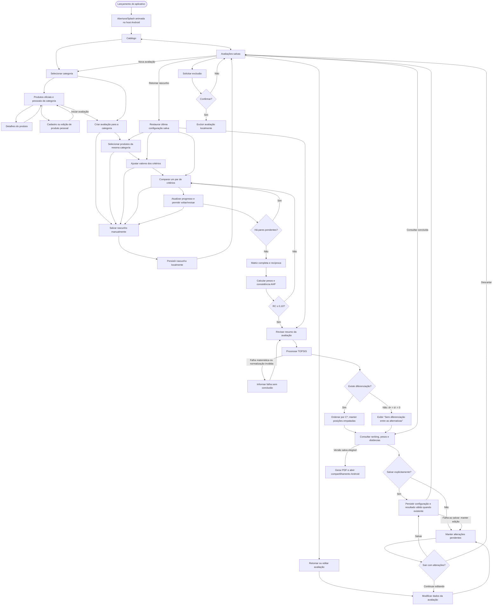
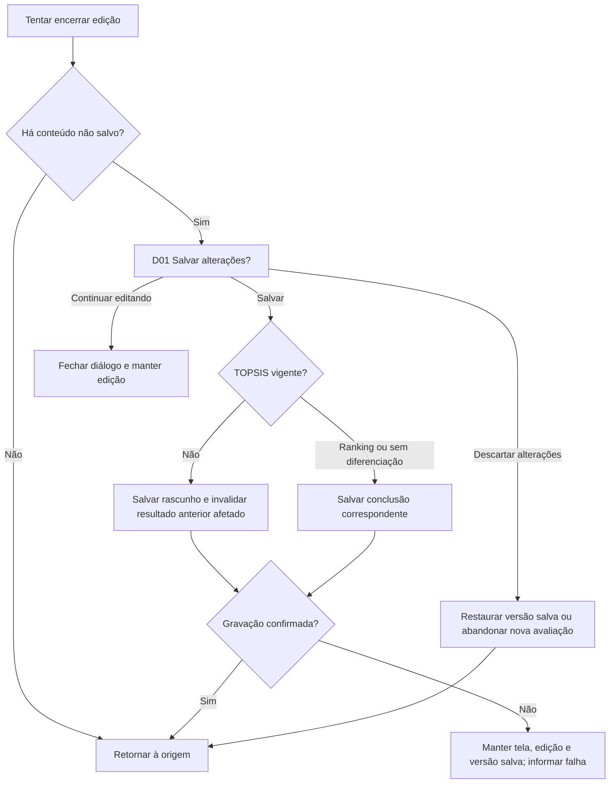
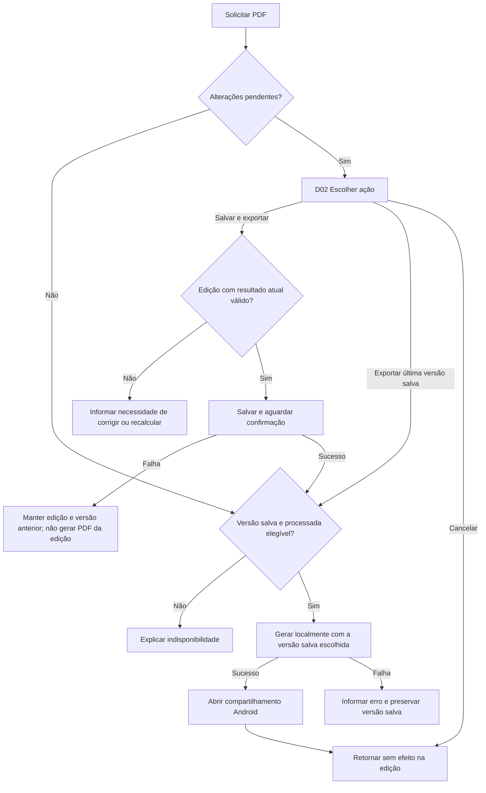

# Navegação e fluxo da avaliação

[Etapa 5](README.md) · [Mapa de telas](mapa-telas.md) · [Protótipo local](prototipos/index.html)

[Resumo vetorial editável em SVG](prototipos/mapa-navegacao.svg).

**Proposta conceitual 0.2, alinhamento documental em 08/11/2026.** Preserva o fluxo de RF01–RF27 e os contratos anteriores, com Navigation Compose adotado na DEC-047 e abertura animada reconhecida na DEC-049, sem definir rotas Kotlin concretas. A categoria fica fixa durante toda a avaliação. Os diagramas representam o comportamento pretendido; o Figma ainda não recebeu as conexões por limite MCP. A abertura acrescentada abaixo ainda não foi aplicada ao HTML/Figma.

## Regras de navegação

- A abertura animada atende ao escopo do enunciado, p. 4, conforme [DEC-049](../decisoes/adotadas/dec-049.md). No percurso normal segue ao catálogo, sem impor espera fixa de dois segundos ou aguardar rede. Não é uma etapa do grafo de avaliação nem um destino para voltar; integração com a splash do sistema e restauração válida seguem o contrato arquitetural, evitando reinício de edição ou duas aberturas em sequência.
- O usuário não altera a categoria depois da criação da avaliação; para outra categoria, inicia uma nova.
- As comparações AHP aparecem uma por vez, com progresso e retorno para revisão. Alterar uma comparação invalida a validação de consistência anterior.
- Uma matriz AHP incompleta pode permanecer em rascunho, mas não libera TOPSIS.
- RC acima de 0,10 retorna o fluxo para revisão dos julgamentos.
- Alterações não são salvas automaticamente. Ao sair com mudanças pendentes, oferecer **Salvar**, **Descartar alterações** ou **Continuar editando**.
- Processar em memória não salva o resultado; sucesso de salvamento só é informado após persistência local confirmada.
- Empates matemáticos compartilham posição. Se não houver diferenciação matemática, informar o estado sem declarar vencedor.

## Exportação em PDF — DEC-032

A consulta da avaliação processada oferece exportação pelo [UC16](../requisitos/casos-de-uso/05-exportacao.md), conforme [RF27](../requisitos/funcionais/07-exportacao.md). Sem edição pendente, gerar a partir da versão salva elegível e abrir o compartilhamento padrão do Android.

Com alterações não salvas, oferecer **Salvar e exportar**, **Exportar última versão salva** e **Cancelar**. A primeira opção exige resultado atualizado e persistência bem-sucedida; a segunda depende de versão salva processada e mantém a edição pendente. Informar necessidade de recálculo antes de permitir exportar uma edição desatualizada. Cancelamentos e falhas não alteram a avaliação salva. Os diálogos D02 e o compartilhamento T13 são representados no protótipo local e nos frames do Figma.

Identidade das alternativas segue origem + ID (DEC-034). Processamento válido sem diferenciação pode ser salvo e listado como **Concluída — sem diferenciação** (DEC-035); isso não converte falhas de normalização em resultados válidos.

## Voltar do Android e encerramento de edição

Voltar entre etapas conserva a sessão em memória. Encerrar a edição aplica a DEC-025. Retomar abre a primeira pendência útil (seleção, valores, par AHP ou revisão); o storyboard local restaura o estado fixo da última gravação simulada.

| Contexto | Comportamento proposto |
|---|---|
| Teclado aberto | Primeiro recolher teclado; próximo Voltar segue a regra da tela. Não descartar entrada. |
| Diálogo de saída/exportação/exclusão | Fechar como Continuar editando/Cancelar; nenhuma gravação, exclusão ou exportação implícita. Devolver foco ao controle de origem. |
| Detalhe de produto | Retornar à lista da mesma categoria/origem, preservando posição quando possível. |
| Produto pessoal em edição | Com mudanças, aplicar as três escolhas de saída; sem mudanças, retornar à origem. |
| AHP, valores e revisão | Voltar ao par/etapa anterior sem perder a edição. Primeiro par retorna aos valores. Navegar não marca mudança por si só. |
| Seleção inicial de uma avaliação | Encerrar sessão; aplicar D01 quando houver alterações, inclusive avaliação nova nunca salva. |
| Resultado recém-processado | Voltar à revisão preserva resultado atual em memória; sair da sessão aplica D01 se o resultado for novo/diferente do salvo. |
| Consulta de avaliação salva sem edição | Retornar às avaliações, sem aviso de alterações inexistentes. |
| Processamento em curso | Retornar à revisão sem publicar resposta tardia em edição abandonada. Cancelamento/identificação da operação depende da arquitetura. |
| Avaliações na raiz | Retornar ao Catálogo; na raiz Catálogo, seguir saída normal do Android quando não houver edição. |
| Compartilhamento padrão | Cancelar retorna à avaliação; não significa envio nem desfaz salvamento já confirmado. |

O botão da barra superior acompanha essas regras. O controle “Simular Voltar do Android” do HTML não emula teclado nem ciclo de processo do sistema operacional.

Na proposta, a origem pode ser catálogo, lista ou detalhe salvo. O protótipo local retorna à lista após salvar e ao descartar rascunhos para facilitar a demonstração; esse retorno é uma escolha visual proposta. Descartar edição de concluída restaura sua consulta salva. Salvar no aviso só permite sair depois do sucesso.

Mudança de valores/alternativas desatualiza TOPSIS, mantendo AHP se julgamentos/critérios não mudaram. Mudança de julgamento desatualiza ambos. Abrir edição sem alterar não invalida resultado; resultado recém-calculado novo/diferente também é conteúdo pendente. Alterações em memória não afetam a versão persistida até salvar.

## Exportação e versões

Não alternar silenciosamente para a versão anterior se Salvar e exportar falhar. Exportar última salva mantém edição pendente. Se a geração do PDF falhar após uma gravação bem-sucedida, a gravação permanece. Abrir compartilhamento não comprova envio. As reações Figma estão [preparadas](prototipos/figma/03-navegacao.js), ainda não aplicadas nem validadas nesse ambiente.
