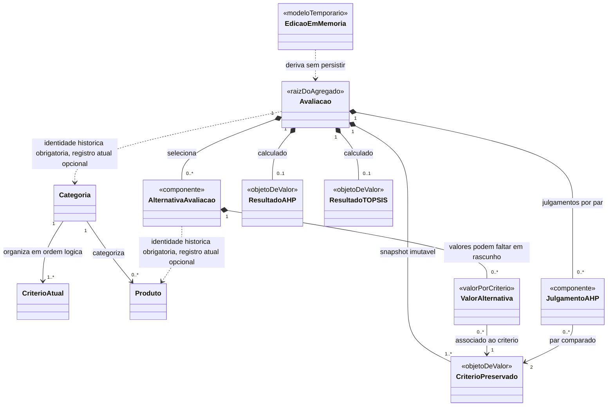

# Parte 1 — Entidades e responsabilidades (aprovada)

[Índice da modelagem](dominio.md) · [Decisões](../decisoes/registro-decisoes.md)

| Entidade | Responsabilidade | Observações |
|---|---|---|
| **Categoria** | Definir o contexto da comparação e agrupar logicamente critérios ordenados e produtos compatíveis. | Uma avaliação escolhe uma categoria fixa (DEC-022). As categorias oficiais vêm do Firestore. A ordem lógica dos critérios deve ser preservada; forma física da associação fica para detalhamento. |
| **Critério** | Definir uma dimensão de comparação, incluindo unidade, natureza de custo/benefício, ordem e regras genéricas de validação. | Metadados de validação fazem parte da definição do critério (DEC-033). |
| **Produto** | Representar um registro reutilizável de catálogo associado a uma categoria. | Tem uma origem: oficial (Firestore) ou pessoal (local). Identidade do registro é origem + ID (DEC-034). |
| **Avaliação** | Ser a entidade central e raiz de agregado: manter consistentes categoria, CritérioPreservado, alternativas, julgamentos, estados e resultados; controlar seu ciclo de vida. | Categoria fixa. É a unidade de salvamento manual. Alterações em memória formam um modelo de edição separado da versão persistida, não uma entidade persistida adicional (DEC-022, DEC-025, DEC-036). |
| **CritérioPreservado** | Guardar a cópia imutável da definição do critério usada por uma avaliação. | Objeto de valor interno da Avaliação, não é a nona entidade. Distingue-se da definição atual do catálogo (DEC-033, DEC-036). |
| **Alternativa da avaliação** | Representar a participação de um produto específico numa avaliação, com identidade histórica de origem e ID e dados de identificação/valores próprios preservados. | Componente da Avaliação. Valores associados a CritérioPreservado. Referência ao produto é histórica, não dependência da existência atual no catálogo (DEC-012, DEC-034, DEC-036). |
| **Julgamento AHP** | Registrar a preferência dada pelo usuário entre um par de critérios preservados no contexto da avaliação. | Componente interno da Avaliação, identificado conceitualmente pelo par de critérios; comparações são recíprocas (DEC-018, DEC-023). |
| **Resultado AHP** | Representar pesos e indicadores calculados a partir dos julgamentos da avaliação. | Objeto de valor pertencente à Avaliação, sem identidade ou ciclo de vida independente. Fica inválido quando os julgamentos correspondentes mudam. |
| **Resultado TOPSIS** | Representar o processamento das alternativas com pesos AHP e critérios da avaliação. | Objeto de valor pertencente à Avaliação, sem identidade ou ciclo de vida independente. Representa ranking definido ou conclusão válida sem diferenciação, sem C*, posição ou vencedor fictício (DEC-024, DEC-035). |

## Distinção importante: Produto e Alternativa da avaliação

**Produto** é o registro atual reutilizável do catálogo. **Alternativa da avaliação** é o componente contextual usado numa comparação específica: mantém a identidade histórica de origem + ID e um snapshot de identificação, sem exigir que o cadastro de origem continue existindo. A própria **Avaliação** preserva cópias imutáveis das definições dos critérios (**CritérioPreservado**) — unidade, natureza, ordem e metadados necessários à validação. Cada alternativa contém valores associados aos critérios preservados, podendo haver valores ausentes enquanto rascunho. Assim, a avaliação não depende de consultas futuras ao catálogo e não repetimos a definição inteira dos critérios para cada produto (DEC-003, DEC-012, DEC-017, DEC-025, DEC-033, DEC-034, DEC-036).

## Organização conceitual proposta

O diagrama é conceitual. CritérioAtual é a definição vigente associada à Categoria; CritérioPreservado é a cópia usada pela Avaliação. A referência tracejada ao Produto é histórica: a Alternativa continua válida após remoção do registro atual. ValorAlternativa torna explícitos os valores por critério e permite ausência em rascunho. As multiplicidades ilustram relações esperadas e ainda serão conferidas; não prescrevem tabelas ou estrutura física. A edição em memória não é entidade persistida independente.

## DEC-036 aprovada — Organização conceitual do domínio

Adotados os oito conceitos principais, com a Avaliação como raiz de agregado. Alternativas e julgamentos são componentes internos; resultados AHP/TOPSIS são objetos de valor sem identidade independente. A Avaliação preserva definições de critérios como objetos de valor internos chamados CritérioPreservado. Alternativas preservam a identidade histórica de origem + ID e dados de identificação sem depender da disponibilidade do catálogo atual, além de conter valores associados aos critérios preservados. Edição em memória permanece separada da versão persistida. A decisão não exige uma tabela por conceito nem define schema físico.
