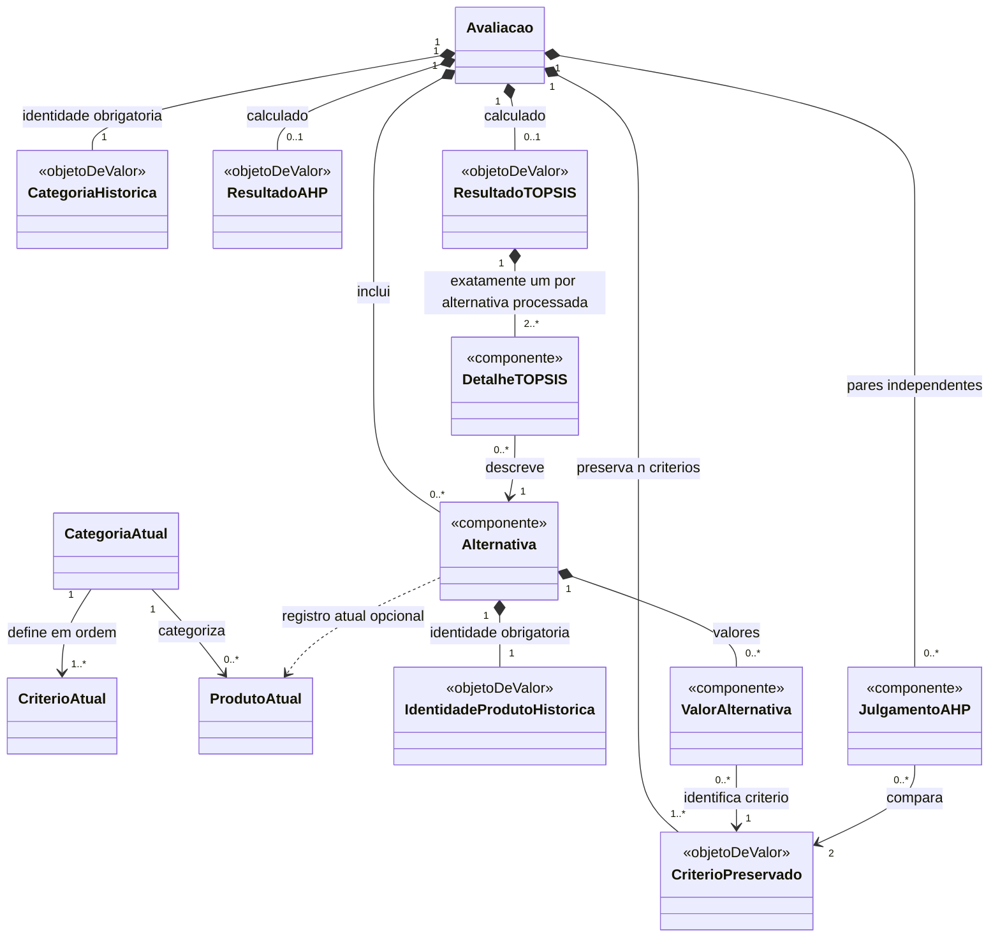

# Parte 3 — Relacionamentos e cardinalidades

[Índice da modelagem](dominio.md) · [Decisões](../decisoes/registro-decisoes.md)

As cardinalidades abaixo descrevem o domínio, não foreign keys, tabelas ou documentos. Uma relação histórica obrigatória guarda a identidade necessária para interpretar o dado; ela não exige que o registro atual do catálogo ainda exista. `n` é o número de critérios preservados da categoria; as duas categorias iniciais têm exatamente cinco critérios. A modelagem permite `n` variável em categorias futuras, condicionado à validação do suporte matemático dos métodos, do RI aplicável e dos casos especiais. Sem regra matemática adequada, o processamento não é habilitado (DEC-037).

## Relações entre catálogo e avaliação

| Relação | Cardinalidade proposta | Regra e preservação |
|---|---|---|
| Categoria atual — Critério atual | Uma Categoria possui `n` critérios ordenados; cada Critério atual pertence logicamente a uma única categoria. | As duas categorias iniciais têm exatamente cinco critérios. Categorias futuras podem ter `n` variável, condicionado à validação dos métodos AHP/TOPSIS, do RI aplicável e dos casos especiais; sem suporte matemático adequado, o processamento é bloqueado. Critérios semelhantes ou homônimos em categorias diferentes têm definições e identidades próprias. A associação lógica não determina estrutura física no Firestore (DEC-037). |
| Categoria atual — Produto atual | Uma Categoria possui zero ou mais produtos; cada Produto atual pertence a uma categoria. | Aplica-se a produtos oficiais e pessoais; categoria de produto pessoal é fixa (DEC-021). |
| Avaliação — categoria histórica | Cada Avaliação guarda exatamente uma identidade e um rótulo histórico de Categoria; o registro atual correspondente pode existir ou não. | A identidade histórica é obrigatória; existência atual do objeto Categoria é opcional. A avaliação pode ser lida offline e após remoção/renomeação no catálogo. |
| Avaliação — CritérioPreservado | Uma Avaliação preserva exatamente `n` critérios para a categoria selecionada; cada CritérioPreservado pertence a uma única Avaliação. | Composição: os snapshots pertencem ao ciclo de vida da avaliação. Uma atualização posterior do catálogo não os substitui. |
| Avaliação — Alternativa | Uma Avaliação em rascunho pode ter zero ou mais alternativas; concluída requer pelo menos duas. Cada Alternativa pertence a exatamente uma Avaliação. | Duplicidade é verificada por origem + ID dentro da avaliação (DEC-034). Conclusão exige dados suficientes para processar. |
| Alternativa — Produto atual | Cada Alternativa guarda exatamente uma identidade histórica origem + ID; pode haver zero ou um registro atual correspondente. | A referência histórica é obrigatória; presença atual do Produto é opcional. Remoção do produto não apaga nem invalida a Alternativa salva (DEC-012, DEC-034, DEC-036). |
| Alternativa — ValorAlternativa | Em rascunho, uma Alternativa pode ter de zero a `n` valores efetivos; para processar, cada alternativa das duas categorias iniciais tem exatamente `n = 5` valores válidos, um para cada CritérioPreservado. | No máximo um valor efetivo por par Alternativa–CritérioPreservado. Valores ausentes são permitidos no rascunho, mas os cinco critérios iniciais são obrigatórios para processamento. Se categorias futuras admitirem critérios opcionais, suas condições de completude devem ser definidas e validadas antes da habilitação. |
| ValorAlternativa — CritérioPreservado | Cada ValorAlternativa aponta para exatamente um CritérioPreservado; cada CritérioPreservado pode ter zero ou um valor em cada Alternativa. | Associação feita dentro da mesma Avaliação; não aponta para a definição atual do catálogo. |

## Relações AHP e TOPSIS

| Relação | Cardinalidade proposta | Regra e preservação |
|---|---|---|
| Avaliação — Julgamento AHP | Rascunho: zero a `n(n−1)/2`; AHP completo: exatamente `n(n−1)/2`. Cada julgamento pertence a uma Avaliação. | Cada julgamento liga um par de critérios distintos preservados. Existe no máximo um julgamento independente por par não ordenado. Para cinco critérios, são dez pares; recíprocos são derivados. |
| Julgamento AHP — CritérioPreservado | Cada julgamento relaciona exatamente dois critérios distintos da mesma Avaliação. | Ambos os critérios devem estar entre os snapshots da avaliação. |
| Avaliação — Resultado AHP vigente | Zero ou um resultado calculado correspondente aos julgamentos atuais. | Rascunho pode preservar pesos e indicadores calculados com `RC > 0,10`, identificados como diagnóstico inconsistente; isso não aprova consistência nem autoriza TOPSIS. TOPSIS exige julgamentos completos, pesos/indicadores vigentes e `RC ≤ 0,10`. Alterar julgamentos invalida os indicadores anteriores na edição. O salvamento é manual e mantém intacta a versão persistida até confirmação explícita (DEC-025, DEC-037). |
| Avaliação — Resultado TOPSIS vigente | Zero ou um resultado que corresponde aos dados, critérios e pesos atuais. Avaliação concluída possui exatamente um resultado TOPSIS válido. | O resultado anterior da versão persistida não é resultado vigente da edição após alteração relevante. Ele permanece somente na versão salva intacta até salvar ou descartar. Salvar edição incompleta como rascunho persiste zero resultados TOPSIS vigentes; descartar restaura a avaliação salva com seu resultado. Falha matemática nunca é resultado concluído (DEC-024, DEC-025, DEC-035). |
| Resultado TOPSIS — detalhe por Alternativa | Um resultado TOPSIS concluído contém exatamente um detalhe para cada alternativa processada, sem duplicação de alternativa dentro do mesmo resultado. | Um único detalhe representa cada alternativa. Ranking definido inclui C* válido para cada alternativa; empates continuam com C* válido e compartilham posição conforme DEC-027/028. Na ausência de diferenciação, C* é matematicamente indefinido: detalhes não incluem C*, posição ou vencedor fictício (DEC-024, DEC-035). |

## Cardinalidades por estado

| Situação da Avaliação | Alternativas | Valores por alternativa | Julgamentos AHP | Resultado AHP | Resultado TOPSIS |
|---|---:|---|---:|---|---|
| Edição nova ou rascunho incompleto persistido | 0..* | 0..`n`; ausências permitidas | 0..`n(n−1)/2` | 0..1; pode faltar ou apresentar `RC > 0,10` | 0 resultado TOPSIS vigente |
| Edição de concluída sem mudança relevante nos dados de cálculo | 2..* | exatamente `n` válidos por alternativa | completa | 1 calculado e consistente | 1 vigente e ainda válido |
| Edição de concluída após mudança relevante, antes de salvar | 0..* na edição | 0..`n`; pode estar incompleta | 0..`n(n−1)/2` | permanece válido se só alternativas/valores mudaram; ausente/inválido se julgamentos mudaram | 0 vigente após alteração relevante; o resultado antigo fica apenas na versão persistida intacta |
| Rascunho salvo após edição incompleta de avaliação concluída | 0..* | 0..`n`; ausências permitidas | 0..`n(n−1)/2` | 0..1, inclusive com `RC > 0,10` | 0; resultado TOPSIS invalidado não é salvo como vigente |
| Pronta para processar | 2..* | Categorias iniciais: exatamente 5 valores válidos por alternativa; categorias futuras: conforme completude definida e validada | exatamente `n(n−1)/2` | 1 válido e consistente | ainda 0 antes do cálculo |
| Concluída com ranking | 2..* | Categorias iniciais: exatamente 5 valores válidos por alternativa; categorias futuras: conforme completude definida e validada | completa | 1 válido e consistente | exatamente 1, ranking definido |
| Concluída — sem diferenciação | 2..* | Categorias iniciais: exatamente 5 valores válidos por alternativa; categorias futuras: conforme completude definida e validada | completa | 1 válido e consistente | exatamente 1, resultado válido com detalhe único por alternativa, sem C*/posição/vencedor |

Estas cardinalidades distinguem a edição em memória da versão persistida. Após alteração que afete alternativas, valores ou pesos, o resultado TOPSIS anterior deixa de ser vigente na edição. A versão persistida continua completa e intacta até a ação de salvar ou descartar. Descartar abandona a edição e restaura a versão salva com seu resultado; salvar a configuração incompleta como rascunho substitui a versão persistida e não pode carregar o resultado TOPSIS invalidado como se fosse válido para os novos dados (DEC-025/RF24).

## Diagrama relacional conceitual

As identidades históricas de Categoria e Produto são obrigatórias dentro de Avaliação e Alternativa; as associações tracejadas aos registros atuais são opcionais. Para cada alternativa, pode existir no máximo um ValorAlternativa por CritérioPreservado. Um Resultado TOPSIS vigente e concluído tem exatamente um detalhe por alternativa processada, com unicidade por (resultado, alternativa); em rascunho sem resultado vigente, não há detalhes TOPSIS. O diagrama não expressa todas as variações condicionadas por estado; a tabela anterior é a referência para rascunhos e conclusões.

## Consolidação da Parte 3

As cardinalidades e regras conceituais desta Parte 3 incorporam a DEC-037: as categorias iniciais têm cinco critérios, o modelo admite `n` variável em categorias futuras condicionado ao suporte matemático, cada definição atual de critério pertence a uma única categoria e rascunhos podem preservar resultados AHP inconsistentes como diagnóstico sem habilitar TOPSIS. CritérioPreservado permanece exclusivo da Avaliação que o copiou.

Um Resultado TOPSIS concluído tem exatamente um detalhe por alternativa processada, sem duplicação. Empates mantêm coeficientes `C*` válidos e posições compartilhadas; na ausência de diferenciação, `C*` é matematicamente indefinido e não há posição ou vencedor fictício (DEC-024, DEC-027, DEC-028, DEC-035).

**Status:** aprovada conceitualmente após revisão técnica final. A aprovação não define schema físico nem decisões de persistência Room/Firestore, que permanecem fora do escopo desta parte.
