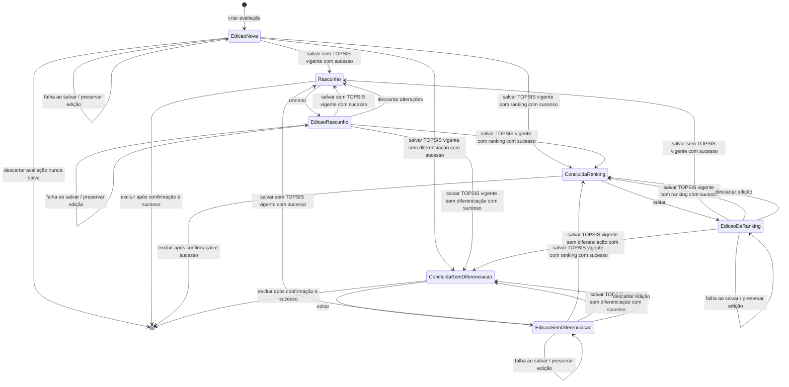
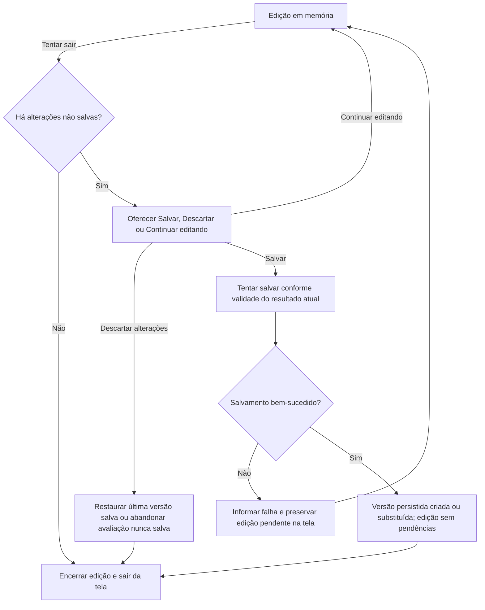

# Parte 4 — Estados e transições da avaliação (aprovada conceitualmente)

[Índice da modelagem](dominio.md) · [Decisões](../decisoes/registro-decisoes.md)

Esta parte descreve o ciclo de vida conceitual da avaliação. Separa a situação da última versão persistida, a edição em memória e a validade dos resultados. Organiza requisitos e decisões já aprovados; não define campos, tabelas, documentos ou implementação. **Status: Aprovada conceitualmente após revisão técnica independente, conforme aprovação do usuário em 04/11/2026.**

## Dimensões de estado

| Dimensão | Estados conceituais | Significado |
|---|---|---|
| Versão persistida | **Rascunho**; **Concluída com ranking**; **Concluída — sem diferenciação** | Situação da última gravação manual bem-sucedida. Antes do primeiro salvamento não existe versão persistida; essa ausência não é um quarto estado armazenado. A lista apresenta a versão salva (RF21, RF22; DEC-025, DEC-035). |
| Edição em memória | **Sem alterações não salvas**; **Com alterações não salvas** | Indica se o conteúdo a salvar difere da última versão persistida, incluindo entradas e resultados calculados. Uma avaliação nova ainda não salva possui edição pendente e nenhuma versão persistida. A edição não é entidade persistida adicional (DEC-025, DEC-036). |
| AHP na edição | **Ausente**; **Desatualizado**; **Calculado consistente**; **Calculado inconsistente** | Ausente significa que não há resultado calculado disponível; julgamentos incompletos impedem calculá-lo. Desatualizado significa que um resultado anterior não corresponde aos julgamentos atuais. Um cálculo vigente com RC acima de 0,10 é diagnóstico inconsistente, pode ser salvo em rascunho e não libera TOPSIS (DEC-023, DEC-037). |
| TOPSIS na edição | **Ausente**; **Desatualizado**; **Válido com ranking**; **Válido sem diferenciação** | Ausente significa que não há resultado disponível. Desatualizado significa que o resultado anterior não corresponde às entradas atuais. Só os dois resultados válidos podem fundamentar conclusão. Ausência de diferenciação não é falha matemática (DEC-024, DEC-035). |

As dimensões se combinam e não formam um único estado enumerado. Uma avaliação salva como concluída pode estar aberta com edição pendente e TOPSIS desatualizado; a versão persistida permanece concluída até um salvamento bem-sucedido ou uma exclusão confirmada bem-sucedida. Não existe histórico de versões.

**Resultados também são conteúdo sujeito a salvamento:** calcular AHP ou TOPSIS pode produzir alterações não salvas mesmo sem mudar produtos, valores ou julgamentos. Por exemplo, um rascunho salvo com entradas completas pode ganhar seu primeiro resultado TOPSIS somente na edição. Essa edição permanece pendente até salvar; sair deve aplicar o aviso da DEC-025. Recalcular um resultado inteiramente igual ao já salvo não implica, por si só, diferença de conteúdo.

**Ausência, desatualização e falha são conceitos distintos:** ausência descreve a falta de resultado; desatualização descreve a falta de correspondência de um resultado anterior; falha descreve uma tentativa de cálculo que não produziu um novo resultado utilizável. Uma falha deve ser informada na edição, sem criar estado persistido “Falha” nem resultado fictício. Não substitui resultado anterior por dados parciais nem o torna vigente: qualquer resultado anterior só pode ser utilizado se ainda corresponder integralmente às entradas atuais. A tentativa que falhou nunca fundamenta conclusão. RC > 0,10 calculado corretamente é diagnóstico de inconsistência, não falha de execução do AHP (DEC-037).

## Transições da avaliação

Nas linhas de salvamento abaixo, o efeito persistido só ocorre após sucesso da operação explícita. Até esse momento, a edição e a versão anterior permanecem separadas.

| Evento | Estado anterior | Efeito na edição em memória | Efeito na versão persistida |
|---|---|---|---|
| Criar avaliação e escolher categoria | Não existe avaliação | Inicia edição pendente, com categoria fixa e dados possivelmente incompletos. | Nenhum; não cria rascunho automaticamente. |
| Retomar rascunho ou abrir concluída para edição | Qualquer uma das três situações persistidas | Carrega a última versão salva sem marcar mudança apenas por abrir; preserva os resultados disponíveis. | Nenhum (RF23, RF24; DEC-025, DEC-036). |
| Alterar alternativa ou valor | Qualquer edição aberta | Marca alterações não salvas e desatualiza TOPSIS. AHP continua vigente se julgamentos e critérios não mudaram. | Nenhum. |
| Alterar julgamento AHP | Qualquer edição aberta | Marca alterações não salvas e desatualiza AHP e TOPSIS anteriores. | Nenhum. |
| Calcular AHP com sucesso | Julgamentos completos e matematicamente válidos para cálculo | Produz diagnóstico atual consistente ou inconsistente; conteúdo novo/diferente do salvo fica pendente. RC > 0,10 não libera TOPSIS. | Nenhum; cálculo isolado não salva (DEC-025, DEC-037). |
| Processar TOPSIS com sucesso | Edição nova ou existente; entradas completas e válidas, AHP vigente e RC ≤ 0,10 | Produz resultado atual com ranking ou sem diferenciação. Resultado novo/diferente do salvo é alteração pendente, mesmo sem mudança nas entradas. | Nenhum; não exige rascunho previamente salvo (DEC-025, DEC-035). |
| Bloqueio de pré-condições ou falha de cálculo | Qualquer tentativa de AHP/TOPSIS | Informa a causa e preserva a edição; não publica resultado parcial como válido. Ausência e desatualização de resultados permanecem distinguíveis da falha. | Nenhum; a tentativa falha não cria conclusão. |
| Salvar como rascunho | Edição nova ou existente sem TOPSIS vigente, ainda que incompleta | Após sucesso, corresponde ao rascunho salvo e fica sem alterações pendentes. AHP vigente inconsistente pode ser preservado como diagnóstico. | Cria ou substitui **Rascunho**; remove/invalida o resultado concluído anterior na mesma operação quando aplicável (RF21, RF24; DEC-025, DEC-037). |
| Salvar processamento válido com ranking | Edição nova nunca salva, de rascunho ou de concluída, com TOPSIS vigente com ranking | Após sucesso, corresponde à versão salva e fica sem alterações pendentes. | Cria diretamente ou substitui **Concluída com ranking**; não requer salvamento anterior como rascunho (RF25; DEC-025). |
| Salvar processamento válido sem diferenciação | Edição nova nunca salva, de rascunho ou de concluída, com TOPSIS vigente sem diferenciação | Após sucesso, corresponde à versão salva e fica sem alterações pendentes. | Cria diretamente ou substitui **Concluída — sem diferenciação**, sem coeficiente, posição ou vencedor fictício; não requer rascunho anterior (DEC-025, DEC-035). |
| Tentar sair com alterações não salvas | Qualquer edição pendente, inclusive apenas por resultados recém-calculados | Mantém a edição e oferece **Salvar**, **Descartar alterações** ou **Continuar editando**. | Nenhum ao apresentar o aviso (DEC-025). |
| Escolher Salvar no aviso de saída | Aviso aberto com edição pendente | Tenta o salvamento correspondente ao conteúdo: rascunho sem TOPSIS vigente ou conclusão conforme o resultado vigente. Só sai após sucesso; em falha, permanece com a edição na tela. | Cria/substitui somente após sucesso, conforme as três linhas de salvamento. |
| Escolher Descartar alterações | Edição pendente ou aviso de saída | Abandona as mudanças e restaura a última versão salva; se nunca houve salvamento, abandona a nova avaliação. No aviso de saída, depois disso encerra a edição. | Preserva a versão salva; nenhuma é criada para avaliação nunca salva (DEC-025). |
| Escolher Continuar editando | Aviso de saída aberto | Fecha o aviso, mantém a edição e suas alterações pendentes na tela. | Nenhum. |
| Sair sem alterações não salvas | Edição equivalente à última versão salva | Encerra a edição sem aviso de mudanças pendentes. | Nenhum. |
| Falha ao salvar, inclusive durante saída | Qualquer tentativa de salvamento | Informa falha, preserva a edição e suas alterações pendentes e não abandona a tela. Não informa sucesso nem descarta automaticamente. | Preserva íntegra a versão anterior; se nunca houve salvamento, continua sem versão persistida (DEC-025, RNF05). |
| Excluir avaliação e confirmar | Rascunho ou concluída persistida | Após sucesso da exclusão, encerra a avaliação removida. | Operação distinta de salvar: remove avaliação e dados/resultados associados conjuntamente; preserva catálogos (DEC-019, RNF05). |
| Cancelar exclusão ou falhar ao excluir | Solicitação de exclusão de avaliação persistida | Cancelamento mantém a avaliação; falha é informada sem declarar exclusão bem-sucedida. | Preserva integralmente a versão salva; não há exclusão parcial (RNF05). |

## Invariantes de estado

- A categoria escolhida permanece fixa durante a vida da avaliação (DEC-022).
- Criar ou substituir a versão persistida exige **salvamento explícito bem-sucedido**. Cálculos e alterações em memória não gravam automaticamente; falha de gravação não cria nem substitui a versão salva (DEC-025, RNF05).
- A **exclusão confirmada** é operação distinta do salvamento: após sucesso, remove atomicamente a avaliação e seus dados/resultados, sem remover produtos dos catálogos. Cancelamento ou falha preserva a versão persistida (DEC-019, RNF05).
- Uma avaliação nova pode ser processada e salva diretamente como concluída com ranking ou sem diferenciação. Rascunho salvo não é pré-condição para calcular nem para concluir.
- Abrir edição de uma concluída não invalida seu resultado. Alterar entradas relevantes desatualiza os resultados afetados na edição; a invalidação persistida só ocorre ao salvar essas alterações. Descartar mantém a última versão salva (DEC-025, DEC-036).
- Resultados recém-calculados novos ou diferentes dos salvos também compõem alterações pendentes. O aviso de saída depende do conteúdo não salvo, não somente de mudanças nos valores ou julgamentos.
- Ao tentar sair com alterações pendentes, oferecer Salvar, Descartar alterações e Continuar editando. Escolher Salvar só permite sair após sucesso; falha mantém a edição e suas alterações na tela. Continuar não grava nem descarta (DEC-025).
- Rascunho persistido não possui TOPSIS vigente. Pode preservar dados incompletos e pesos/indicadores AHP atuais inconsistentes como diagnóstico, sem liberar TOPSIS (RF17, RF21; DEC-037).
- Conclusão exige exatamente um resultado TOPSIS vigente, produzido com entradas válidas e AHP vigente consistente: ranking ou ausência de diferenciação. Empates têm posições compartilhadas com C* definido; ausência de diferenciação não recebe C*, posição ou vencedor fictício (DEC-024, DEC-027, DEC-028, DEC-035).
- Ausência de resultado, resultado desatualizado e falha da tentativa de cálculo não constituem novos estados persistidos. Falha matemática não produz conclusão; o estado válido sem diferenciação não encobre normalização indefinida ou outras falhas.

## Diagrama de ciclo de vida e salvamento

Os nós `Edicao...` representam sessões em memória; `Rascunho`, `ConcluidaRanking` e `ConcluidaSemDiferenciacao` representam a última situação persistida. As dimensões de validade permanecem nas tabelas, não são novos estados persistidos. Toda seta de salvamento pressupõe ação explícita e gravação bem-sucedida. A saída de qualquer sessão segue o fluxo comum do próximo diagrama.

Cálculo bloqueado ou com falha permanece na sessão de edição, sem gravar; a mensagem da tentativa e a validade dos resultados são tratadas separadamente. Uma falha de exclusão mantém o nó persistido anterior. O encerramento de uma sessão no fluxo abaixo não significa excluir a avaliação persistida.

## Fluxo comum de saída com alterações não salvas

Este fluxo se aplica a todas as sessões `Edicao...`, inclusive à avaliação nova e à edição que só ganhou resultados calculados. “Salvar” usa as mesmas condições e destinos de persistência da tabela e do diagrama anterior.

**Conferência da revisão técnica aprovada:** criação → processamento → primeira gravação concluída tem caminhos com ranking e sem diferenciação; salvamento de rascunho continua opcional; saída com alterações oferece as três opções; falha ao salvar retorna à edição preservada; exclusão confirmada permanece distinta de salvar; ausência, desatualização e falha não criam estados persistidos adicionais.

**Status da Parte 4:** Aprovada conceitualmente após revisão técnica em 04/11/2026. A aprovação detalha as decisões vigentes, especialmente DEC-025, DEC-036 e DEC-037, sem criar nova DEC nem aprovar o mapeamento físico da Parte 5.

**Rastreabilidade da Parte 4:** RF10–RF27; RNF01, RNF04–RNF06, RNF08, RNF10; DEC-019, DEC-022–DEC-025, DEC-027, DEC-028, DEC-032, DEC-035–DEC-037; UC06–UC16.
