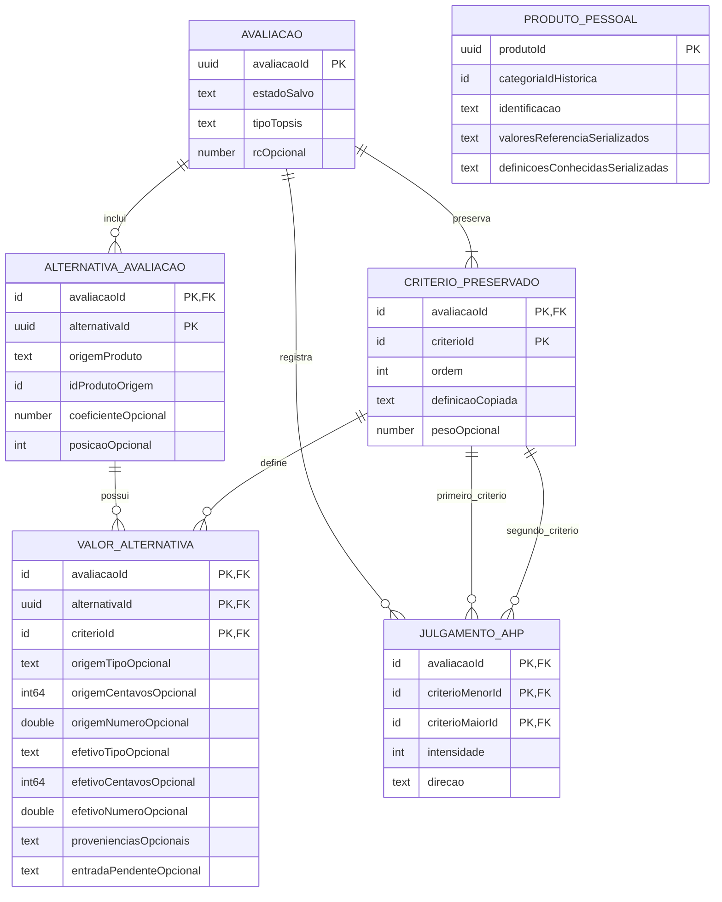

# Parte 5 — Mapeamento do Domínio para Room, Firestore e Snapshots

**Versão:** 0.4 — P5-A aprovada; P5-B–P5-E consolidadas como propostas pendentes de revisão e confirmação.
**Data:** 05/11/2026.
**Situação:** organização híbrida de seis tabelas e integridade geral da P5-A aprovadas na DEC-038. Demais campos, tipos e escolhas de P5-B–P5-E permanecem propostas. A implementação da defesa CHECK canônica requer validação antes da implementação definitiva.

[Domínio e Partes 1–4](dominio.md) · [Decisões aprovadas](../decisoes/registro-decisoes.md) · [Requisitos](../requisitos/README.md)

## Contrato consolidado para esta revisão

As escolhas preferenciais indicadas pelo usuário foram detalhadas em [Contratos P5-B–P5-E](05-contratos-persistencia.md), incluindo o dicionário físico, formato remoto, conversões e política de compatibilidade. As [propostas DEC-039–042](../decisoes/propostas-parte5.md) aguardam confirmação formal. São candidatas, não pertencem ao conjunto aprovado. Este contrato consolidado especifica a recomendação atual; as alternativas abaixo permanecem como comparação, sem representar escolhas definitivamente aprovadas.

## 5.1. Base aprovada e limite da proposta

As Partes 1–4 definem conceitos e regras. Uma entidade do domínio não exige uma tabela própria: Avaliação continua raiz de agregado, CritérioPreservado é objeto de valor, alternativas/julgamentos são componentes e resultados não possuem identidade independente (DEC-036). Esta parte propõe sua representação física; não altera requisitos ou decisões.

| Informação | Responsabilidade já aprovada | Representação física proposta |
|---|---|---|
| Categorias, critérios e produtos oficiais | Firestore, somente leitura pelo aplicativo | Documentos remotos e cache do SDK |
| Produtos pessoais | Persistência local, categoria fixa | Room, registro próprio com valores e definições necessárias à validação offline |
| Avaliações, critérios preservados, alternativas, julgamentos e resultados | Room; salvamento manual do agregado | Tabelas locais e gravação transacional |
| Edição pendente e mensagens de erro | Memória, distinta da última versão salva | Modelo de edição; sem tabela de autosave, falha ou histórico |
| PDF | Relatório gerado da versão salva processada | Arquivo derivado, não tabela nem backup restaurável |

A preservação de definições dentro de produtos pessoais proposta adiante é escolha técnica pendente (P5-E). Não altera o Firestore como fonte oficial. A cópia em avaliações já decorre das DEC-033/036. Nenhuma estrutura concede escrita do cliente no catálogo, sincronização pessoal ou novas categorias na versão inicial.

## 5.2. Estrutura Room — P5-A aprovada (DEC-038)

| Alternativa | Vantagens | Desvantagens |
|---|---|---|
| Agregado serializado em uma linha de avaliação | Poucas tabelas; leitura/substituição simples; atomicidade de uma linha | Unicidade e referências internas dependem de validação; consulta de componentes por SQL é difícil; evolução exige versão do conteúdo |
| Totalmente normalizado | Mais invariantes garantidas por chaves e relacionamentos; consultas detalhadas | Mais tabelas, junções, mapeamento e testes, inclusive para resultados sem identidade própria |
| **Híbrido recomendado para revisão** | Normaliza componentes com unicidade e relações importantes; incorpora metadados e blocos escalares; evita tabela por conceito | Conversão entre representação física e domínio deve ser explícita; integridade do agregado ainda exige validação |

**Base aprovada:** seis tabelas, detalhadas abaixo. Tabelas adicionais exigem justificativa técnica e aprovação posterior. A aprovação não abrange campos/localização dos resultados, contratos remotos, tipos finais ou definições pessoais dos demais tópicos. Metadados variáveis e valores do produto pessoal podem ser serializados em colunas; componentes das avaliações usam relações explícitas. Room suporta conversão de tipos para colunas persistíveis; a escolha de biblioteca e formato ainda não foi feita. [Documentação de tipos personalizados em Room](https://developer.android.com/training/data-storage/room/referencing-data).

### Tabelas candidatas

PK significa chave primária; FK, chave estrangeira; UNIQUE, unicidade. Nomes não são APIs ou código Kotlin aprovados. A proposta consolidada P5-D prefere UUID textual canônico para produto pessoal, avaliação e alternativa; aprovação formal ainda pendente.

| Tabela proposta | Chave e conteúdo principal | Relações e justificativa |
|---|---|---|
| `produto_pessoal` | PK `produtoId`; `categoriaId` histórico e rótulo; identificação; `valoresReferencia` por ID de critério e proveniência conhecida por valor; definições conhecidas para validação; revisão/formato do conteúdo serializado quando aplicável | Sem vínculo obrigatório ao catálogo atual; continua consultável offline. Não aceita cadastro pessoal incompleto. Atualização nunca altera avaliações existentes. |
| `avaliacao` | PK `avaliacaoId`; categoria histórica e rótulo; título opcional; estado salvo; datas de criação/último salvamento; bloco AHP opcional (`lambdaMax`, `ic`, `ri`, `rc`); tipo TOPSIS (`AUSENTE`, `RANKING`, `SEM_DIFERENCIACAO`) | Raiz física do agregado. `AUSENTE` descreve resultado faltante, não novo estado persistido da avaliação. Bloco AHP não precisa de ID ou tabela própria. |
| `criterio_preservado` | PK `(avaliacaoId, criterioId)`; nome, descrição/unidade, natureza, ordem e metadados copiados; referência/revisão de origem quando conhecida; `pesoAhp` opcional | FK `avaliacaoId` → avaliação. UNIQUE `(avaliacaoId, ordem)`. A definição copiada é imutável; o peso é coluna de resultado separada semanticamente e pode ser recalculado. |
| `alternativa_avaliacao` | PK `(avaliacaoId, alternativaId)`; `origemProduto`, `idProdutoOrigem`; identificação e referência/proveniência copiadas; ordem de apresentação; `dMais`, `dMenos`, `coeficiente` e `posicao` opcionais | FK para avaliação. UNIQUE `(avaliacaoId, origemProduto, idProdutoOrigem)`. Sem FK para produto atual. Colunas de resultado representam o detalhe TOPSIS da alternativa, sem entidade independente. |
| `valor_alternativa` | PK `(avaliacaoId, alternativaId, criterioId)`; `valorEfetivo` e `valorOrigem` conhecido, ambos distinguindo ausência de zero; blocos de proveniência por valor de origem e efetivo, conforme 5.4 | FKs compostas para alternativa e critério preservado da mesma avaliação. Uma linha por par alternativa/critério, sem repetir a definição do critério. |
| `julgamento_ahp` | PK `(avaliacaoId, criterioMenorId, criterioMaiorId)`; intensidade e direção da preferência | Duas FKs compostas para critérios da mesma avaliação. Normalização obrigatória do par e possível CHECK físico de ordem canônica; impedir comparação consigo mesmo e pares invertidos independentes. Recíproco e diagonal são derivados. |

### Unicidade obrigatória do julgamento AHP

A ordem canônica serve à unicidade e independe da ordem de apresentação dos critérios. Antes de qualquer gravação, ordenar os dois IDs por um comparador estável e compatível com a comparação física do banco. Para IDs textuais opacos, propõe-se comparação binária determinística; para outra representação, definir a ordem correspondente em P5-D. Não usar idioma, rótulo do critério ou posição da tela para formar a chave.

Ao inverter os membros para normalizar, inverter também a direção da preferência, mantendo a intensidade e o significado do julgamento. Exemplo: `(B, A, preferência por B, intensidade 3)` e `(A, B, preferência por B, intensidade 3)` representam o mesmo par canônico e a mesma preferência. Igual importância usa intensidade 1 e representação de direção única. Rejeitar IDs iguais e critérios de avaliações diferentes.

A PK `(avaliacaoId, criterioMenorId, criterioMaiorId)` sozinha permitiria linhas `(A,B)` e `(B,A)` se não houvesse normalização. Todas as escritas devem passar pelo normalizador; julgamento invertido normaliza para a mesma PK e só pode atualizar aquele julgamento ou ser rejeitado por conflito, nunca criar outra comparação independente.

**Defesa física proposta:** colunas de ID não nulas e restrição CHECK equivalente a `criterioMenorId < criterioMaiorId`, com a mesma ordenação usada pelo normalizador, além da PK e FKs. Para texto, especificar explicitamente a collation pertinente, por exemplo BINARY. Um par invertido enviado diretamente à persistência deve ser rejeitado pela restrição. SQLite admite CHECK, mas o mapeamento final precisa verificar como declará-lo no schema gerenciado pelo Room; não se pressupõe uma anotação automática. Sem essa definição, a garantia física ainda não está concluída. Nenhuma restrição foi criada ou executada nesta revisão. [Restrições SQLite](https://www.sqlite.org/lang_createtable.html).

A direção é interpretada em relação aos dois IDs canônicos; recíproco e diagonal são derivados. Os campos de referência física continuam propostas de P5-A/P5-D. A alternativa tem identidade contextual local, além da identidade histórica origem + ID do produto; a chave contextual não deve mudar apenas porque os valores foram ajustados.

Os metadados de validação podem ser serializados como mapa tipado contendo tipo, unidade, limites/inclusividade, ausência e natureza aplicáveis. Não propor expressões executáveis recebidas do servidor. Os limites ainda não definidos continuam para preparação dos dados; esta proposta não os inventa (DEC-033).

### Modelo físico candidato — relações internas



`uuid`, `int64`, `double` e `text` no desenho representam tipos propostos para confirmação; `id` representa a referência correspondente. UUID é TEXT, int64 é INTEGER e double é REAL no mapeamento candidato Room. Não é schema implementado. Campos opcionais representam nulabilidade. A tabela de integridade abaixo define as FKs compostas que o desenho simplifica. Produto pessoal fica sem ligação obrigatória com a alternativa: a cópia histórica sobrevive à exclusão do cadastro. As contagens mínimas de critérios, valores, julgamentos e detalhes de conclusão são validadas pelo estado, não apenas pelas linhas do diagrama.

### Integridade e índices candidatos

| Regra | Garantia física proposta | Validação complementar do agregado |
|---|---|---|
| Componentes pertencem à mesma avaliação | FK `(avaliacaoId, alternativaId)` e FK `(avaliacaoId, criterioId)` em valores; duas FKs `(avaliacaoId, criterioId)` nos julgamentos | Conferir identidade e contexto ao montar/carregar o agregado |
| Sem duplicidade | PKs compostas; UNIQUE de identidade de produto e ordem de critérios; CHECK proposto de ordem canônica AHP e IDs não nulos | Normalização obrigatória com direção ajustada; par invertido converge à mesma chave; critério igual a ele mesmo é rejeitado; mapas sem chaves repetidas |
| Exclusão completa | CASCADE de avaliação para seus componentes; dependentes de critérios/alternativas também removidos de forma consistente | Testar exclusão atômica, sem apagar produto pessoal ou catálogo |
| Imutabilidade dos snapshots | Nenhuma FK aos documentos atuais do catálogo; identidade histórica como dado | Não atualizar definição preservada por sincronização; comparar antes/depois de editar avaliação |
| Conteúdo coerente por estado | Nulabilidade para rascunhos e resultados opcionais; domínio de discriminadores | Exigir conjunto completo antes de conclusão; não aceitar metadados/payload ilegíveis como dados válidos |
| Índices de acesso | PKs/UNIQUE já criam caminhos de busca; índice de avaliação por data de atualização para a lista; produto pessoal por categoria | Criar índice composto extra apenas se consulta real exigir |
| Índices de FK | Garantir prefixos compatíveis com as colunas filhas | Verificar índice adicional nos julgamentos para `(avaliacaoId, criterioMaiorId)` e nos valores para `(avaliacaoId, criterioId)`; a PK nem sempre cobre esses acessos |

Em Room, as colunas pai referenciadas precisam ser PK ou possuir índice único; índices nas colunas filhas evitam buscas completas em operações com FK. PKs compostas acima buscam garantir pertencimento ao agregado, não apenas existência global do critério. [Referência de ForeignKey](https://developer.android.com/reference/androidx/room/ForeignKey).

Não propor índice de nome para deduplicação, índice único de posição TOPSIS (empates são permitidos), tabela para cada origem ou tabela de edição não salva. A categoria é histórica e fixa; essa regra não depende de FK ao documento remoto.

## 5.3. Persistência de AHP e TOPSIS — P5-B

O modelo recomendado coloca o cabeçalho AHP na avaliação, pesos nas linhas de critérios e detalhes TOPSIS nas alternativas. **Isso não torna peso parte imutável de CritérioPreservado nem transforma resultado em propriedade do produto:** o mapeador reconstrói objetos de valor Resultado AHP/TOPSIS, associados exclusivamente à avaliação. Todos esses campos são gravados/limpos na mesma transação.

Alternativa: tabelas próprias `resultado_ahp`, `peso_ahp`, `resultado_topsis` e `detalhe_topsis`. Tornam os objetos mais visíveis fisicamente e permitem restrições específicas, mas acrescentam tabelas e junções. Recomenda-se a incorporação para a primeira versão, sem necessidade de histórico ou consulta independente de resultados; essa escolha aguarda aprovação.

| Situação salva | AHP e pesos | TOPSIS/detalhes |
|---|---|---|
| Rascunho sem AHP vigente | Cabeçalho e todos os pesos ausentes | Tipo AUSENTE; distâncias, coeficientes e posições ausentes |
| Rascunho com diagnóstico AHP vigente | Cabeçalho completo, pesos de todos os critérios; RC pode exceder 0,10 (DEC-037) | AUSENTE; se RC > 0,10, bloqueia TOPSIS. Se RC ≤ 0,10 e demais entradas válidas, permite processar em memória; concluir exige depois salvar o resultado vigente |
| Concluída com ranking | AHP completo e RC ≤ 0,10 | RANKING; d+/d−, C* e posição por alternativa; empate compartilha posição e permite coeficientes distintos dentro da tolerância aprovada |
| Concluída — sem diferenciação | AHP completo e RC ≤ 0,10 | SEM_DIFERENCIACAO; detalhe para cada alternativa, distâncias calculáveis; C*/posição ausentes e nenhum vencedor fictício |

### Conjuntos coerentes de resultados

- **AHP ausente:** todos os campos do cabeçalho e todos os pesos ausentes; nenhum peso isolado implica AHP calculado.
- **AHP vigente:** cabeçalho completo e finito (`lambdaMax`, IC, RI e RC) e exatamente um peso positivo e finito por critério preservado, sem pesos extras, com normalização e indicadores coerentes com os julgamentos completos atuais e o RI aplicável. RC > 0,10 continua sendo diagnóstico inconsistente válido para rascunho, não aprovação de consistência (DEC-037).
- **TOPSIS AUSENTE:** todas as colunas calculadas de detalhe (distâncias, coeficientes e posições) estão ausentes em todas as alternativas; não carregar sobras de resultado antigo.
- **TOPSIS RANKING:** avaliação concluída, AHP vigente consistente, dados completos e exatamente um detalhe completo por alternativa, sem omissões ou duplicações. Distâncias finitas e não negativas, C* definido/finito na faixa matemática esperada e posições competitivas coerentes com o agrupamento aprovado; nenhuma unicidade de posição que proíba empate.
- **TOPSIS SEM_DIFERENCIACAO:** avaliação concluída, AHP vigente consistente e detalhe para todas as alternativas, com as distâncias/indicadores calculáveis que caracterizam esse caso; C* e posição ausentes para todas, sem vencedor fictício. Não aceitar detalhes misturando ranking e ausência de diferenciação.

**Validação de conjunto:** ao gravar e ao carregar, conferir correspondência entre estado salvo, tipo de resultado, cabeçalho/pesos e todos os detalhes. Transação impede gravação parcial, mas não transforma um conjunto incompleto em válido. Restrições locais de nulabilidade/domínio ajudam, enquanto relações que cruzam linhas exigem validador do agregado. Resultado parcial ou incoerente é informado e bloqueia apresentação/exportação como conclusão válida; não completar pelo catálogo nem salvar um reparo automaticamente. Rascunho pode ser incompleto nas entradas e continuar válido como rascunho, mas não conter um resultado parcial declarado vigente.

Cálculo falho e resultado desatualizado ficam na edição; ao salvar entradas alteradas, limpar os campos de resultado afetados. Se apenas alternativas/valores mudaram, AHP vigente pode permanecer; se julgamentos mudaram, AHP e TOPSIS são removidos/invalidados. Não arredondar valores internos para persistir ou calcular; RC é comparado diretamente com 0,10, empates seguem DEC-027/028 e testes seguem DEC-029.

### Representação numérica e monetária — P5-D pendente

A proposta distingue a representação fiel da entrada da aproximação usada pelos motores. Double/REAL representa números binários aproximados e não garante exatidão decimal de centavos. Inteiros preservam unidades de escala fixa exatamente dentro do seu intervalo; decimais exigem representação e conversão explícitas. [Precisão numérica no SQLite](https://sqlite.org/floatingpoint.html).

| Alternativa para dinheiro | Precisão e limites | Integração Room/Firestore | Conversão para AHP/TOPSIS e complexidade |
|---|---|---|---|
| `Double/REAL` em reais | Simples, mas muitos valores decimais não têm representação binária exata; igualdade/arredondamento monetário exigem cuidado | REAL local e número de ponto flutuante remoto; pouca adaptação | Usa diretamente o tipo numérico do motor; menor complexidade, menor garantia de preservação exata dos centavos |
| Inteiro de 64 bits em centavos | Exato para escala fixa de duas casas; verificar intervalo/overflow ao converter; não representa fração de centavo | INTEGER local e inteiro de 64 bits remoto, com moeda/escala/unidade explícitas nos metadados | Converter para a unidade do critério somente na fronteira do motor; complexidade moderada e previsível |
| Decimal como texto canônico | Preserva escala e valor decimal; validação obrigatória; texto não fornece ordenação numérica SQL por si só | TEXT/conversor local e string remota; Firestore não tem tipo decimal arbitrário nativo | Interpretar como decimal e converter explicitamente para cálculo; maior cuidado com parsing, consultas e limites |
| Decimal como valor não escalado + escala | Exato dentro do intervalo do inteiro; mais flexível que centavos; para precisão arbitrária pode precisar texto | Dois campos ou mapa em ambas as fontes; maior esforço de coerência e consulta | Reconstruir decimal antes de converter; flexibilidade com complexidade superior ao escopo monetário inicial |

Firestore oferece inteiro de 64 bits e ponto flutuante de 64 bits, além de strings/mapas; não há tipo BigDecimal nativo. Um objeto decimal do aplicativo precisa de codificação explícita, não envio implícito como número. BigDecimal representa valor não escalado e escala e pode ser convertido por contrato de serialização próprio. [Tipos Firestore](https://firebase.google.com/docs/firestore/manage-data/data-types), [BigDecimal](https://docs.oracle.com/en/java/javase/17/docs/api/java.base/java/math/BigDecimal.html).

**Recomendação sujeita a aprovação:** armazenar preços e seguro anual em reais como inteiro em centavos, se for aprovada escala de duas casas para esses critérios; moeda BRL, escala e período/unidade continuam explícitos. Manter resultados dos motores em Double/REAL, sem arredondamento intermediário. Outros critérios seguem seu domínio, sem obrigá-los a usar centavos ou inteiro. Os marcadores `number` do diagrama não fecham o tipo físico de `valorEfetivo`/`valorOrigem`; a tabela genérica precisará de representação tipada coerente com os metadados escolhidos, sem pressupor uma única coluna REAL para todos os casos.

A entrada decimal deve ser interpretada de forma exata antes da conversão em centavos, evitando multiplicar um Double aproximado e truncar. Valores com mais casas do que a escala aprovada devem ser rejeitados para correção ou seguir uma política de arredondamento explicitamente aprovada; não arredondar, converter ou migrar silenciosamente. Dados legados remotos em Double também precisam de contrato de conversão validado; não presumir reconstrução exata da entrada decimal original.

Na fronteira dos motores, converter centavos/decimal para o valor na unidade preservada do critério, verificar faixa e finitude e usar a aproximação numérica conforme a metodologia. Preservar no snapshot a entrada canônica, sua escala e proveniência; a conversão para cálculo não substitui o dado original. Isso não exige aritmética decimal dentro dos motores nem torna seus resultados exatos. Não alterar RC, tolerâncias de empate/teste ou regras de arredondamento visual das DEC-018/027/029. NaN e infinitos são rejeitados mesmo quando aceitos como tipo numérico pelo Firestore.

A escolha do tipo, a escala monetária, o formato genérico dos valores e eventual política de arredondamento continuam pendentes em P5-D; não são limites ou tipos aprovados por esta recomendação.

## 5.4. Snapshots e independência dos catálogos

1. **Criar em memória:** copiar categoria histórica e definições dos critérios disponíveis, em ordem estável. Depois, ao selecionar produtos, copiar identificação, origem + ID e valores de referência conhecidos.
2. **Ajustar valores:** manter valor efetivo próprio e valor original quando conhecido; ausência continua distinta de zero. Não copiar todas as definições para cada alternativa.
3. **Salvar:** gravar todo o agregado e apenas resultados vigentes. Avaliação nova pode ir diretamente para concluída sem rascunho prévio. Critérios preservados já definidos permanecem imutáveis nas próximas edições.
4. **Reabrir/recalcular/exportar:** usar dados locais preservados; não buscar dados atuais para preencher silenciosamente ausências ou atualizar valores/unidades.
5. **Editar/excluir catálogo pessoal ou atualizar/remover documento oficial:** nenhuma cascata/atualização alcança avaliações salvas. Produtos removidos não são oferecidos em novas seleções, mas a participação histórica continua.

Os dados de referência/proveniência conhecidos no momento da seleção são históricos. Não apresentar o snapshot como dado atualmente confirmado pelo servidor. Uma avaliação não precisa armazenar matrizes normalizadas/ponderadas para continuar consultável; indicadores e entradas aprovados são suficientes ao escopo, e fórmulas intermediárias podem ser recomputadas conforme necessário.

### Proveniência por valor utilizado

Recomendação física: cada linha `valor_alternativa` preserva, além dos números, dois blocos opcionais de proveniência — **do valor de origem** e **do valor efetivo**. Podem ser campos incorporados/serializados, sem tabela independente. Referências gerais do produto ou da definição do critério não substituem a associação inequívoca com o valor realmente usado.

| Informação do bloco | Preservação proposta |
|---|---|
| Fonte | Documento, URL, publicação ou descrição conhecida; referência histórica à origem + ID do registro quando aplicável |
| Data de referência | Data/perfil do valor na fonte, quando disponível; não usar a data do salvamento, geração do PDF ou consulta como substituta |
| Protocolo/rubrica | Identificação e versão conhecidas e descrição/parâmetros necessários à interpretação: teste de autonomia, rubrica de câmera/ADAS, perfil de seguro ou condições de recarga, conforme o critério |
| Indicação de estimativa/simulação | Verdadeiro, falso ou desconhecido, conforme informação disponível; ausência de indicação não significa “medido” nem “não estimado” |
| Origem do valor efetivo | Cópia do catálogo oficial, cópia do produto pessoal ou ajuste específico na avaliação; não pressupõe identificação pessoal do usuário |

Ao copiar um valor sem modificá-lo, sua proveniência acompanha o valor efetivo. Ao ajustá-lo, preservar o valor/proveniência de origem como referência e marcar o efetivo como ajustado; não atribuir automaticamente ao novo valor a fonte, a data ou o protocolo do número substituído. Informações aplicáveis já conhecidas podem ser mantidas apenas quando continuarem descrevendo o novo valor; detalhes desconhecidos permanecem desconhecidos. Se houver nova fonte informada no fluxo de dados, copiá-la com o valor; esta proposta não cria uma nova tela obrigatória de edição de fontes.

Preservar a proveniência conhecida disponível em produto oficial/pessoal antes da seleção, sem buscar obrigatoriamente a fonte externa no futuro. Cópia de avaliação salva é histórica e independente do catálogo. Não inventar fonte, data, versão de protocolo, condição de medição ou indicação de estimativa, nem inferir que todo ajuste manual seja necessariamente uma estimativa. A definição preservada pode guardar a rubrica comum, mas deve ficar claro qual versão fundamenta cada valor.

## 5.5. Salvamento, leitura e exclusão atômicos

**Recomendação técnica:** validar e preparar a cópia a gravar fora da transação, incluindo correspondência entre entradas e resultados. Capturar uma edição coerente; o sucesso só limpa a marca de alterações para o conteúdo efetivamente gravado. Uma alteração posterior em memória não pode ser marcada indevidamente como salva.

Dentro de uma única transação Room: criar ou atualizar a raiz, substituir os componentes mutáveis necessários, preservar as definições copiadas e gravar/limpar todos os campos de resultado correspondentes. Evitar substituir a raiz por uma estratégia implícita de excluir/reinserir que possa acionar cascatas indevidas; preferir atualização controlada. Nenhuma chamada Firestore, cálculo demorado ou geração PDF integra essa transação.

Após sucesso, a edição corresponde ao conteúdo salvo; em falha, reverter a operação inteira e manter versão anterior e edição pendente. No primeiro salvamento que falha, nenhuma avaliação parcial deve surgir na lista. Descartar edição não executa atualização no banco. Salvar ao sair aplica a mesma operação; falha mantém a edição na tela (Parte 4).

**Exclusão:** após confirmação, remover raiz e todos os componentes na mesma operação transacional. Não excluir produtos pessoais nem dados oficiais. Se falhar, manter avaliação íntegra. Cancelamento não executa exclusão.

**Leitura:** quando o agregado exige várias consultas, carregá-las sob leitura transacional coerente, evitando combinar componentes de antes e depois de uma gravação. A listagem pode consultar somente o cabeçalho. Transações de leitura/escrita compostas são suportadas pelo Room; isso não substitui as validações do domínio. [Referência de Transaction](https://developer.android.com/reference/androidx/room/Transaction).

## 5.6. Catálogo oficial no Firestore — P5-C

Recomendação para revisão: categorias e produtos em coleções raiz; critérios embutidos como conjunto pequeno no documento da categoria. IDs de critérios são estáveis, exclusivos à categoria e globalmente inequívocos no catálogo; nomes iguais não significam identidade compartilhada (DEC-037).

```text
categorias/{categoriaId}
  nome, descricao?, revisaoDefinicao, atualizadoEm?
  criterios: [
    { id, ordem, nome, descricao?, unidade, natureza,
      validacao: { tipo, limites?, ausencia, ... }, referencias? }
  ]

produtos/{produtoId}
  categoriaId, revisaoDefinicao
  nome, fabricante?, modelo?, versao?, ano?
  valores: { criterioId: valor ou ausencia explicita }
  referenciasPorCriterio?: { criterioId: { fonte?, dataReferencia?, protocoloOuRubrica?, estimativa? } }
  dataReferencia?, atualizadoEm?
```

Esse desenho é ilustrativo; obrigatoriedade final de campos e formato de revisão aguardam modelagem detalhada. `?` indica informação opcional/desconhecida, nunca data estimada. Não contém produtos pessoais, julgamentos ou avaliações. A ordem de negócio é explícita em `ordem`, e não inferida da iteração de mapas.

| Alternativa | Vantagens | Desvantagens e recomendação |
|---|---|---|
| Critérios embutidos na categoria | Uma leitura obtém definição coerente, ordem e validações; proporcional aos cinco critérios atuais | Documento cresce com o conjunto; **recomendado** para este escopo |
| Critérios em subcoleção | Consultas/atualizações independentes e crescimento mais flexível | Mais documentos/leituras e verificação de coerência de revisão; não necessária apenas por existir conceito Critério |
| Produtos em coleção raiz | ID oficial inequívoco e consulta por categoria | Consulta exige filtro `categoriaId`; **recomendado** |
| Produtos em subcoleção da categoria | Agrupamento por caminho | IDs locais à coleção podem colidir entre categorias; nesse caso o ID histórico precisa incluir caminho/namespace completo |

A documentação do Firestore apresenta mapas/listas aninhados para conjuntos pequenos e subcoleções para dados que crescem ou precisam de consultas próprias. A escolha acima é recomendação da proposta, não obrigação da plataforma. [Estruturas de dados Firestore](https://firebase.google.com/docs/firestore/manage-data/structure-data).

### Identidade, coerência e validação remota

- Produto oficial: identidade de domínio `(OFICIAL, produtoId)` no layout recomendado. Produto pessoal: `(PESSOAL, produtoIdLocal)`. Não incluir nome/modelo na identidade e não trocar ID só por editar dados.
- Duas identidades podem representar o mesmo produto físico; a seleção não as deduplica automaticamente (DEC-034).
- A categoria e os critérios devem corresponder ao produto e à revisão informada. Não há FK entre Firestore e Room; o leitor valida o documento antes de convertê-lo ao domínio.
- Propor `revisaoDefinicao` explícita para detectar categoria e produto com definições incompatíveis, inclusive em cache. Revisão não é histórico de avaliações. Se houver incompatibilidade ou tipo desconhecido, sinalizar e impedir processamento que reinterpretaria unidade/domínio; não inventar conversões.
- Produtos oficiais incompletos continuam consultáveis e sinalizados; a alternativa pode manter ausência no rascunho, mas não pode processar sem os valores exigidos. Produto pessoal tem validação de cadastro própria (RF06).
- Índices Firestore: planejar consulta de produtos por `categoriaId`; acrescentar índice composto somente se filtros/ordenação reais exigirem. Não configurar índices nesta proposta.
- A publicação por responsáveis pelo catálogo deverá manter categorias/produtos coerentes. Não se está propondo tela administrativa, rotina de publicação ou escrita pelo cliente. Leitura pública e escrita bloqueada continuam conforme RNF07.

### Comparação de definições de produtos pessoais — P5-E pendente

**Alvo da comparação:** no novo cadastro/seleção, comparar a definição conhecida junto ao produto com a definição usada pela avaliação de destino. Em uma avaliação nova, ela deriva da categoria disponível naquele momento; ao acrescentar alternativa a uma avaliação existente, usar seus CritérioPreservado, sem trocar suas definições pelas atuais. Consultar, recalcular e exportar uma avaliação histórica completa utiliza exclusivamente os snapshots já salvos.

**Detecção proposta:** conferir categoria, conjunto de IDs, significado do critério, unidade/moeda/período e escala, tipo/domínio/ausência, limites/inclusividade, natureza benefício/custo e protocolo/rubrica aplicável. Comparar por ID, nunca somente por nome, posição ou tipo físico da coluna. `revisaoDefinicao` serve como indício para comparar: revisões diferentes não provam incompatibilidade, e revisão igual não dispensa validar o conteúdo recebido. A revisão deve ser preservada quando conhecida; não fabricar revisão ausente.

| Alteração observada | Classificação proposta e ação |
|---|---|
| Nome, descrição ou ordem de apresentação, com significado/IDs/metadados semânticos preservados | Compatível após conferência; associar por ID e manter a ordem/definições da avaliação de destino. Alteração de texto que mude significado não é apenas editorial |
| Limites ampliados, ou restrição nova/mais estreita | Revalidar cada valor sob a definição de destino. Só considerar reutilizável quando o mesmo valor e seu significado satisfizerem as regras; não declarar compatibilidade universal da revisão |
| Tipo representacional diferente ou escala de armazenamento diferente, mas mesma grandeza | Somente compatível com codificação e conversão exatas explicitamente definidas/aprovadas; não adivinhar centavos versus reais, truncar ou mudar valor. Sem contrato, indeterminada |
| Mudança de unidade, moeda/período, custo/benefício, rubrica/protocolo que altere a comparabilidade, remoção/troca de ID ou de categoria | Incompatível para reutilização direta. Não renomear IDs nem converter valor automaticamente; requer revisão/correção explícita dos dados para o destino |
| Definição ausente, tipo/regra desconhecida ou metadados insuficientes | Indeterminada. Não afirmar compatibilidade; informar a lacuna e impedir uso que dependa dessa interpretação, mantendo consulta histórica/local disponível |

**Ação recomendada:** incompatibilidade ou indeterminação mantém o produto e a definição anterior intactos e sinaliza o motivo antes de incluir/processar dados novos. Pedir correção ou confirmação explícita da representação nos fluxos de edição/ajuste já previstos, quando suficientes; se fosse necessário um novo fluxo de conversão, isso exigiria aprovação separada. Não criar migração, conversão de unidade, atualização de categoria ou substituição de valores/definições silenciosa.

Compatibilidade é relativa aos dados e à definição de destino conhecida. Offline, comparar somente cópias locais disponíveis e informar que podem estar desatualizadas; não afirmar validação contra revisão atual desconhecida do servidor nem impor uma leitura remota ao recálculo histórico. Atualização do catálogo não invalida nem reinterpreta avaliações existentes. Esta política e seu contrato de comparação são propostas pendentes em P5-E/P5-C, não decisões tomadas.

## 5.7. Offline, proveniência e datas — P5-E

**Recomendação:** cache do SDK como cópia corrente dos produtos oficiais; não replicar todo o catálogo em Room. Room mantém dados pessoais e snapshots das avaliações, que não são cache descartável. Ler avaliação salva completa nunca depende de o documento de origem ainda estar no cache.

`fromCache` identifica a origem da consulta, não fornece data de atualização nem certifica completude. O cache pode conter somente parte dos documentos de uma categoria, produtos sem todos os valores/metadados ou categoria e produtos de revisões diferentes. Uma consulta local vazia não prova ausência de produtos no catálogo remoto. Conferir os dados disponíveis, sinalizar campos/definições ausentes e impedir processamento quando faltar informação exigida, sem fabricar valores ou descartar snapshots íntegros.

Mudanças de metadados podem exigir observação específica para atualizar a indicação na interface. Dados confirmados pelo servidor confirmam a leitura daquela consulta, não garantem completude semântica dos campos nem igualdade de todos os documentos com uma mesma revisão. Uma definição ausente/incompatível não fica válida apenas por a origem ser servidor. Cache parcial/ausente pode limitar consultas oficiais sem impedir operações locais com dados completos. [Funcionamento offline do Firestore](https://firebase.google.com/docs/firestore/manage-data/enable-offline).

| Informação | Significado proposto | Cuidado |
|---|---|---|
| `dataReferencia` | Data/perfil da fonte do valor | Pode variar entre critérios; não é data da consulta |
| `atualizadoEm` | Data da alteração informada pelo publicador para aquele documento | Pode não existir; não é a data de leitura. Não atribuir um timestamp de um documento a todos os valores/documentos do catálogo |
| `confirmadoNoServidorEm`, se adotado | Instante conhecido da última leitura efetivamente confirmada no servidor, limitado ao documento/consulta correspondente | Registro local de consulta, sujeito ao relógio do dispositivo; não é timestamp de publicação nem comprova quando o valor mudou. Uma leitura apenas do cache não atualiza essa confirmação |
| Origem da leitura | Cache ou servidor confirmado no evento da consulta | Não converter uma antiga leitura confirmada em garantia de atualidade quando o dado atual veio do cache |

Para produtos pessoais existentes, consultar/editar/validar offline exige definições locais suficientes. Duas opções: **A**, manter as definições conhecidas junto ao produto (campo serializado proposto na tabela); **B**, criar armazenamento local compartilhado de definições por categoria/revisão. A evita tabela adicional e dependência de cache descartável, mas repete pequenas definições; B reduz repetição e centraliza atualização, com relações e ciclo de vida extras. **Recomendação inicial A**, sujeita a revisão.

Essa cópia não altera o catálogo oficial nem deve reinterpretar automaticamente os valores pessoais quando o servidor muda. A política de compatibilidade da seção 5.6 precisa ser aprovada; recomenda-se preservar a interpretação existente, validar contra a definição de destino disponível e pedir correção explícita quando necessária. Não propor migração silenciosa ou mudança de categoria. Novo cadastro/avaliação offline depende das definições disponíveis conforme RNF06; não se promete catálogo completo offline.

Continuam aplicáveis: ausência de sincronização pessoal, restrições de backup/transferência Android da DEC-030 e compartilhamento explícito do PDF da DEC-032. Não há criação de configurações Firebase/Android nesta parte.

## 5.8. Escolhas pendentes de aprovação

Os identificadores abaixo são tópicos de revisão, não novas decisões DEC. Apenas a base P5-A está aprovada; as recomendações restantes não significam schema final aprovado.

| Tópico | Alternativas | Recomendação e consequência |
|---|---|---|
| **P5-A — Estrutura Room (aprovada, DEC-038)** | Agregado serializado; normalizado; híbrido | Híbrido de seis tabelas: integridade interna mais explícita sem tabela por conceito; mais mapeamento que JSON integral |
| **P5-B — Localização física dos resultados** | Incorporar blocos/colunas; tabelas próprias | Incorporar em avaliação/critério/alternativa, com separação semântica do snapshot; economiza tabelas, exige limpeza/validação conjunta |
| **P5-C — Layout Firestore e revisão** | Critérios embutidos/subcoleção; produtos raiz/subcoleção; revisão explícita | Critérios embutidos e produtos raiz com IDs globais; revisão de definição para detectar incompatibilidade, sem prometer histórico |
| **P5-D — Identificadores e números** | IDs locais opacos textuais ou inteiros; dinheiro em Double, centavos inteiros ou representação decimal | IDs locais opacos estáveis; centavos para preços/seguro em BRL com escala de duas casas, se aprovada; Double para motores/resultados. Tipo genérico, escala e contrato de conversão continuam pendentes |
| **P5-E — Definições pessoais e offline** | Copiar pequenas definições por produto; tabela compartilhada por categoria/revisão | Cópia local junto ao produto; comparação semântica com a definição de destino, classificação compatível/incompatível/indeterminada e ação explícita. Cache pode ser parcial; snapshots históricos independem da revisão remota |

Não foi encontrada incompatibilidade que exija mudar DEC-025, DEC-036 ou DEC-037. As escolhas desta tabela são propostas de implementação para revisão técnica independente e discussão com o usuário.

### Consolidação em rodada única, sem aprovação automática

| Tópico | Escolha preferencial consolidada | Proposta pendente |
|---|---|---|
| P5-B | Campos de resultado incorporados às seis tabelas, com conjuntos coerentes e reconstrução de objetos de valor | DEC-039 |
| P5-C | Categorias raiz com critérios embutidos; produtos raiz; revisão explícita e proveniência por valor | DEC-040 |
| P5-D | UUID textual local; dinheiro BRL em Long centavos; demais valores/resultados Double; união tipada | DEC-041 |
| P5-E | Definições junto ao produto pessoal, snapshots independentes e comparação semântica com o destino; cache SDK | DEC-042 |

O [contrato consolidado](05-contratos-persistencia.md) resolve os detalhes desta proposta, incluindo rejeição de frações de centavo, formato legado e compatibilidade. As opções são preferências do usuário para elaboração e revisão, não aprovações formais. P5-A permanece aprovada na DEC-038; nenhuma proposta é integrada automaticamente ao conjunto aprovado.

## 5.9. Verificações previstas da proposta

| Cenário | Evidência a obter na implementação |
|---|---|
| Avaliação nova → resultado → primeiro salvamento concluído | Conjunto completo gravado atomicamente sem rascunho prévio |
| Rascunho com valores de alternativas ausentes, julgamentos completos e AHP RC > 0,10 | Retoma ausências e diagnóstico inconsistente sem resultado TOPSIS ou conclusão indevida |
| Rascunho com julgamentos incompletos | Retoma pares pendentes sem inventar AHP vigente ou respostas |
| Julgamento aponta para critério de outra avaliação | FK/validação rejeita; não ocorre gravação parcial |
| Inserir `(A,B)` e depois `(B,A)`, inclusive por tentativa direta sem normalizador | Normalização preserva preferência e converge à mesma chave; restrição física rejeita ordem invertida quando adotada; nunca há dois julgamentos independentes |
| Alterar valor de catálogo na avaliação | Valor original/proveniência permanecem históricos; efetivo é marcado como ajustado sem atribuir fonte/data/rubrica desconhecidas |
| Cabeçalho/pesos AHP parciais ou detalhes TOPSIS misturados/incompletos | Salvar/carregar rejeita conjunto como vigente; transação reverte tentativa inválida; não há conclusão ou reparo automático |
| Valor monetário com centavos, excesso de casas, overflow ou entrada remota legada | Contrato aprovado preserva valor/escala; rejeita conversão ambígua ou fora de faixa; sem truncamento/arredondamento silencioso |
| Revisão apenas editorial, limites restritos e mudança semântica | Compara por IDs e metadados, revalida valores e classifica sem depender só do número da revisão |
| Produto repetido e IDs iguais em origens diferentes | Rejeita repetição da identidade, permite identidades distintas |
| Cadastro original editado/excluído ou cache removido | Avaliação salva mantém consulta, recálculo e PDF offline |
| Mudança remota de unidade/revisão | Snapshot não muda; novo cadastro/seleção de dados do catálogo exige compatibilidade. Recálculo histórico com snapshots íntegros permanece independente da revisão remota |
| Empate e sem diferenciação | Posições repetidas permitidas; coeficiente indefinido permanece ausente, nunca zero substituto |
| Falha provocada em gravação ou exclusão | Rollback integral; última versão salva e edição preservadas conforme o fluxo |
| Resultado novo sem mudança nas entradas | Alteração pendente até salvar; aviso ao sair permanece correto |
| Cache parcial, consulta vazia e data desconhecida | Não promete catálogo completo nem inventa valores/data; publicação e confirmação de leitura são distintas; leitura de cache não atualiza confirmação de servidor |

Esses são testes planejados, vinculados aos VT03, VT06–VT13 e VT17 existentes. Nenhum teste de Room/Firestore, migration, banco ou Kotlin foi executado. Na conferência documental, foram esclarecidos o processamento a partir de rascunho consistente, os pré-requisitos do diagnóstico AHP e a independência do recálculo histórico. O diagrama candidato passou no parser/renderizador Mermaid 11.12.0. Essa validação não aprova a modelagem física.

**Status final da Parte 5: P5-A aprovada com ressalvas na DEC-038; P5-B–P5-E em rascunho. Consolidação aguardando revisão independente, sem avanço automático para P5-B.**

## Histórico da proposta

- **0.1:** proposta inicial de persistência híbrida, snapshots e alternativas P5-A–P5-E.
- **0.2:** refinamentos solicitados na revisão independente: pares AHP canônicos, proveniência por valor, alternativas monetárias, compatibilidade sem migração silenciosa, coerência integral de resultados e limites do cache/datas. As escolhas físicas continuam pendentes; Partes 1–4 e DEC-001–DEC-037 preservadas.

- **0.3 (05/11/2026):** aprovação limitada de P5-A formalizada na DEC-038; demais escolhas pendentes. Pares não respondidos podem faltar no rascunho; cada par respondido possui um único julgamento independente.

- **0.4 (05/11/2026):** P5-B–P5-E consolidadas em contrato e propostas DEC-039–042, todas pendentes; diagrama detalha original/efetivo tipados.
