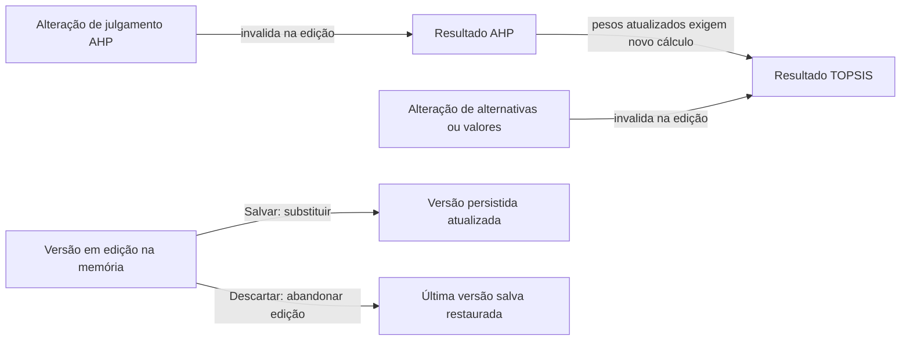

# Modelagem do domínio

**Versão:** 0.5 — Partes 1 e 2 aprovadas em nível conceitual; Parte 3 em andamento.
**Situação:** entidades, atributos e regras conceituais aprovados. Tipos concretos, cardinalidades finais e schema físico continuam para detalhamento.

[Requisitos](../requisitos/README.md) · [Decisões](../decisoes/registro-decisoes.md)

## Objetivo e limites

Esta modelagem traduz os requisitos aprovados em conceitos do domínio, relações e regras de preservação. A organização conceitual da Parte 1 foi aprovada na DEC-036. A Parte 2 está aprovada em nível conceitual; tipos concretos, cardinalidades finais e estrutura Room/Firestore continuam para detalhamento posterior.

As definições oficiais de categorias, critérios e produtos vêm do Firestore (DEC-009). Produtos pessoais, avaliações e resultados permanecem locais (DEC-004). A modelagem precisa preservar a identidade de origem dos produtos (DEC-034), a definição dos critérios e os valores usados em cada avaliação (DEC-017, DEC-033), bem como representar conclusão sem diferenciação (DEC-035).

## Parte 1 — Entidades e responsabilidades (aprovada)

| Entidade | Responsabilidade | Observações |
|---|---|---|
| **Categoria** | Definir o contexto da comparação e agrupar logicamente critérios ordenados e produtos compatíveis. | Uma avaliação escolhe uma categoria fixa (DEC-022). As categorias oficiais vêm do Firestore. A ordem lógica dos critérios deve ser preservada; forma física da associação fica para detalhamento. |
| **Critério** | Definir uma dimensão de comparação, incluindo unidade, natureza de custo/benefício, ordem e regras genéricas de validação. | Metadados de validação fazem parte da definição do critério (DEC-033). |
| **Produto** | Representar um registro reutilizável de catálogo associado a uma categoria. | Tem uma origem: oficial (Firestore) ou pessoal (local). Identidade do registro é origem + ID (DEC-034). |
| **Avaliação** | Ser a entidade central e raiz de agregado: manter consistentes categoria, CritérioPreservado, alternativas, julgamentos, estados e resultados; controlar seu ciclo de vida. | Categoria fixa. É a unidade de salvamento manual. Alterações em memória formam um modelo de edição separado da versão persistida, não uma entidade persistida adicional (DEC-022, DEC-025, DEC-036). |
| **CritérioPreservado** | Guardar a cópia imutável da definição do critério usada por uma avaliação. | Objeto de valor interno da Avaliação, não é a nona entidade. Distingue-se da definição atual do catálogo (DEC-033, DEC-036). |
| **Alternativa da avaliação** | Representar a participação de um produto específico numa avaliação, com identidade histórica de origem e ID e dados de identificação/valores próprios preservados. | Componente da Avaliação. Valores associados a CritérioPreservado. Referência ao produto é histórica, não dependência da existência atual no catálogo (DEC-012, DEC-034, DEC-036). |
| **Julgamento AHP** | Registrar a preferência dada pelo usuário entre um par de critérios preservados no contexto da avaliação. | Componente interno da Avaliação, identificado conceitualmente pelo par de critérios; comparações são recíprocas (DEC-018, DEC-023). |
| **Resultado AHP** | Representar pesos e indicadores calculados a partir dos julgamentos da avaliação. | Objeto de valor pertencente à Avaliação, sem identidade ou ciclo de vida independente. Fica inválido quando os julgamentos correspondentes mudam. |
| **Resultado TOPSIS** | Representar o processamento das alternativas com pesos AHP e critérios da avaliação. | Objeto de valor pertencente à Avaliação, sem identidade ou ciclo de vida independente. Representa ranking definido ou conclusão válida sem diferenciação, sem C*, posição ou vencedor fictício (DEC-024, DEC-035). |

### Distinção importante: Produto e Alternativa da avaliação

**Produto** é o registro atual reutilizável do catálogo. **Alternativa da avaliação** é o componente contextual usado numa comparação específica: mantém a identidade histórica de origem + ID e um snapshot de identificação, sem exigir que o cadastro de origem continue existindo. A própria **Avaliação** preserva cópias imutáveis das definições dos critérios (**CritérioPreservado**) — unidade, natureza, ordem e metadados necessários à validação. Cada alternativa contém valores associados aos critérios preservados, podendo haver valores ausentes enquanto rascunho. Assim, a avaliação não depende de consultas futuras ao catálogo e não repetimos a definição inteira dos critérios para cada produto (DEC-003, DEC-012, DEC-017, DEC-025, DEC-033, DEC-034, DEC-036).

## Organização conceitual proposta

```mermaid
classDiagram
    class Categoria
    class CriterioAtual
    class CriterioPreservado <<objeto de valor>>
    class Produto
    class Avaliacao <<raiz do agregado>>
    class AlternativaAvaliacao <<componente>>
    class ValorAlternativa <<valor por criterio>>
    class JulgamentoAHP <<componente>>
    class ResultadoAHP <<objeto de valor>>
    class ResultadoTOPSIS <<objeto de valor>>
    class EdicaoEmMemoria <<modelo temporario>>

    Categoria "1" --> "1..*" CriterioAtual : organiza em ordem logica
    Categoria "1" --> "0..*" Produto : categoriza
    Avaliacao ..> Categoria : identidade historica obrigatoria, registro atual opcional
    Avaliacao "1" *-- "1..*" CriterioPreservado : snapshot imutavel
    Avaliacao "1" *-- "0..*" AlternativaAvaliacao : seleciona
    AlternativaAvaliacao ..> Produto : identidade historica obrigatoria, registro atual opcional
    AlternativaAvaliacao "1" *-- "0..*" ValorAlternativa : valores podem faltar em rascunho
    ValorAlternativa "0..*" --> "1" CriterioPreservado : associado ao criterio
    Avaliacao "1" *-- "0..*" JulgamentoAHP : julgamentos por par
    JulgamentoAHP "0..*" --> "2" CriterioPreservado : par comparado
    Avaliacao "1" *-- "0..1" ResultadoAHP : calculado
    Avaliacao "1" *-- "0..1" ResultadoTOPSIS : calculado
    EdicaoEmMemoria ..> Avaliacao : deriva sem persistir
```

O diagrama é conceitual. CritérioAtual é a definição vigente associada à Categoria; CritérioPreservado é a cópia usada pela Avaliação. A referência tracejada ao Produto é histórica: a Alternativa continua válida após remoção do registro atual. ValorAlternativa torna explícitos os valores por critério e permite ausência em rascunho. As multiplicidades ilustram relações esperadas e ainda serão conferidas; não prescrevem tabelas ou estrutura física. A edição em memória não é entidade persistida independente.

### DEC-036 aprovada — Organização conceitual do domínio

Adotados os oito conceitos principais, com a Avaliação como raiz de agregado. Alternativas e julgamentos são componentes internos; resultados AHP/TOPSIS são objetos de valor sem identidade independente. A Avaliação preserva definições de critérios como objetos de valor internos chamados CritérioPreservado. Alternativas preservam a identidade histórica de origem + ID e dados de identificação sem depender da disponibilidade do catálogo atual, além de conter valores associados aos critérios preservados. Edição em memória permanece separada da versão persistida. A decisão não exige uma tabela por conceito nem define schema físico.

## Parte 2 — Atributos e regras do domínio (aprovada conceitualmente)

Os itens desta seção são uma proposta de atributos conceituais para revisar. “Obrigatório” descreve a informação necessária à responsabilidade do conceito; campos podem ainda estar ausentes em um rascunho incompleto. Tipos físicos, nomes de colunas, serialização e estrutura Firestore/Room não estão definidos.

### Categoria

| Atributo conceitual | Regra proposta |
|---|---|
| Identidade | Identificador estável na fonte oficial; necessário para associar produtos, critérios e avaliações. |
| Nome | Obrigatório para apresentação. |
| Descrição | Opcional; explica o escopo da categoria. |
| Critérios da categoria | Conjunto lógico ordenado de definições atuais de critério; a ordem deve ser estável para apresentação e associação dos valores. |
| Origem | As categorias oficiais vêm do Firestore; estado de cache/proveniência é informação de consulta, não altera identidade. |

### Critério atual

| Atributo conceitual | Regra proposta |
|---|---|
| Identidade | Estável e única no contexto do catálogo. Ao criar avaliação, as definições relevantes são copiadas para CritérioPreservado; alternativas, valores e julgamentos da avaliação utilizam exclusivamente essas cópias. |
| Nome e descrição | Nome obrigatório; descrição pode ser opcional. |
| Unidade | Obrigatória para valores quantitativos, conforme DEC-017/DEC-033. |
| Natureza | Benefício ou custo; define a direção do ideal TOPSIS. |
| Tipo/domínio | Tipo de valor e regras genéricas de validação, incluindo limites quando definidos e justificados. |
| Ausência | Regra que informa se o valor pode faltar no cadastro e se pode faltar para processar. Rascunhos podem preservar ausência; processamento exige todos os valores requeridos (RF13, RF21). |
| Ordem | Posição lógica dentro da categoria; preservada também no snapshot. |
| Proveniência/revisão | Fonte e versão/data da definição quando disponíveis, para rastreabilidade. Estratégia concreta de versionamento permanece aberta. |

Nas avaliações, alternativas, valores e julgamentos referenciam exclusivamente a cópia imutável CritérioPreservado, nunca a definição atual. Ao iniciar a avaliação, as definições relevantes são copiadas. A identidade estável do critério permite rastreabilidade, mas a avaliação não depende de conseguir reler essa definição no catálogo.

Os domínios numéricos não são fechados nesta proposta. Permanecem válidos os limites previamente aprovados, inclusive câmeras/ADAS de 1 a 10; outros limites dependem de domínio e fonte conforme DEC-033.

### Produto

| Atributo conceitual | Regra proposta |
|---|---|
| Identidade de registro | Par origem + ID (DEC-034): documento Firestore para oficial ou identificador local para pessoal. |
| Categoria | Obrigatória e fixa para o produto pessoal; produto selecionado deve pertencer à categoria da avaliação. |
| Identificação | Nome/modelo e fabricante, com versão/ano quando aplicáveis e conhecidos. Atributos opcionais ausentes não devem ser inventados. |
| Valores de referência | Valores associados às definições atuais de critérios da categoria. Produto oficial pode apresentar informação ausente; isso sinaliza que não está pronto para processamento. Produto pessoal só é cadastrado quando identificação e valores obrigatórios estão preenchidos e válidos, conforme RF06. |
| Referências de dados | Fonte, data de referência e observações quando conhecidas, especialmente para dados oficiais (DEC-016, DEC-017, DEC-020). |

### Avaliação e componentes

| Conceito | Informação conceitual necessária | Regras propostas |
|---|---|---|
| Avaliação | Identidade, título opcional, identidade e rótulo histórico da categoria, estado persistido, critérios preservados ordenados, alternativas, julgamentos AHP, resultados válidos e datas relevantes. | É raiz de agregado. O usuário não precisa fornecer um nome; a identificação exibida na lista pode ser gerada pelo sistema e será detalhada na Parte 3/estados. A referência à categoria é histórica; cópias próprias dos critérios tornam a avaliação independente do catálogo atual. Só estado explicitamente salvo é persistido (DEC-025). A edição corrente em memória não substitui a última versão salva até confirmar salvamento. |
| CritérioPreservado | Identidade de origem do critério e cópia de nome, descrição/unidade, custo-benefício, ordem e metadados de validação necessários. | Imutável no contexto daquela avaliação; evita depender da versão atual do Firestore. É objeto de valor, não entidade independente (DEC-033, DEC-036). |
| Alternativa da avaliação | Identidade histórica origem + ID, identificação do produto copiada e coleção de valores associados a CritérioPreservado. | Referência ao produto atual é opcional/histórica. Pode ter valor pendente em rascunho, por exemplo quando dados oficiais estão ausentes ou durante edição; isso não permite salvar produto pessoal incompleto. Para processar, critérios requeridos devem estar completos e válidos. Ajustes afetam somente a avaliação (DEC-003, DEC-012, DEC-034; RF06, RF13, RF21). |
| Valor da alternativa | CritérioPreservado associado, valor efetivo para cálculo e, quando aplicável, valor de origem para explicar ajustes. | No máximo um valor efetivo por alternativa e CritérioPreservado. Ausência é distinta de zero. O valor efetivo precisa ser finito e obedecer à definição do critério antes do processamento. |
| Julgamento AHP | Par não ordenado de CritérioPreservado e intensidade/sentido de preferência em relação aos dois membros. | No máximo um julgamento independente por par não ordenado; par não respondido pode faltar em rascunho. O recíproco da direção inversa é derivado pela regra AHP, não cadastrado como segundo julgamento independente (DEC-018, DEC-023). |
| Resultado AHP | Pesos associados aos CritérioPreservado, λmax, IC, RI e RC. | Objeto de valor calculado; corresponde aos julgamentos atuais e deixa de ser válido quando eles mudam. |
| Resultado TOPSIS | Estado do processamento, distâncias calculáveis, coeficientes e posições quando definidos. | Estado mínimo distingue ranking definido de sem diferenciação. Não há C*, posição ou vencedor fictício; resultado sem diferenciação continua concluído (DEC-024, DEC-035). Falha matemática não é resultado concluído. |

### Invariantes propostos

- Cada avaliação usa uma única categoria; seus CritérioPreservado correspondem à definição utilizada para aquela categoria.
- Identidades de alternativas são únicas dentro da avaliação pelo par origem + ID; equivalência física entre registros distintos não é inferida.
- Cada valor de alternativa está associado a um CritérioPreservado da própria avaliação; existe no máximo um valor efetivo por par (Alternativa, CritérioPreservado). Valores ausentes são possíveis em rascunhos, mas bloqueiam processamento quando requeridos.
- Julgamentos AHP só se referem a critérios preservados da avaliação; existe no máximo um julgamento independente por par não ordenado de critérios. Sua orientação inversa é obtida por reciprocidade.
- Alterar julgamentos na edição em memória invalida imediatamente o Resultado AHP e o Resultado TOPSIS daquela edição, pois os pesos AHP alimentam o TOPSIS.
- Alterar alternativas selecionadas ou valores efetivos invalida o Resultado TOPSIS na edição em memória. Resultado AHP continua válido se julgamentos e critérios não mudaram.
- Invalidações em memória não alteram a última versão salva. Somente ao salvar as alterações a avaliação persistida substitui dados/resultados anteriores, conforme DEC-025; descartar restaura a versão salva.
- Resultado TOPSIS só é válido para os valores, critérios e pesos atuais. Falha matemática não é conclusão válida; ausência de diferenciação, quando matematicamente válida, é estado concluído (DEC-024, DEC-035).
- Avaliações salvas devem ser consultáveis e exportáveis sem leitura obrigatória do catálogo atual (DEC-032, DEC-036).

### Ausência de valores: catálogo e rascunho

- **Produto oficial:** a fonte pode omitir um valor. O registro continua consultável e sinalizado como incompleto; uma alternativa criada a partir dele pode manter esse valor pendente durante o rascunho.
- **Produto pessoal:** RF06 exige identificação e valores obrigatórios válidos para concluir o cadastro. A possibilidade de salvar rascunho incompleto da avaliação (RF21) não autoriza salvar produto pessoal incompleto.
- **Alternativa em avaliação:** valores podem ficar ausentes ou pendentes enquanto a avaliação está incompleta/em edição. Antes do cálculo, todos os valores exigidos pelo critério devem existir, ser finitos e passar validação (RF13).
- **Zero:** valor numérico zero é distinto de ausência. A aceitação de zero depende do domínio do critério; não se infere a partir da possibilidade de manter um campo vazio (DEC-033).

### Dependências de invalidação propostas



Este fluxo reflete a DEC-025: resultados na edição podem ser invalidados sem tocar imediatamente na última versão persistida. Atualizações do catálogo não modificam os critérios preservados nem invalidam resultados salvos; salvar substitui a versão persistida pela edição, enquanto descartar abandona a edição e restaura a última versão salva.

**Parte 2 — Atributos e Regras do Domínio:** aprovada em nível conceitual. Tipos concretos, cardinalidades finais e esquemas de persistência permanecem para as próximas partes.

## Parte 3 — Relacionamentos e cardinalidades (em andamento)

A Parte 3 detalhará cardinalidades e relações de composição, especialmente como a Avaliação reúne critérios preservados, alternativas, julgamentos e resultados nos estados de rascunho e concluído. O diagrama conceitual acima já diferencia referências históricas obrigatórias da existência opcional dos registros atuais; a tabela de relações será refinada nesta parte.

## Próximas partes

1. DEC-036 aprovada: organização conceitual e três ajustes registrados.
2. Parte 2 aprovada em nível conceitual; tipos concretos e esquemas físicos permanecem em aberto.
3. Definir relacionamentos e cardinalidades (Parte 3 em andamento).
4. Definir estados e transições da avaliação.
5. Mapear conceitos para Firestore, Room e snapshots preservados.

**Rastreabilidade:** RF01–RF27, RNF01–RNF13; DEC-004, DEC-009, DEC-017, DEC-022, DEC-024, DEC-025, DEC-033–DEC-035.
