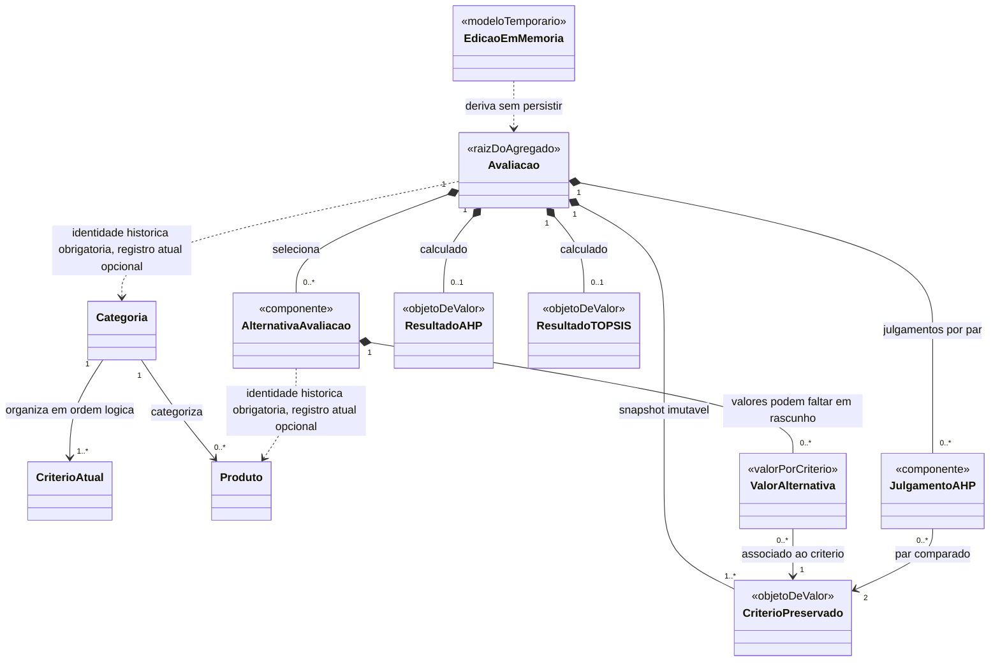
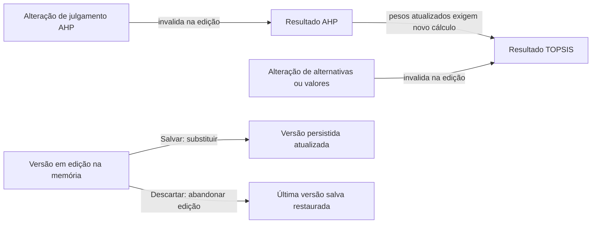
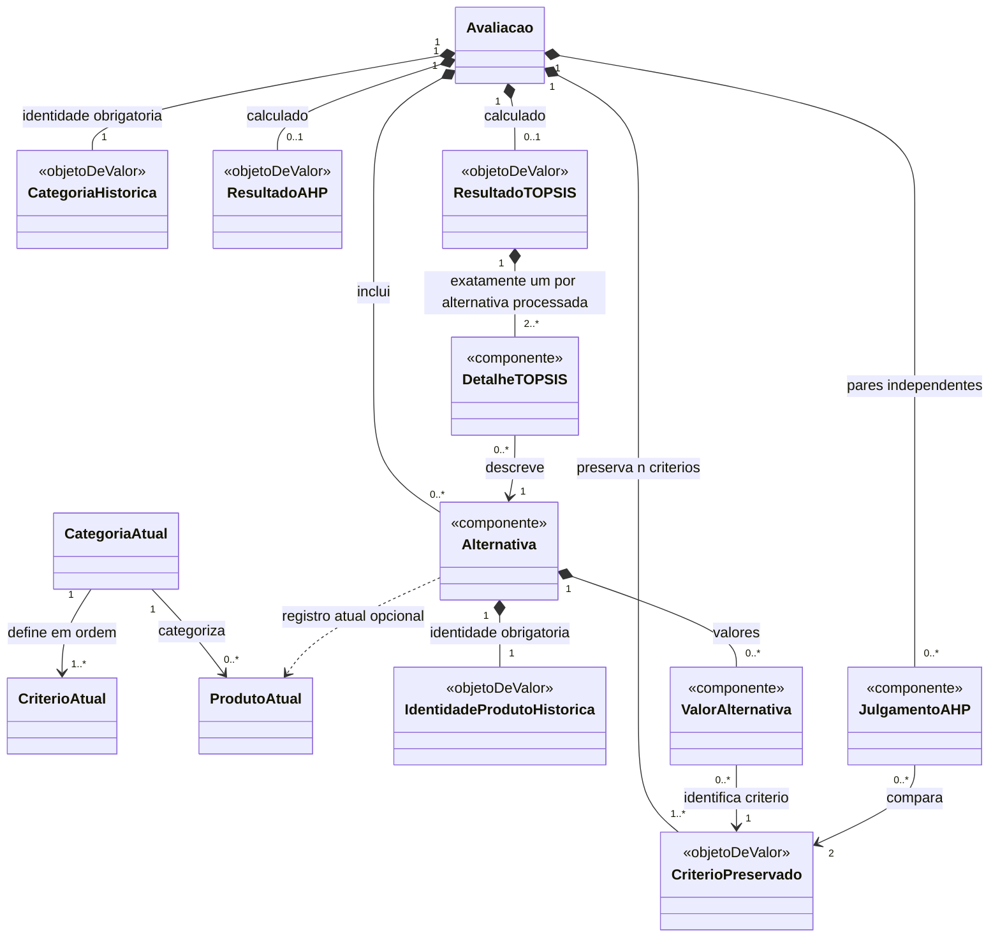
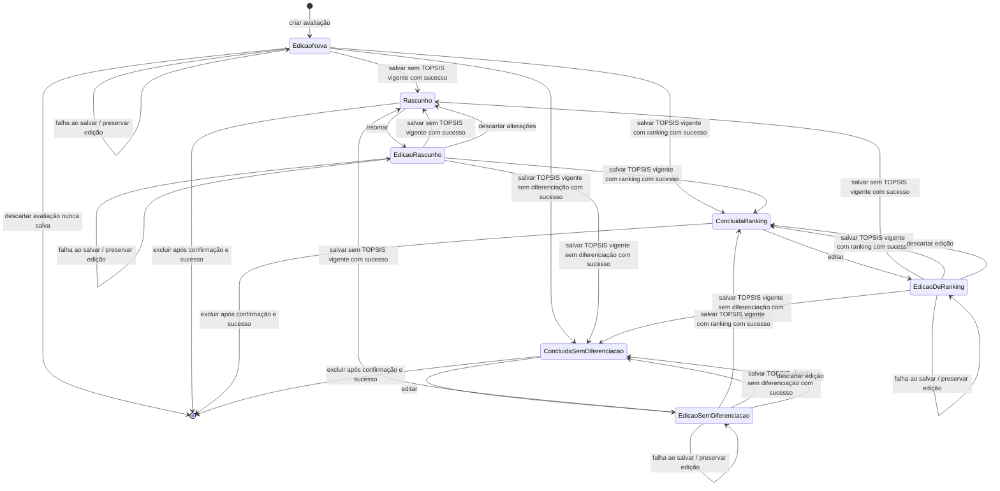
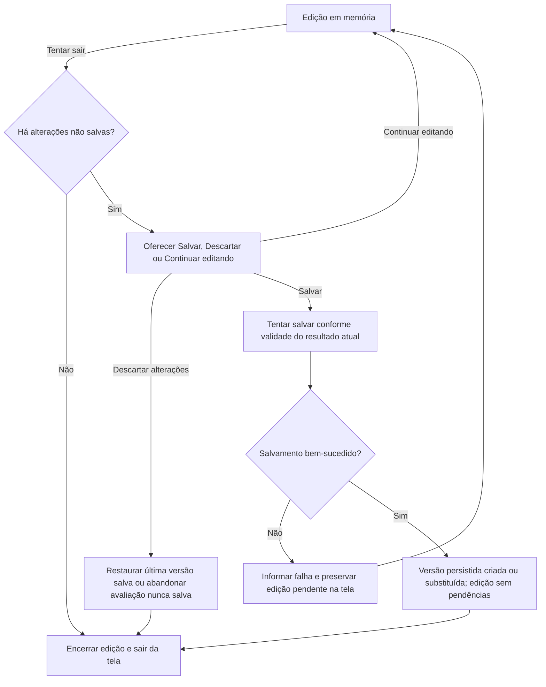

# Modelagem do domínio

**Versão:** 1.1 — Parte 4 aprovada conceitualmente após revisão técnica.
**Situação:** Partes 1–4 aprovadas conceitualmente nos níveis registrados. A Parte 4 foi aprovada após revisão técnica independente em 04/11/2026. A modelagem física permanece para proposta e revisão na Parte 5.

[Requisitos](../requisitos/README.md) · [Decisões](../decisoes/registro-decisoes.md)

## Objetivo e limites

Esta modelagem traduz os requisitos aprovados em conceitos do domínio, relações e regras de preservação. A organização conceitual da Parte 1 foi aprovada na DEC-036. A Parte 2 está aprovada em nível conceitual; tipos concretos, cardinalidades finais e estrutura Room/Firestore continuam para detalhamento posterior.

As definições oficiais de categorias, critérios e produtos vêm do Firestore (DEC-009). Produtos pessoais, avaliações e resultados permanecem locais (DEC-004). A modelagem precisa preservar a identidade de origem dos produtos (DEC-034), a definição dos critérios e os valores usados em cada avaliação (DEC-017, DEC-033), bem como representar conclusão sem diferenciação (DEC-035).

## Parte 1 — Entidades e responsabilidades (aprovada)

| Entidade | Responsabilidade | Observações |
|---|---|---|
| **Categoria** | Definir o contexto da comparação e agrupar logicamente critérios ordenados e produtos compatíveis. | Uma avaliação escolhe uma categoria fixa (DEC-022). As categorias oficiais vêm do Firestore. A ordem lógica dos critérios deve ser preservada; forma física da associação fica para detalhamento. |
| **Critério** | Definir uma dimensão de comparação, incluindo unidade, natureza de custo/benefício, ordem e regras genéricas de validação. | Metadados de validação fazem parte da definição do critério (DEC-033). |
| **Produto** | Representar um registro reutilizável de catálogo associado a uma categoria. | Tem uma origem: oficial (Firestore) ou pessoal (local). Identidade do registro é origem + ID (DEC-034). |
| **Avaliação** | Ser a entidade central e raiz de agregado: manter consistentes categoria, CritérioPreservado, alternativas, julgamentos, estados e resultados; controlar seu ciclo de vida. | Categoria fixa. É a unidade de salvamento manual. Alterações em memória formam um modelo de edição separado da versão persistida, não uma entidade persistida adicional (DEC-022, DEC-025, DEC-036). |
| **CritérioPreservado** | Guardar a cópia imutável da definição do critério usada por uma avaliação. | Objeto de valor interno da Avaliação, não é a nona entidade. Distingue-se da definição atual do catálogo (DEC-033, DEC-036). |
| **Alternativa da avaliação** | Representar a participação de um produto específico numa avaliação, com identidade histórica de origem e ID e dados de identificação/valores próprios preservados. | Componente da Avaliação. Valores associados a CritérioPreservado. Referência ao produto é histórica, não dependência da existência atual no catálogo (DEC-012, DEC-034, DEC-036). |
| **Julgamento AHP** | Registrar a preferência dada pelo usuário entre um par de critérios preservados no contexto da avaliação. | Componente interno da Avaliação, identificado conceitualmente pelo par de critérios; comparações são recíprocas (DEC-018, DEC-023). |
| **Resultado AHP** | Representar pesos e indicadores calculados a partir dos julgamentos da avaliação. | Objeto de valor pertencente à Avaliação, sem identidade ou ciclo de vida independente. Fica inválido quando os julgamentos correspondentes mudam. |
| **Resultado TOPSIS** | Representar o processamento das alternativas com pesos AHP e critérios da avaliação. | Objeto de valor pertencente à Avaliação, sem identidade ou ciclo de vida independente. Representa ranking definido ou conclusão válida sem diferenciação, sem C*, posição ou vencedor fictício (DEC-024, DEC-035). |

### Distinção importante: Produto e Alternativa da avaliação

**Produto** é o registro atual reutilizável do catálogo. **Alternativa da avaliação** é o componente contextual usado numa comparação específica: mantém a identidade histórica de origem + ID e um snapshot de identificação, sem exigir que o cadastro de origem continue existindo. A própria **Avaliação** preserva cópias imutáveis das definições dos critérios (**CritérioPreservado**) — unidade, natureza, ordem e metadados necessários à validação. Cada alternativa contém valores associados aos critérios preservados, podendo haver valores ausentes enquanto rascunho. Assim, a avaliação não depende de consultas futuras ao catálogo e não repetimos a definição inteira dos critérios para cada produto (DEC-003, DEC-012, DEC-017, DEC-025, DEC-033, DEC-034, DEC-036).

## Organização conceitual proposta

O diagrama é conceitual. CritérioAtual é a definição vigente associada à Categoria; CritérioPreservado é a cópia usada pela Avaliação. A referência tracejada ao Produto é histórica: a Alternativa continua válida após remoção do registro atual. ValorAlternativa torna explícitos os valores por critério e permite ausência em rascunho. As multiplicidades ilustram relações esperadas e ainda serão conferidas; não prescrevem tabelas ou estrutura física. A edição em memória não é entidade persistida independente.

### DEC-036 aprovada — Organização conceitual do domínio

Adotados os oito conceitos principais, com a Avaliação como raiz de agregado. Alternativas e julgamentos são componentes internos; resultados AHP/TOPSIS são objetos de valor sem identidade independente. A Avaliação preserva definições de critérios como objetos de valor internos chamados CritérioPreservado. Alternativas preservam a identidade histórica de origem + ID e dados de identificação sem depender da disponibilidade do catálogo atual, além de conter valores associados aos critérios preservados. Edição em memória permanece separada da versão persistida. A decisão não exige uma tabela por conceito nem define schema físico.

## Parte 2 — Atributos e regras do domínio (aprovada conceitualmente)

Os itens desta seção são uma proposta de atributos conceituais para revisar. “Obrigatório” descreve a informação necessária à responsabilidade do conceito; campos podem ainda estar ausentes em um rascunho incompleto. Tipos físicos, nomes de colunas, serialização e estrutura Firestore/Room não estão definidos.

### Categoria

| Atributo conceitual | Regra proposta |
|---|---|
| Identidade | Identificador estável na fonte oficial; necessário para associar produtos, critérios e avaliações. |
| Nome | Obrigatório para apresentação. |
| Descrição | Opcional; explica o escopo da categoria. |
| Critérios da categoria | Conjunto lógico ordenado de definições atuais de critério; a ordem deve ser estável para apresentação e associação dos valores. |
| Origem | As categorias oficiais vêm do Firestore; estado de cache/proveniência é informação de consulta, não altera identidade. |

### Critério atual

| Atributo conceitual | Regra proposta |
|---|---|
| Identidade | Estável e única no contexto do catálogo. Ao criar avaliação, as definições relevantes são copiadas para CritérioPreservado; alternativas, valores e julgamentos da avaliação utilizam exclusivamente essas cópias. |
| Nome e descrição | Nome obrigatório; descrição pode ser opcional. |
| Unidade | Obrigatória para valores quantitativos, conforme DEC-017/DEC-033. |
| Natureza | Benefício ou custo; define a direção do ideal TOPSIS. |
| Tipo/domínio | Tipo de valor e regras genéricas de validação, incluindo limites quando definidos e justificados. |
| Ausência | Regra que informa se o valor pode faltar no cadastro e se pode faltar para processar. Rascunhos podem preservar ausência; processamento exige todos os valores requeridos (RF13, RF21). |
| Ordem | Posição lógica dentro da categoria; preservada também no snapshot. |
| Proveniência/revisão | Fonte e versão/data da definição quando disponíveis, para rastreabilidade. Estratégia concreta de versionamento permanece aberta. |

Nas avaliações, alternativas, valores e julgamentos referenciam exclusivamente a cópia imutável CritérioPreservado, nunca a definição atual. Ao iniciar a avaliação, as definições relevantes são copiadas. A identidade estável do critério permite rastreabilidade, mas a avaliação não depende de conseguir reler essa definição no catálogo.

Os domínios numéricos não são fechados nesta proposta. Permanecem válidos os limites previamente aprovados, inclusive câmeras/ADAS de 1 a 10; outros limites dependem de domínio e fonte conforme DEC-033.

### Produto

| Atributo conceitual | Regra proposta |
|---|---|
| Identidade de registro | Par origem + ID (DEC-034): documento Firestore para oficial ou identificador local para pessoal. |
| Categoria | Obrigatória e fixa para o produto pessoal; produto selecionado deve pertencer à categoria da avaliação. |
| Identificação | Nome/modelo e fabricante, com versão/ano quando aplicáveis e conhecidos. Atributos opcionais ausentes não devem ser inventados. |
| Valores de referência | Valores associados às definições atuais de critérios da categoria. Produto oficial pode apresentar informação ausente; isso sinaliza que não está pronto para processamento. Produto pessoal só é cadastrado quando identificação e valores obrigatórios estão preenchidos e válidos, conforme RF06. |
| Referências de dados | Fonte, data de referência e observações quando conhecidas, especialmente para dados oficiais (DEC-016, DEC-017, DEC-020). |

### Avaliação e componentes

| Conceito | Informação conceitual necessária | Regras propostas |
|---|---|---|
| Avaliação | Identidade, título opcional, identidade e rótulo histórico da categoria, estado persistido, critérios preservados ordenados, alternativas, julgamentos AHP, resultados válidos e datas relevantes. | É raiz de agregado. O usuário não precisa fornecer um nome; a identificação exibida na lista pode ser gerada pelo sistema e será detalhada na Parte 3/estados. A referência à categoria é histórica; cópias próprias dos critérios tornam a avaliação independente do catálogo atual. Só estado explicitamente salvo é persistido (DEC-025). A edição corrente em memória não substitui a última versão salva até confirmar salvamento. |
| CritérioPreservado | Identidade de origem do critério e cópia de nome, descrição/unidade, custo-benefício, ordem e metadados de validação necessários. | Imutável no contexto daquela avaliação; evita depender da versão atual do Firestore. É objeto de valor, não entidade independente (DEC-033, DEC-036). |
| Alternativa da avaliação | Identidade histórica origem + ID, identificação do produto copiada e coleção de valores associados a CritérioPreservado. | Referência ao produto atual é opcional/histórica. Pode ter valor pendente em rascunho, por exemplo quando dados oficiais estão ausentes ou durante edição; isso não permite salvar produto pessoal incompleto. Para processar, critérios requeridos devem estar completos e válidos. Ajustes afetam somente a avaliação (DEC-003, DEC-012, DEC-034; RF06, RF13, RF21). |
| Valor da alternativa | CritérioPreservado associado, valor efetivo para cálculo e, quando aplicável, valor de origem para explicar ajustes. | No máximo um valor efetivo por alternativa e CritérioPreservado. Ausência é distinta de zero. O valor efetivo precisa ser finito e obedecer à definição do critério antes do processamento. |
| Julgamento AHP | Par não ordenado de CritérioPreservado e intensidade/sentido de preferência em relação aos dois membros. | No máximo um julgamento independente por par não ordenado; par não respondido pode faltar em rascunho. O recíproco da direção inversa é derivado pela regra AHP, não cadastrado como segundo julgamento independente (DEC-018, DEC-023). |
| Resultado AHP | Pesos associados aos CritérioPreservado, λmax, IC, RI e RC. | Objeto de valor calculado; corresponde aos julgamentos atuais e deixa de ser válido quando eles mudam. |
| Resultado TOPSIS | Estado do processamento, distâncias calculáveis, coeficientes e posições quando definidos. | Estado mínimo distingue ranking definido de sem diferenciação. Não há C*, posição ou vencedor fictício; resultado sem diferenciação continua concluído (DEC-024, DEC-035). Falha matemática não é resultado concluído. |

### Invariantes propostos

- Cada avaliação usa uma única categoria; seus CritérioPreservado correspondem à definição utilizada para aquela categoria.
- Identidades de alternativas são únicas dentro da avaliação pelo par origem + ID; equivalência física entre registros distintos não é inferida.
- Cada valor de alternativa está associado a um CritérioPreservado da própria avaliação; existe no máximo um valor efetivo por par (Alternativa, CritérioPreservado). Valores ausentes são possíveis em rascunhos, mas bloqueiam processamento quando requeridos.
- Julgamentos AHP só se referem a critérios preservados da avaliação; existe no máximo um julgamento independente por par não ordenado de critérios. Sua orientação inversa é obtida por reciprocidade.
- Alterar julgamentos na edição em memória invalida imediatamente o Resultado AHP e o Resultado TOPSIS daquela edição, pois os pesos AHP alimentam o TOPSIS.
- Alterar alternativas selecionadas ou valores efetivos invalida o Resultado TOPSIS na edição em memória. Resultado AHP continua válido se julgamentos e critérios não mudaram.
- Invalidações em memória não alteram a última versão salva. Somente ao salvar as alterações a avaliação persistida substitui dados/resultados anteriores, conforme DEC-025; descartar restaura a versão salva.
- Resultado TOPSIS só é válido para os valores, critérios e pesos atuais. Falha matemática não é conclusão válida; ausência de diferenciação, quando matematicamente válida, é estado concluído (DEC-024, DEC-035).
- Avaliações salvas devem ser consultáveis e exportáveis sem leitura obrigatória do catálogo atual (DEC-032, DEC-036).

### Ausência de valores: catálogo e rascunho

- **Produto oficial:** a fonte pode omitir um valor. O registro continua consultável e sinalizado como incompleto; uma alternativa criada a partir dele pode manter esse valor pendente durante o rascunho.
- **Produto pessoal:** RF06 exige identificação e valores obrigatórios válidos para concluir o cadastro. A possibilidade de salvar rascunho incompleto da avaliação (RF21) não autoriza salvar produto pessoal incompleto.
- **Alternativa em avaliação:** valores podem ficar ausentes ou pendentes enquanto a avaliação está incompleta/em edição. Antes do cálculo, todos os valores exigidos pelo critério devem existir, ser finitos e passar validação (RF13).
- **Zero:** valor numérico zero é distinto de ausência. A aceitação de zero depende do domínio do critério; não se infere a partir da possibilidade de manter um campo vazio (DEC-033).

### Dependências de invalidação propostas

Este fluxo reflete a DEC-025: resultados na edição podem ser invalidados sem tocar imediatamente na última versão persistida. Atualizações do catálogo não modificam os critérios preservados nem invalidam resultados salvos; salvar substitui a versão persistida pela edição, enquanto descartar abandona a edição e restaura a última versão salva.

**Parte 2 — Atributos e Regras do Domínio:** aprovada em nível conceitual. Tipos concretos, cardinalidades finais e esquemas de persistência permanecem para as próximas partes.

## Parte 3 — Relacionamentos e cardinalidades

As cardinalidades abaixo descrevem o domínio, não foreign keys, tabelas ou documentos. Uma relação histórica obrigatória guarda a identidade necessária para interpretar o dado; ela não exige que o registro atual do catálogo ainda exista. `n` é o número de critérios preservados da categoria; as duas categorias iniciais têm exatamente cinco critérios. A modelagem permite `n` variável em categorias futuras, condicionado à validação do suporte matemático dos métodos, do RI aplicável e dos casos especiais. Sem regra matemática adequada, o processamento não é habilitado (DEC-037).

### Relações entre catálogo e avaliação

| Relação | Cardinalidade proposta | Regra e preservação |
|---|---|---|
| Categoria atual — Critério atual | Uma Categoria possui `n` critérios ordenados; cada Critério atual pertence logicamente a uma única categoria. | As duas categorias iniciais têm exatamente cinco critérios. Categorias futuras podem ter `n` variável, condicionado à validação dos métodos AHP/TOPSIS, do RI aplicável e dos casos especiais; sem suporte matemático adequado, o processamento é bloqueado. Critérios semelhantes ou homônimos em categorias diferentes têm definições e identidades próprias. A associação lógica não determina estrutura física no Firestore (DEC-037). |
| Categoria atual — Produto atual | Uma Categoria possui zero ou mais produtos; cada Produto atual pertence a uma categoria. | Aplica-se a produtos oficiais e pessoais; categoria de produto pessoal é fixa (DEC-021). |
| Avaliação — categoria histórica | Cada Avaliação guarda exatamente uma identidade e um rótulo histórico de Categoria; o registro atual correspondente pode existir ou não. | A identidade histórica é obrigatória; existência atual do objeto Categoria é opcional. A avaliação pode ser lida offline e após remoção/renomeação no catálogo. |
| Avaliação — CritérioPreservado | Uma Avaliação preserva exatamente `n` critérios para a categoria selecionada; cada CritérioPreservado pertence a uma única Avaliação. | Composição: os snapshots pertencem ao ciclo de vida da avaliação. Uma atualização posterior do catálogo não os substitui. |
| Avaliação — Alternativa | Uma Avaliação em rascunho pode ter zero ou mais alternativas; concluída requer pelo menos duas. Cada Alternativa pertence a exatamente uma Avaliação. | Duplicidade é verificada por origem + ID dentro da avaliação (DEC-034). Conclusão exige dados suficientes para processar. |
| Alternativa — Produto atual | Cada Alternativa guarda exatamente uma identidade histórica origem + ID; pode haver zero ou um registro atual correspondente. | A referência histórica é obrigatória; presença atual do Produto é opcional. Remoção do produto não apaga nem invalida a Alternativa salva (DEC-012, DEC-034, DEC-036). |
| Alternativa — ValorAlternativa | Em rascunho, uma Alternativa pode ter de zero a `n` valores efetivos; para processar, cada alternativa das duas categorias iniciais tem exatamente `n = 5` valores válidos, um para cada CritérioPreservado. | No máximo um valor efetivo por par Alternativa–CritérioPreservado. Valores ausentes são permitidos no rascunho, mas os cinco critérios iniciais são obrigatórios para processamento. Se categorias futuras admitirem critérios opcionais, suas condições de completude devem ser definidas e validadas antes da habilitação. |
| ValorAlternativa — CritérioPreservado | Cada ValorAlternativa aponta para exatamente um CritérioPreservado; cada CritérioPreservado pode ter zero ou um valor em cada Alternativa. | Associação feita dentro da mesma Avaliação; não aponta para a definição atual do catálogo. |

### Relações AHP e TOPSIS

| Relação | Cardinalidade proposta | Regra e preservação |
|---|---|---|
| Avaliação — Julgamento AHP | Rascunho: zero a `n(n−1)/2`; AHP completo: exatamente `n(n−1)/2`. Cada julgamento pertence a uma Avaliação. | Cada julgamento liga um par de critérios distintos preservados. Existe no máximo um julgamento independente por par não ordenado. Para cinco critérios, são dez pares; recíprocos são derivados. |
| Julgamento AHP — CritérioPreservado | Cada julgamento relaciona exatamente dois critérios distintos da mesma Avaliação. | Ambos os critérios devem estar entre os snapshots da avaliação. |
| Avaliação — Resultado AHP vigente | Zero ou um resultado calculado correspondente aos julgamentos atuais. | Rascunho pode preservar pesos e indicadores calculados com `RC > 0,10`, identificados como diagnóstico inconsistente; isso não aprova consistência nem autoriza TOPSIS. TOPSIS exige julgamentos completos, pesos/indicadores vigentes e `RC ≤ 0,10`. Alterar julgamentos invalida os indicadores anteriores na edição. O salvamento é manual e mantém intacta a versão persistida até confirmação explícita (DEC-025, DEC-037). |
| Avaliação — Resultado TOPSIS vigente | Zero ou um resultado que corresponde aos dados, critérios e pesos atuais. Avaliação concluída possui exatamente um resultado TOPSIS válido. | O resultado anterior da versão persistida não é resultado vigente da edição após alteração relevante. Ele permanece somente na versão salva intacta até salvar ou descartar. Salvar edição incompleta como rascunho persiste zero resultados TOPSIS vigentes; descartar restaura a avaliação salva com seu resultado. Falha matemática nunca é resultado concluído (DEC-024, DEC-025, DEC-035). |
| Resultado TOPSIS — detalhe por Alternativa | Um resultado TOPSIS concluído contém exatamente um detalhe para cada alternativa processada, sem duplicação de alternativa dentro do mesmo resultado. | Um único detalhe representa cada alternativa. Ranking definido inclui C* válido para cada alternativa; empates continuam com C* válido e compartilham posição conforme DEC-027/028. Na ausência de diferenciação, C* é matematicamente indefinido: detalhes não incluem C*, posição ou vencedor fictício (DEC-024, DEC-035). |

### Cardinalidades por estado

| Situação da Avaliação | Alternativas | Valores por alternativa | Julgamentos AHP | Resultado AHP | Resultado TOPSIS |
|---|---:|---|---:|---|---|
| Edição nova ou rascunho incompleto persistido | 0..* | 0..`n`; ausências permitidas | 0..`n(n−1)/2` | 0..1; pode faltar ou apresentar `RC > 0,10` | 0 resultado TOPSIS vigente |
| Edição de concluída sem mudança relevante nos dados de cálculo | 2..* | exatamente `n` válidos por alternativa | completa | 1 calculado e consistente | 1 vigente e ainda válido |
| Edição de concluída após mudança relevante, antes de salvar | 0..* na edição | 0..`n`; pode estar incompleta | 0..`n(n−1)/2` | permanece válido se só alternativas/valores mudaram; ausente/inválido se julgamentos mudaram | 0 vigente após alteração relevante; o resultado antigo fica apenas na versão persistida intacta |
| Rascunho salvo após edição incompleta de avaliação concluída | 0..* | 0..`n`; ausências permitidas | 0..`n(n−1)/2` | 0..1, inclusive com `RC > 0,10` | 0; resultado TOPSIS invalidado não é salvo como vigente |
| Pronta para processar | 2..* | Categorias iniciais: exatamente 5 valores válidos por alternativa; categorias futuras: conforme completude definida e validada | exatamente `n(n−1)/2` | 1 válido e consistente | ainda 0 antes do cálculo |
| Concluída com ranking | 2..* | Categorias iniciais: exatamente 5 valores válidos por alternativa; categorias futuras: conforme completude definida e validada | completa | 1 válido e consistente | exatamente 1, ranking definido |
| Concluída — sem diferenciação | 2..* | Categorias iniciais: exatamente 5 valores válidos por alternativa; categorias futuras: conforme completude definida e validada | completa | 1 válido e consistente | exatamente 1, resultado válido com detalhe único por alternativa, sem C*/posição/vencedor |

Estas cardinalidades distinguem a edição em memória da versão persistida. Após alteração que afete alternativas, valores ou pesos, o resultado TOPSIS anterior deixa de ser vigente na edição. A versão persistida continua completa e intacta até a ação de salvar ou descartar. Descartar abandona a edição e restaura a versão salva com seu resultado; salvar a configuração incompleta como rascunho substitui a versão persistida e não pode carregar o resultado TOPSIS invalidado como se fosse válido para os novos dados (DEC-025/RF24).

### Diagrama relacional conceitual

As identidades históricas de Categoria e Produto são obrigatórias dentro de Avaliação e Alternativa; as associações tracejadas aos registros atuais são opcionais. Para cada alternativa, pode existir no máximo um ValorAlternativa por CritérioPreservado. Um Resultado TOPSIS vigente e concluído tem exatamente um detalhe por alternativa processada, com unicidade por (resultado, alternativa); em rascunho sem resultado vigente, não há detalhes TOPSIS. O diagrama não expressa todas as variações condicionadas por estado; a tabela anterior é a referência para rascunhos e conclusões.

### Consolidação da Parte 3

As cardinalidades e regras conceituais desta Parte 3 incorporam a DEC-037: as categorias iniciais têm cinco critérios, o modelo admite `n` variável em categorias futuras condicionado ao suporte matemático, cada definição atual de critério pertence a uma única categoria e rascunhos podem preservar resultados AHP inconsistentes como diagnóstico sem habilitar TOPSIS. CritérioPreservado permanece exclusivo da Avaliação que o copiou.

Um Resultado TOPSIS concluído tem exatamente um detalhe por alternativa processada, sem duplicação. Empates mantêm coeficientes `C*` válidos e posições compartilhadas; na ausência de diferenciação, `C*` é matematicamente indefinido e não há posição ou vencedor fictício (DEC-024, DEC-027, DEC-028, DEC-035).

**Status:** aprovada conceitualmente após revisão técnica final. A aprovação não define schema físico nem decisões de persistência Room/Firestore, que permanecem fora do escopo desta parte.

## Próximas partes

1. DEC-036 aprovada: organização conceitual e três ajustes registrados.
2. Parte 2 aprovada em nível conceitual; tipos concretos e esquemas físicos permanecem em aberto.
3. Parte 3 aprovada conceitualmente após revisão técnica final; schema físico permanece para detalhamento posterior.
4. Parte 4 aprovada conceitualmente após revisão técnica; detalha comportamentos já aprovados, sem nova DEC.
5. Mapear conceitos para Firestore, Room e snapshots preservados.

**Rastreabilidade:** RF01–RF27, RNF01–RNF13; DEC-004, DEC-009, DEC-017, DEC-022, DEC-024, DEC-025, DEC-033–DEC-037.

## Parte 4 — Estados e transições da avaliação (aprovada conceitualmente)

Esta parte descreve o ciclo de vida conceitual da avaliação. Separa a situação da última versão persistida, a edição em memória e a validade dos resultados. Organiza requisitos e decisões já aprovados; não define campos, tabelas, documentos ou implementação. **Status: Aprovada conceitualmente após revisão técnica independente, conforme aprovação do usuário em 04/11/2026.**

### Dimensões de estado

| Dimensão | Estados conceituais | Significado |
|---|---|---|
| Versão persistida | **Rascunho**; **Concluída com ranking**; **Concluída — sem diferenciação** | Situação da última gravação manual bem-sucedida. Antes do primeiro salvamento não existe versão persistida; essa ausência não é um quarto estado armazenado. A lista apresenta a versão salva (RF21, RF22; DEC-025, DEC-035). |
| Edição em memória | **Sem alterações não salvas**; **Com alterações não salvas** | Indica se o conteúdo a salvar difere da última versão persistida, incluindo entradas e resultados calculados. Uma avaliação nova ainda não salva possui edição pendente e nenhuma versão persistida. A edição não é entidade persistida adicional (DEC-025, DEC-036). |
| AHP na edição | **Ausente**; **Desatualizado**; **Calculado consistente**; **Calculado inconsistente** | Ausente significa que não há resultado calculado disponível; julgamentos incompletos impedem calculá-lo. Desatualizado significa que um resultado anterior não corresponde aos julgamentos atuais. Um cálculo vigente com RC acima de 0,10 é diagnóstico inconsistente, pode ser salvo em rascunho e não libera TOPSIS (DEC-023, DEC-037). |
| TOPSIS na edição | **Ausente**; **Desatualizado**; **Válido com ranking**; **Válido sem diferenciação** | Ausente significa que não há resultado disponível. Desatualizado significa que o resultado anterior não corresponde às entradas atuais. Só os dois resultados válidos podem fundamentar conclusão. Ausência de diferenciação não é falha matemática (DEC-024, DEC-035). |

As dimensões se combinam e não formam um único estado enumerado. Uma avaliação salva como concluída pode estar aberta com edição pendente e TOPSIS desatualizado; a versão persistida permanece concluída até um salvamento bem-sucedido ou uma exclusão confirmada bem-sucedida. Não existe histórico de versões.

**Resultados também são conteúdo sujeito a salvamento:** calcular AHP ou TOPSIS pode produzir alterações não salvas mesmo sem mudar produtos, valores ou julgamentos. Por exemplo, um rascunho salvo com entradas completas pode ganhar seu primeiro resultado TOPSIS somente na edição. Essa edição permanece pendente até salvar; sair deve aplicar o aviso da DEC-025. Recalcular um resultado inteiramente igual ao já salvo não implica, por si só, diferença de conteúdo.

**Ausência, desatualização e falha são conceitos distintos:** ausência descreve a falta de resultado; desatualização descreve a falta de correspondência de um resultado anterior; falha descreve uma tentativa de cálculo que não produziu um novo resultado utilizável. Uma falha deve ser informada na edição, sem criar estado persistido “Falha” nem resultado fictício. Não substitui resultado anterior por dados parciais nem o torna vigente: qualquer resultado anterior só pode ser utilizado se ainda corresponder integralmente às entradas atuais. A tentativa que falhou nunca fundamenta conclusão. RC > 0,10 calculado corretamente é diagnóstico de inconsistência, não falha de execução do AHP (DEC-037).

### Transições da avaliação

Nas linhas de salvamento abaixo, o efeito persistido só ocorre após sucesso da operação explícita. Até esse momento, a edição e a versão anterior permanecem separadas.

| Evento | Estado anterior | Efeito na edição em memória | Efeito na versão persistida |
|---|---|---|---|
| Criar avaliação e escolher categoria | Não existe avaliação | Inicia edição pendente, com categoria fixa e dados possivelmente incompletos. | Nenhum; não cria rascunho automaticamente. |
| Retomar rascunho ou abrir concluída para edição | Qualquer uma das três situações persistidas | Carrega a última versão salva sem marcar mudança apenas por abrir; preserva os resultados disponíveis. | Nenhum (RF23, RF24; DEC-025, DEC-036). |
| Alterar alternativa ou valor | Qualquer edição aberta | Marca alterações não salvas e desatualiza TOPSIS. AHP continua vigente se julgamentos e critérios não mudaram. | Nenhum. |
| Alterar julgamento AHP | Qualquer edição aberta | Marca alterações não salvas e desatualiza AHP e TOPSIS anteriores. | Nenhum. |
| Calcular AHP com sucesso | Julgamentos completos e matematicamente válidos para cálculo | Produz diagnóstico atual consistente ou inconsistente; conteúdo novo/diferente do salvo fica pendente. RC > 0,10 não libera TOPSIS. | Nenhum; cálculo isolado não salva (DEC-025, DEC-037). |
| Processar TOPSIS com sucesso | Edição nova ou existente; entradas completas e válidas, AHP vigente e RC ≤ 0,10 | Produz resultado atual com ranking ou sem diferenciação. Resultado novo/diferente do salvo é alteração pendente, mesmo sem mudança nas entradas. | Nenhum; não exige rascunho previamente salvo (DEC-025, DEC-035). |
| Bloqueio de pré-condições ou falha de cálculo | Qualquer tentativa de AHP/TOPSIS | Informa a causa e preserva a edição; não publica resultado parcial como válido. Ausência e desatualização de resultados permanecem distinguíveis da falha. | Nenhum; a tentativa falha não cria conclusão. |
| Salvar como rascunho | Edição nova ou existente sem TOPSIS vigente, ainda que incompleta | Após sucesso, corresponde ao rascunho salvo e fica sem alterações pendentes. AHP vigente inconsistente pode ser preservado como diagnóstico. | Cria ou substitui **Rascunho**; remove/invalida o resultado concluído anterior na mesma operação quando aplicável (RF21, RF24; DEC-025, DEC-037). |
| Salvar processamento válido com ranking | Edição nova nunca salva, de rascunho ou de concluída, com TOPSIS vigente com ranking | Após sucesso, corresponde à versão salva e fica sem alterações pendentes. | Cria diretamente ou substitui **Concluída com ranking**; não requer salvamento anterior como rascunho (RF25; DEC-025). |
| Salvar processamento válido sem diferenciação | Edição nova nunca salva, de rascunho ou de concluída, com TOPSIS vigente sem diferenciação | Após sucesso, corresponde à versão salva e fica sem alterações pendentes. | Cria diretamente ou substitui **Concluída — sem diferenciação**, sem coeficiente, posição ou vencedor fictício; não requer rascunho anterior (DEC-025, DEC-035). |
| Tentar sair com alterações não salvas | Qualquer edição pendente, inclusive apenas por resultados recém-calculados | Mantém a edição e oferece **Salvar**, **Descartar alterações** ou **Continuar editando**. | Nenhum ao apresentar o aviso (DEC-025). |
| Escolher Salvar no aviso de saída | Aviso aberto com edição pendente | Tenta o salvamento correspondente ao conteúdo: rascunho sem TOPSIS vigente ou conclusão conforme o resultado vigente. Só sai após sucesso; em falha, permanece com a edição na tela. | Cria/substitui somente após sucesso, conforme as três linhas de salvamento. |
| Escolher Descartar alterações | Edição pendente ou aviso de saída | Abandona as mudanças e restaura a última versão salva; se nunca houve salvamento, abandona a nova avaliação. No aviso de saída, depois disso encerra a edição. | Preserva a versão salva; nenhuma é criada para avaliação nunca salva (DEC-025). |
| Escolher Continuar editando | Aviso de saída aberto | Fecha o aviso, mantém a edição e suas alterações pendentes na tela. | Nenhum. |
| Sair sem alterações não salvas | Edição equivalente à última versão salva | Encerra a edição sem aviso de mudanças pendentes. | Nenhum. |
| Falha ao salvar, inclusive durante saída | Qualquer tentativa de salvamento | Informa falha, preserva a edição e suas alterações pendentes e não abandona a tela. Não informa sucesso nem descarta automaticamente. | Preserva íntegra a versão anterior; se nunca houve salvamento, continua sem versão persistida (DEC-025, RNF05). |
| Excluir avaliação e confirmar | Rascunho ou concluída persistida | Após sucesso da exclusão, encerra a avaliação removida. | Operação distinta de salvar: remove avaliação e dados/resultados associados conjuntamente; preserva catálogos (DEC-019, RNF05). |
| Cancelar exclusão ou falhar ao excluir | Solicitação de exclusão de avaliação persistida | Cancelamento mantém a avaliação; falha é informada sem declarar exclusão bem-sucedida. | Preserva integralmente a versão salva; não há exclusão parcial (RNF05). |

### Invariantes de estado

- A categoria escolhida permanece fixa durante a vida da avaliação (DEC-022).
- Criar ou substituir a versão persistida exige **salvamento explícito bem-sucedido**. Cálculos e alterações em memória não gravam automaticamente; falha de gravação não cria nem substitui a versão salva (DEC-025, RNF05).
- A **exclusão confirmada** é operação distinta do salvamento: após sucesso, remove atomicamente a avaliação e seus dados/resultados, sem remover produtos dos catálogos. Cancelamento ou falha preserva a versão persistida (DEC-019, RNF05).
- Uma avaliação nova pode ser processada e salva diretamente como concluída com ranking ou sem diferenciação. Rascunho salvo não é pré-condição para calcular nem para concluir.
- Abrir edição de uma concluída não invalida seu resultado. Alterar entradas relevantes desatualiza os resultados afetados na edição; a invalidação persistida só ocorre ao salvar essas alterações. Descartar mantém a última versão salva (DEC-025, DEC-036).
- Resultados recém-calculados novos ou diferentes dos salvos também compõem alterações pendentes. O aviso de saída depende do conteúdo não salvo, não somente de mudanças nos valores ou julgamentos.
- Ao tentar sair com alterações pendentes, oferecer Salvar, Descartar alterações e Continuar editando. Escolher Salvar só permite sair após sucesso; falha mantém a edição e suas alterações na tela. Continuar não grava nem descarta (DEC-025).
- Rascunho persistido não possui TOPSIS vigente. Pode preservar dados incompletos e pesos/indicadores AHP atuais inconsistentes como diagnóstico, sem liberar TOPSIS (RF17, RF21; DEC-037).
- Conclusão exige exatamente um resultado TOPSIS vigente, produzido com entradas válidas e AHP vigente consistente: ranking ou ausência de diferenciação. Empates têm posições compartilhadas com C* definido; ausência de diferenciação não recebe C*, posição ou vencedor fictício (DEC-024, DEC-027, DEC-028, DEC-035).
- Ausência de resultado, resultado desatualizado e falha da tentativa de cálculo não constituem novos estados persistidos. Falha matemática não produz conclusão; o estado válido sem diferenciação não encobre normalização indefinida ou outras falhas.

### Diagrama de ciclo de vida e salvamento

Os nós `Edicao...` representam sessões em memória; `Rascunho`, `ConcluidaRanking` e `ConcluidaSemDiferenciacao` representam a última situação persistida. As dimensões de validade permanecem nas tabelas, não são novos estados persistidos. Toda seta de salvamento pressupõe ação explícita e gravação bem-sucedida. A saída de qualquer sessão segue o fluxo comum do próximo diagrama.

Cálculo bloqueado ou com falha permanece na sessão de edição, sem gravar; a mensagem da tentativa e a validade dos resultados são tratadas separadamente. Uma falha de exclusão mantém o nó persistido anterior. O encerramento de uma sessão no fluxo abaixo não significa excluir a avaliação persistida.

### Fluxo comum de saída com alterações não salvas

Este fluxo se aplica a todas as sessões `Edicao...`, inclusive à avaliação nova e à edição que só ganhou resultados calculados. “Salvar” usa as mesmas condições e destinos de persistência da tabela e do diagrama anterior.

**Conferência da revisão técnica aprovada:** criação → processamento → primeira gravação concluída tem caminhos com ranking e sem diferenciação; salvamento de rascunho continua opcional; saída com alterações oferece as três opções; falha ao salvar retorna à edição preservada; exclusão confirmada permanece distinta de salvar; ausência, desatualização e falha não criam estados persistidos adicionais.

**Status da Parte 4:** Aprovada conceitualmente após revisão técnica em 04/11/2026. A aprovação detalha as decisões vigentes, especialmente DEC-025, DEC-036 e DEC-037, sem criar nova DEC nem aprovar o mapeamento físico da Parte 5.

**Rastreabilidade da Parte 4:** RF10–RF27; RNF01, RNF04–RNF06, RNF08, RNF10; DEC-019, DEC-022–DEC-025, DEC-027, DEC-028, DEC-032, DEC-035–DEC-037; UC06–UC16.
