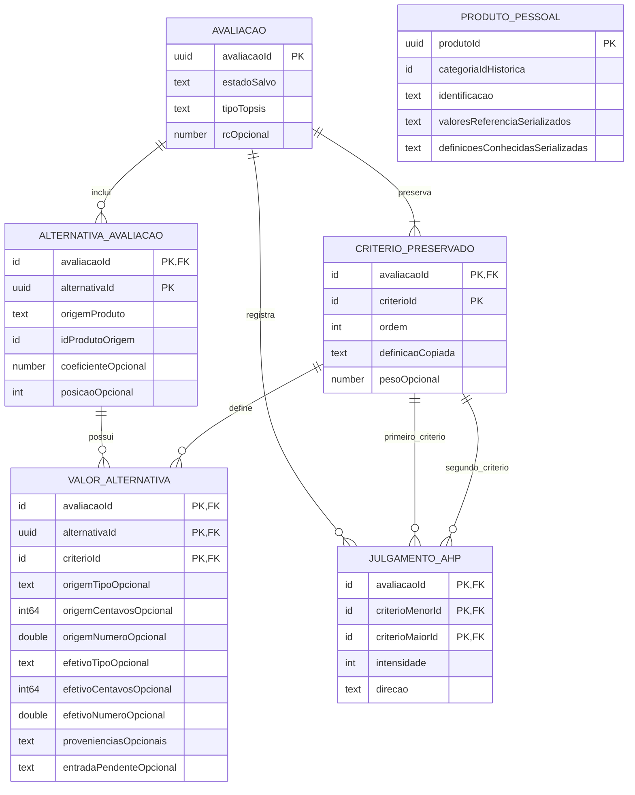

# 5.2. Estrutura Room — P5-A aprovada (DEC-038)

[Índice da Parte 5](../05-persistencia-snapshots.md) · [Contrato consolidado](../05-contratos-persistencia.md)

**Situação da Parte 5:** somente P5-A aprovada (DEC-038); P5-B–P5-E pendentes. CHECK canônico requer validação técnica.

| Alternativa | Vantagens | Desvantagens |
|---|---|---|
| Agregado serializado em uma linha de avaliação | Poucas tabelas; leitura/substituição simples; atomicidade de uma linha | Unicidade e referências internas dependem de validação; consulta de componentes por SQL é difícil; evolução exige versão do conteúdo |
| Totalmente normalizado | Mais invariantes garantidas por chaves e relacionamentos; consultas detalhadas | Mais tabelas, junções, mapeamento e testes, inclusive para resultados sem identidade própria |
| **Híbrido recomendado para revisão** | Normaliza componentes com unicidade e relações importantes; incorpora metadados e blocos escalares; evita tabela por conceito | Conversão entre representação física e domínio deve ser explícita; integridade do agregado ainda exige validação |

**Base aprovada:** seis tabelas, detalhadas abaixo. Tabelas adicionais exigem justificativa técnica e aprovação posterior. A aprovação não abrange campos/localização dos resultados, contratos remotos, tipos finais ou definições pessoais dos demais tópicos. Metadados variáveis e valores do produto pessoal podem ser serializados em colunas; componentes das avaliações usam relações explícitas. Room suporta conversão de tipos para colunas persistíveis; a escolha de biblioteca e formato ainda não foi feita. [Documentação de tipos personalizados em Room](https://developer.android.com/training/data-storage/room/referencing-data).

## Tabelas candidatas

PK significa chave primária; FK, chave estrangeira; UNIQUE, unicidade. Nomes não são APIs ou código Kotlin aprovados. A proposta consolidada P5-D prefere UUID textual canônico para produto pessoal, avaliação e alternativa; aprovação formal ainda pendente.

| Tabela proposta | Chave e conteúdo principal | Relações e justificativa |
|---|---|---|
| `produto_pessoal` | PK `produtoId`; `categoriaId` histórico e rótulo; identificação; `valoresReferencia` por ID de critério e proveniência conhecida por valor; definições conhecidas para validação; revisão/formato do conteúdo serializado quando aplicável | Sem vínculo obrigatório ao catálogo atual; continua consultável offline. Não aceita cadastro pessoal incompleto. Atualização nunca altera avaliações existentes. |
| `avaliacao` | PK `avaliacaoId`; categoria histórica e rótulo; título opcional; estado salvo; datas de criação/último salvamento; bloco AHP opcional (`lambdaMax`, `ic`, `ri`, `rc`); tipo TOPSIS (`AUSENTE`, `RANKING`, `SEM_DIFERENCIACAO`) | Raiz física do agregado. `AUSENTE` descreve resultado faltante, não novo estado persistido da avaliação. Bloco AHP não precisa de ID ou tabela própria. |
| `criterio_preservado` | PK `(avaliacaoId, criterioId)`; nome, descrição/unidade, natureza, ordem e metadados copiados; referência/revisão de origem quando conhecida; `pesoAhp` opcional | FK `avaliacaoId` → avaliação. UNIQUE `(avaliacaoId, ordem)`. A definição copiada é imutável; o peso é coluna de resultado separada semanticamente e pode ser recalculado. |
| `alternativa_avaliacao` | PK `(avaliacaoId, alternativaId)`; `origemProduto`, `idProdutoOrigem`; identificação e referência/proveniência copiadas; ordem de apresentação; `dMais`, `dMenos`, `coeficiente` e `posicao` opcionais | FK para avaliação. UNIQUE `(avaliacaoId, origemProduto, idProdutoOrigem)`. Sem FK para produto atual. Colunas de resultado representam o detalhe TOPSIS da alternativa, sem entidade independente. |
| `valor_alternativa` | PK `(avaliacaoId, alternativaId, criterioId)`; `valorEfetivo` e `valorOrigem` conhecido, ambos distinguindo ausência de zero; blocos de proveniência por valor de origem e efetivo, conforme a [seção 5.4 — snapshots e proveniência](04-snapshots-proveniencia.md) | FKs compostas para alternativa e critério preservado da mesma avaliação. Uma linha por par alternativa/critério, sem repetir a definição do critério. |
| `julgamento_ahp` | PK `(avaliacaoId, criterioMenorId, criterioMaiorId)`; intensidade e direção da preferência | Duas FKs compostas para critérios da mesma avaliação. Normalização obrigatória do par e possível CHECK físico de ordem canônica; impedir comparação consigo mesmo e pares invertidos independentes. Recíproco e diagonal são derivados. |

## Unicidade obrigatória do julgamento AHP

A ordem canônica serve à unicidade e independe da ordem de apresentação dos critérios. Antes de qualquer gravação, ordenar os dois IDs por um comparador estável e compatível com a comparação física do banco. Para IDs textuais opacos, propõe-se comparação binária determinística; para outra representação, definir a ordem correspondente em P5-D. Não usar idioma, rótulo do critério ou posição da tela para formar a chave.

Ao inverter os membros para normalizar, inverter também a direção da preferência, mantendo a intensidade e o significado do julgamento. Exemplo: `(B, A, preferência por B, intensidade 3)` e `(A, B, preferência por B, intensidade 3)` representam o mesmo par canônico e a mesma preferência. Igual importância usa intensidade 1 e representação de direção única. Rejeitar IDs iguais e critérios de avaliações diferentes.

A PK `(avaliacaoId, criterioMenorId, criterioMaiorId)` sozinha permitiria linhas `(A,B)` e `(B,A)` se não houvesse normalização. Todas as escritas devem passar pelo normalizador; julgamento invertido normaliza para a mesma PK e só pode atualizar aquele julgamento ou ser rejeitado por conflito, nunca criar outra comparação independente.

**Defesa física proposta:** colunas de ID não nulas e restrição CHECK equivalente a `criterioMenorId < criterioMaiorId`, com a mesma ordenação usada pelo normalizador, além da PK e FKs. Para texto, especificar explicitamente a collation pertinente, por exemplo BINARY. Um par invertido enviado diretamente à persistência deve ser rejeitado pela restrição. SQLite admite CHECK, mas o mapeamento final precisa verificar como declará-lo no schema gerenciado pelo Room; não se pressupõe uma anotação automática. Sem essa definição, a garantia física ainda não está concluída. Nenhuma restrição foi criada ou executada nesta revisão. [Restrições SQLite](https://www.sqlite.org/lang_createtable.html).

A direção é interpretada em relação aos dois IDs canônicos; recíproco e diagonal são derivados. Os campos de referência física continuam propostas de P5-A/P5-D. A alternativa tem identidade contextual local, além da identidade histórica origem + ID do produto; a chave contextual não deve mudar apenas porque os valores foram ajustados.

Os metadados de validação podem ser serializados como mapa tipado contendo tipo, unidade, limites/inclusividade, ausência e natureza aplicáveis. Não propor expressões executáveis recebidas do servidor. Os limites ainda não definidos continuam para preparação dos dados; esta proposta não os inventa (DEC-033).

## Modelo físico candidato — relações internas

`uuid`, `int64`, `double` e `text` no desenho representam tipos propostos para confirmação; `id` representa a referência correspondente. UUID é TEXT, int64 é INTEGER e double é REAL no mapeamento candidato Room. Não é schema implementado. Campos opcionais representam nulabilidade. A tabela de integridade abaixo define as FKs compostas que o desenho simplifica. Produto pessoal fica sem ligação obrigatória com a alternativa: a cópia histórica sobrevive à exclusão do cadastro. As contagens mínimas de critérios, valores, julgamentos e detalhes de conclusão são validadas pelo estado, não apenas pelas linhas do diagrama.

## Integridade e índices candidatos

| Regra | Garantia física proposta | Validação complementar do agregado |
|---|---|---|
| Componentes pertencem à mesma avaliação | FK `(avaliacaoId, alternativaId)` e FK `(avaliacaoId, criterioId)` em valores; duas FKs `(avaliacaoId, criterioId)` nos julgamentos | Conferir identidade e contexto ao montar/carregar o agregado |
| Sem duplicidade | PKs compostas; UNIQUE de identidade de produto e ordem de critérios; CHECK proposto de ordem canônica AHP e IDs não nulos | Normalização obrigatória com direção ajustada; par invertido converge à mesma chave; critério igual a ele mesmo é rejeitado; mapas sem chaves repetidas |
| Exclusão completa | CASCADE de avaliação para seus componentes; dependentes de critérios/alternativas também removidos de forma consistente | Testar exclusão atômica, sem apagar produto pessoal ou catálogo |
| Imutabilidade dos snapshots | Nenhuma FK aos documentos atuais do catálogo; identidade histórica como dado | Não atualizar definição preservada por sincronização; comparar antes/depois de editar avaliação |
| Conteúdo coerente por estado | Nulabilidade para rascunhos e resultados opcionais; domínio de discriminadores | Exigir conjunto completo antes de conclusão; não aceitar metadados/payload ilegíveis como dados válidos |
| Índices de acesso | PKs/UNIQUE já criam caminhos de busca; índice de avaliação por data de atualização para a lista; produto pessoal por categoria | Criar índice composto extra apenas se consulta real exigir |
| Índices de FK | Garantir prefixos compatíveis com as colunas filhas | Verificar índice adicional nos julgamentos para `(avaliacaoId, criterioMaiorId)` e nos valores para `(avaliacaoId, criterioId)`; a PK nem sempre cobre esses acessos |

Em Room, as colunas pai referenciadas precisam ser PK ou possuir índice único; índices nas colunas filhas evitam buscas completas em operações com FK. PKs compostas acima buscam garantir pertencimento ao agregado, não apenas existência global do critério. [Referência de ForeignKey](https://developer.android.com/reference/androidx/room/ForeignKey).

Não propor índice de nome para deduplicação, índice único de posição TOPSIS (empates são permitidos), tabela para cada origem ou tabela de edição não salva. A categoria é histórica e fixa; essa regra não depende de FK ao documento remoto.
